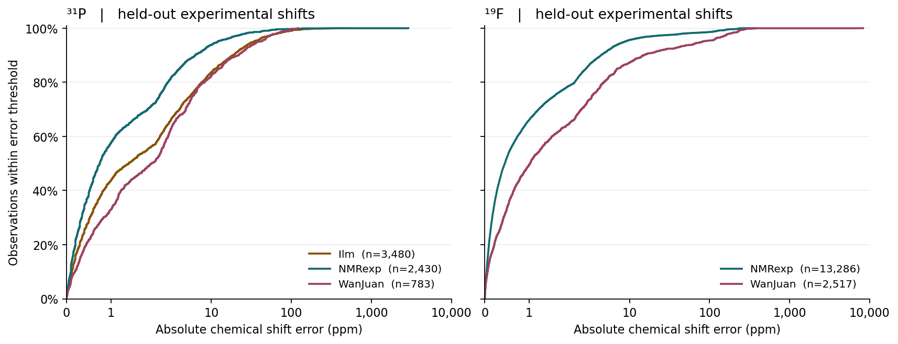

# ³¹P 和 ¹⁹F 溶液化学位移预测

以下记录首次发布的树模型。³¹P 后续在固定分子划分上完成了 GNN 对照，当前线上模型和留出测试结果见[³¹P 模型卡](../documentation/tasks/nmr-forward-31P.zh.md)。

OpenMolSpec 的 `nmr.forward.31P` 和 `nmr.forward.19F` 现在可以从 SMILES 直接计算溶液 NMR 化学位移。两个模型分别用 35,696 和 116,126 种具有明确监督信号的分子训练。在按分子连通性留出的单一环境测试集上，³¹P 的 MAE 为 **6.38 ppm**，¹⁹F 为 **6.10 ppm**。下列指标均保留极端误差。[³¹P 训练和评测记录](../results/solution_shifts_31P.json) · [¹⁹F 训练和评测记录](../results/solution_shifts_19F.json)

## 先看磷的化学环境

常见 P=O 结构占本次磷测试集的大部分，误差也最低。三个相邻原子中含杂原子的中性三配位磷，以及其余少见连接方式，在当前模型上更难。需要评估新系列分子时，可以先看表中相应环境的误差和样本量。表中分组按输入 SMILES 的电荷与键型依次判定，带电共振表示可能改变分组。[逐环境统计](../results/solution_shifts_31P_environments.json)

| 测试记录中磷的连接方式 | 观测数 | MAE（ppm） | 中位绝对误差（ppm） |
| --- | ---: | ---: | ---: |
| P=O | 4,676 | 3.17 | 0.80 |
| P=S | 327 | 6.62 | 2.11 |
| 其余带正电的 P | 129 | 9.73 | 4.33 |
| 中性 P，三个相邻原子均为碳 | 583 | 7.41 | 1.13 |
| 中性 P，三个相邻原子中含杂原子 | 401 | 17.93 | 6.90 |
| 其他 | 577 | 22.43 | 7.72 |

## 模型调研与选择

| 公开路线 | 作者结果 | 对这个任务的意义 |
| --- | --- | --- |
| Ilm-NMR-P31 的 HOSE 局部环境法与 GNN | 首版有 14,250 条数据、13,730 种结构，作者对两种方法报告约 11–12 ppm MAE | 磷周围的键型与取代基能提供强基线。作者目前分发的 CSV 已扩充到 43,317 行，本次读取其中的实验 shift 字段。[原论文](https://doi.org/10.1186/s13321-023-00792-y) · [作者数据仓库](https://github.com/clacor/Ilm-NMR-P31) |
| 轻量图网络 SDGNN | 在作者筛选的 Ilm 数据和分组拆分上，³¹P MAE 为 8.88 ppm | 是后续比较图网络的合适模型。复现时应固定同一批训练、验证和测试结构。[SDGNN 论文](https://link.springer.com/article/10.1186/s13321-026-01178-6) |
| DFT 屏蔽与构象平均 | 对 10,007 种含磷化合物，加入构象集合后 RMSE 从 30.82 降至 29.37 ppm，溶剂效应因化学类别而异 | 适合调查特定难例的构象与溶剂效应。全库推理优先使用二维结构，以覆盖没有三维坐标的实验记录。[DFT 研究](https://doi.org/10.1021/acsomega.5c13249) |
| 实验 ¹⁹F GCN | Li 等在 Dolbier 和 nmrshiftdb2 来源的测试集上报告 3.636 ppm MAE | 氟位点同样可从局部图结构学习。该数据来源、化合物范围和拆分与本次不同。[¹⁹F GCN 论文](https://www.sciencedirect.com/science/article/pii/S2949747724000010) |

本次训练的是 OpenMolSpec 自有的二维结构模型。用目标原子的 Morgan 环境、各键距内的片段和元素计数、分子描述符及已记录的溶剂训练绝对误差回归树。对训练集中有至少两条训练观测支持的环境，还可使用半径 5、4 或 3 的局部中位数。用整分子等权的验证 MAE 选择树的轮次和局部中位数的混合权重。³¹P 验证 MAE 从单用回归树的 8.06 降至 7.77 ppm，¹⁹F 从 6.08 降至 5.83 ppm。遇到没有足够训练观测的局部环境时使用回归树。上述论文结果没有在同一测试集重跑，不能据这些数字给模型排名。

## 数据与留出规则

| 来源 | ³¹P 原始记录 | ¹⁹F 原始记录 |
| --- | ---: | ---: |
| 当前 WanJuan 实验数据 | 21,662 | 56,679 |
| 当前 NMRexp 实验数据 | 32,890 | 195,077 |
| 当前 Ilm-NMR-P31 实验数据 | 43,317 | — |
| 另外保留的历史池记录 | 7,498 | 9,144 |
| 实际拟合的分子连通性 | 35,696 | 116,126 |
| 实际拟合的分子、环境及溶剂组合 | 37,434 | 118,491 |

- NMRexp 来自文献支撑材料，可按核种读取本地实验谱。本次对区间峰取两端中点，对缺失溶剂使用独立类别，Ilm 仅使用实测位移。历史池和当前来源有重合，原始行数不能直接相加作为独立样本数。[NMRexp 数据论文](https://www.nature.com/articles/s41597-025-06245-5)
- 以分析物 InChIKey 前 14 位分组，将盐形式、立体异构体及不同来源的同一连通结构放在同一个划分。优先保留完整历史池，再按 WanJuan 的测试、验证、训练顺序分配。其余连通性用固定哈希按 80/10/10 分配。两个核种的拟合分子与验证、测试、历史池的连通性重合均为零。该协议允许训练集与测试集包含结构类似物，论文、实验室和时间维度仍可能重合。
- 训练需要一个图对称环境和一个实测峰。允许 CF₃ 中三个等价 F 共享一个观测峰。同一分子、环境与溶剂的重复位移先按不同实测数值取中位数，再按分子等权拟合。含多个目标成分、无法解释的共存分子或无有效连通性键的结构计入排除统计。
- 多环境测试要求预测环境数等于实测峰数，再按升序配对。此处评估峰位置集合。非对映异位、构象交换、未分辨峰以及不同的质子化状态都可能造成图环境与实验峰数不符。报告 JSON 保留各来源的原始覆盖计数和不匹配次数。

## 留出测试

所有误差单位均为 ppm。观测 MAE 对每条观测等权，分子 MAE 先在每个连通结构内部取平均，随后对各结构等权。P90 是绝对误差的第 90 百分位。

| 核种与范围 | 分子数 | 观测数 | 观测 MAE | 分子 MAE | 中位数 | P90 | RMSE |
| --- | ---: | ---: | ---: | ---: | ---: | ---: | ---: |
| ³¹P，单一环境 | 4,248 | 6,693 | 6.38 | 8.40 | 1.10 | 13.73 | 40.12 |
| ³¹P，其中训练未见过的非空 Murcko 骨架 | 1,225 | 1,759 | 9.12 | 11.15 | 1.59 | 19.35 | 71.80 |
| ¹⁹F，单一环境 | 14,330 | 15,803 | 6.10 | 5.79 | 0.52 | 5.30 | 71.00 |
| ¹⁹F，其中训练未见过的非空 Murcko 骨架 | 3,618 | 3,834 | 7.06 | 6.33 | 0.67 | 6.76 | 30.59 |

在相同测试记录上，用训练集单一中位数作预测，³¹P 和 ¹⁹F 的 MAE 分别为 24.47 和 33.33 ppm。新模型的绝对误差在 5 ppm 内的比例分别是 78.7% 和 89.4%。按谱源拆分，³¹P 在 NMRexp、WanJuan、Ilm 的 MAE 分别为 4.38、7.55、7.51 ppm。¹⁹F 在 NMRexp 和 WanJuan 分别为 4.29 和 15.62 ppm。

下图按谱源展示误差分布。横轴是允许的绝对误差，纵轴是该来源内满足阈值的实验记录比例。



在多环境且峰数匹配的子集中，³¹P 有 241 条谱、525 个峰，峰位置 MAE 为 11.00 ppm。¹⁹F 有 3,556 条谱、8,687 个峰，MAE 为 13.15 ppm。逐峰原子归属、强度、J 耦合和线形仍需独立验证。

## 与原模型的配对比较

旧模型使用固态 NMRNet 权重。首次排查的 32 条记录上，³¹P 旧模型 MAE 为 226.45 ppm，¹⁹F 为 356.34 ppm。下表只在两种模型都能处理、且输入 SMILES 与实测目标都核对一致的原记录上比较。[旧运行记录](../results/fp_frozen_fresh_diagnostic_20261115.json)

| 核种 | 原 32 条中配对数 | 旧 MAE | 新 MAE |
| --- | ---: | ---: | ---: |
| ³¹P | 31 | 218.01 | 15.90 |
| ¹⁹F | 32 | 356.34 | 7.22 |

排除的一条磷记录由复杂有机阳离子和 PF₆⁻ 组成。当前预测器只自动剥离简单单原子反离子。保留的 ³¹P 记录也有大误差，例如 `CC(C)(C)OP(Cl)Cl` 的旧参考值为 −178.00 ppm，新模型为 +183.08 ppm。该记录仍参与计分。

历史全池保留原始标签。³¹P 实际覆盖 7,323/7,498 条，MAE 为 5.02，P90 为 9.00，RMSE 为 71.57 ppm。¹⁹F 覆盖 9,108/9,144 条，MAE 为 **316.54**，P90 为 **8.76**，RMSE 为 **23,244.24 ppm**。¹⁹F 第 5122 行的目标值为 2,212,113 ppm，新模型为 −113.48 ppm。当前 WanJuan 库中相同连通结构 `MTUPINQDZNXFAG` 有一条 −112.96 ppm 的记录，来源标记为 US20070287721A1。该结构在所有来源均已留出。³¹P 第 5306 行的 6,145.07 ppm 也出现在当前 WanJuan 清洗文本中。原始报告保留了这些值，未根据模型输出改签、裁剪或删除误差。评估实际使用范围时，应结合当前实验测试集、分源误差和历史原始标签看结果。

## 调用与复现

以下路径以工作区的 `studio/` 为当前目录。预测只需 `model.json`、`booster.txt` 和 `environments.json.gz`。正式评测还会读取参考集和分子划分，并验证文件 SHA-256。

```bash
python -m pip install -e '.[solution-nmr]'
openmolspec-solution-shift --model-dir ../runs/solution-shifts-v1/31P \
  --smiles 'CCOP(=O)(OCC)OCC' --solvent CDCl3
openmolspec-solution-shift --model-dir ../runs/solution-shifts-v1/19F \
  --smiles 'Fc1ccccc1' --solvent CDCl3
python -m openmolspec_bench run --workspace .. --tasks nmr.forward.31P nmr.forward.19F \
  --limit 100000 --output results/solution-test-replay.json
python scripts/audit_solution_phosphorus.py --benchmark results/solution-test-replay.json \
  --output results/phosphorus-environment-replay.json
```

磷酸三乙酯和氟苯的以上调用分别给出 −0.535 和 −113.700 ppm。可用 `from openmolspec.model import SolutionShiftPredictor` 在一次进程中加载权重并重复预测。返回值的 `environments` 按化学环境列出原子编号和位移，`atom_indices` 与 `prediction_ppm` 按输入原子逐一对应。

本次使用 Python 3.10、RDKit 2025.03.6 和 LightGBM 3.3.5。为重新训练，可在同一目录运行下列命令。输出指向新的复现目录。添加 `--old-diagnostic` 会读取历史 PyTorch 输出并检查每条目标与原始清单，因此复现该项还需安装 PyTorch。原 LMDB 全池重算可在评测命令中加 `--solution-reference historical-pool` 并提供 `--models-root`。

```bash
python -m pip install -e '.[solution-nmr,data]'
for nucleus in 31P 19F; do
  python scripts/prepare_solution_shifts.py --nucleus "$nucleus" \
    --wanjuan .runtime/manual-data-v1/experimental --nmrexp ../../data/NMRExp \
    --pool-root ../../models/nmrnetpp \
    --ilm ../../data/ilm-nmr-p31/Ilm-NMR-P31-master/Ilm-NMR-P31.csv \
    --output ".runtime/solution-replay/${nucleus}.jsonl.gz"
  python scripts/train_solution_shifts.py --nucleus "$nucleus" --threads 2 \
    --features ".runtime/solution-replay/${nucleus}.jsonl.gz" \
    --output "../runs/solution-replay/${nucleus}" --report "results/${nucleus}-replay.json"
done
```

最值得继续改善的是误差集中的磷环境。对中性三配位杂原子磷和其他难例，可先回查原文中的符号、参考物、化合物对应关系及质子化状态，再在固定训练与验证划分上比较 SDGNN 和当前回归器。验证新方法时应另留新的盲测分子，因为本次测试结果已用于分析错误类型。

## 复现后续 ³¹P 模型比较

两个训练程序读取同一批已准备好的实验数据。以下命令使用在既有验证对照中确定的 5,960 轮和局部环境权重 1.0 复现树模型，然后按相同的分子划分训练图网络。图网络以验证集选择 epoch 和局部环境混合权重，最后一条命令在选型后评测测试集。线上版本的选型记录见[对照结果](../results/phosphorus_gnn_selection.json)。

```bash
python -m pip install -e '.[phosphorus-gnn,solution-nmr,data]'
python scripts/train_solution_shifts.py --nucleus 31P --features .runtime/solution-shifts/31P.jsonl.gz \
  --fixed-rounds 5960 --environment-weight 1 --output ../runs/replay-tree \
  --report results/replay-tree.json
python scripts/train_phosphorus_gnn.py --features .runtime/solution-shifts/31P.jsonl.gz \
  --tree ../runs/replay-tree --output ../runs/replay-gnn
python scripts/compare_phosphorus_models.py --features .runtime/solution-shifts/31P.jsonl.gz \
  --tree ../runs/replay-tree --gnn ../runs/replay-gnn --output results/replay-comparison.json \
  --predictions ../runs/replay-gnn/paired-test.jsonl.gz
```
