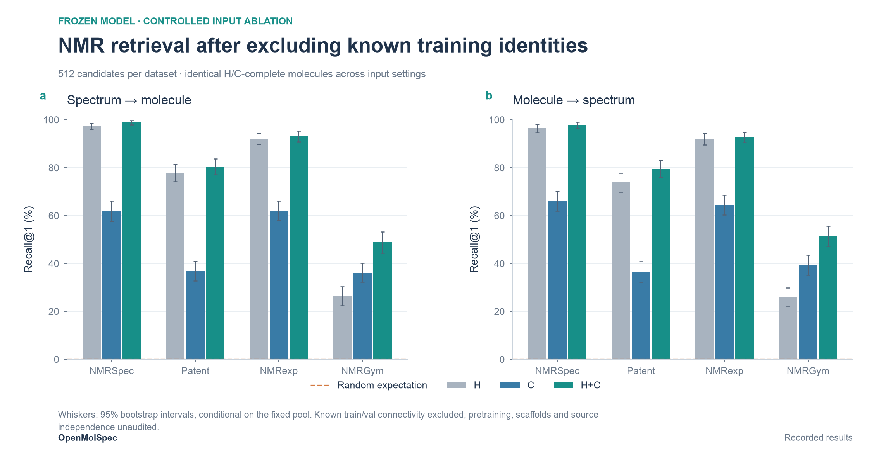

# Benchmarks

Software execution, frozen-model evaluation and gains from new training are separate questions. This page records their current evidence.

## Actual training integration check

Both NMRTransformer stages completed one optimizer update on two real training records, with two validation records and no test examples. Checkpoint saving, configuration reload and repeated inference agreed. This is a successful software integration check, not a learning curve or a meaningful model accuracy result. [Report](assets/reports/sdk_training_roundtrip_20261117.json) · [Training API](api.md).

## Retrieval with train/validation identity exclusion

The frozen alignment checkpoint is evaluated on 512 H/C-complete molecules per source. Both fingerprint-matched alignment train and validation files are excluded at InChIKey connectivity level, grouping stereoisomers. Seed 42 selects the pool; the same molecules and candidate identities are used for H, C and H+C ablations. No molecular formula is supplied. The checkpoint uses byte encoding with a 512-token source budget; longer NMR text is truncated by its original encoder.



[SVG](assets/gallery/filtered-retrieval.svg) · [Full report](assets/reports/nmr_filtered_retrieval_20261117.json)

| Source | H R@1 | C R@1 | H+C R@1 | H+C R@5 | H+C R@10 |
| --- | ---: | ---: | ---: | ---: | ---: |
| `nmrspec_test` | 97.5% | 62.1% | 98.8% | 99.6% | 99.8% |
| `patent_test_10k` | 77.9% | 36.9% | 80.5% | 92.0% | 94.5% |
| `nmrexp_exp_10k` | 92.0% | 62.1% | 93.2% | 99.8% | 99.8% |
| `nmrgym_test` | 26.4% | 36.1% | 48.8% | 77.5% | 87.9% |

Table: spectrum-to-molecule retrieval. The report also includes the reverse direction, per-query ranks, shuffled-pair controls and 2,000-bootstrap intervals conditional on the fixed candidate pool. These controls do not establish unknown pretraining-history, scaffold or source-document independence. Related molecules remain possible. Missing-channel results are ablations of the same checkpoint, not separate trained models.

The [token-budget audit](assets/reports/nmr_filtered_token_budget_20261117.json) found no truncated candidate SMILES. Some spectral texts exceed the checkpoint source budget; those original preprocessing limits remain in the scores.

```bash
python scripts/evaluate_filtered_nmr.py \
  --workspace /path/to/OpenMolSpec \
  --work runs/filtered-retrieval \
  --output results/filtered-retrieval.json --limit 512
```

[Data comparison](corpus-comparison.md) · [Data splits](data/splits.md) · [Model review](model-audit.md)
