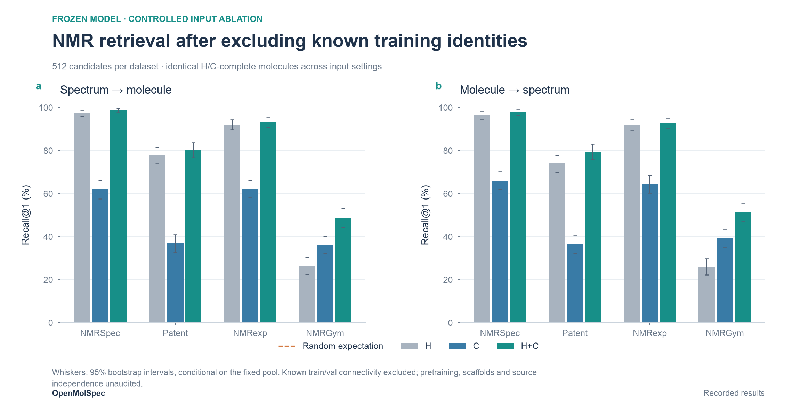

# Benchmarks 统一评测

软件能运行、冻结模型有效、增加训练数据带来提升，是三个不同问题。这里分别列出当前证据。

## 实际训练链路检查

NMRTransformer 两个阶段均使用两个真实训练记录、两个验证记录，各完成一次优化器更新，没有使用测试样本。Checkpoint 保存、配置重载及重复推理一致性检查通过。这是成功的软件链路验证，不是学习曲线或模型精度结论。[报告](assets/reports/sdk_training_roundtrip_20261117.json) · [训练 API](api.md)。

## 排除训练／验证身份后的检索

每个来源选取 512 个 H/C 完整分子评估冻结编码器。按 InChIKey 连接关系排除与哈希匹配的编码器 train/val 文件重叠的身份，包括立体异构体。固定种子 42 选择候选池，H、C、H+C 消融使用完全相同的分子与候选身份，不提供分子式。该权重使用 byte 编码和 512-token 输入预算，超长 NMR 文本按原编码器规则截断。



[SVG](assets/gallery/filtered-retrieval.svg) · [Full report](assets/reports/nmr_filtered_retrieval_20261117.json)

| Source | H R@1 | C R@1 | H+C R@1 | H+C R@5 | H+C R@10 |
| --- | ---: | ---: | ---: | ---: | ---: |
| `nmrspec_test` | 97.5% | 62.1% | 98.8% | 99.6% | 99.8% |
| `patent_test_10k` | 77.9% | 36.9% | 80.5% | 92.0% | 94.5% |
| `nmrexp_exp_10k` | 92.0% | 62.1% | 93.2% | 99.8% | 99.8% |
| `nmrgym_test` | 26.4% | 36.1% | 48.8% | 77.5% | 87.9% |

表格为谱到分子检索。完整报告还包括反向检索、逐查询排名、随机打乱配对的对照，以及基于固定候选池的 2,000 次 bootstrap 区间。这些控制不能证明未知预训练历史、骨架或来源文档独立；仍可能存在相关分子。缺通道结果是同一 checkpoint 的消融，不是独立训练的模型。

[输入预算审计](assets/reports/nmr_filtered_token_budget_20261117.json)确认没有候选 SMILES 超长；部分谱文本超过该权重的输入预算，评分保留原模型预处理限制。

```bash
python scripts/evaluate_filtered_nmr.py \
  --workspace /path/to/OpenMolSpec \
  --work runs/filtered-retrieval \
  --output results/filtered-retrieval.json --limit 512
```

[Data comparison](corpus-comparison.md) · [Data splits](data/splits.md) · [Model review](model-audit.md)
