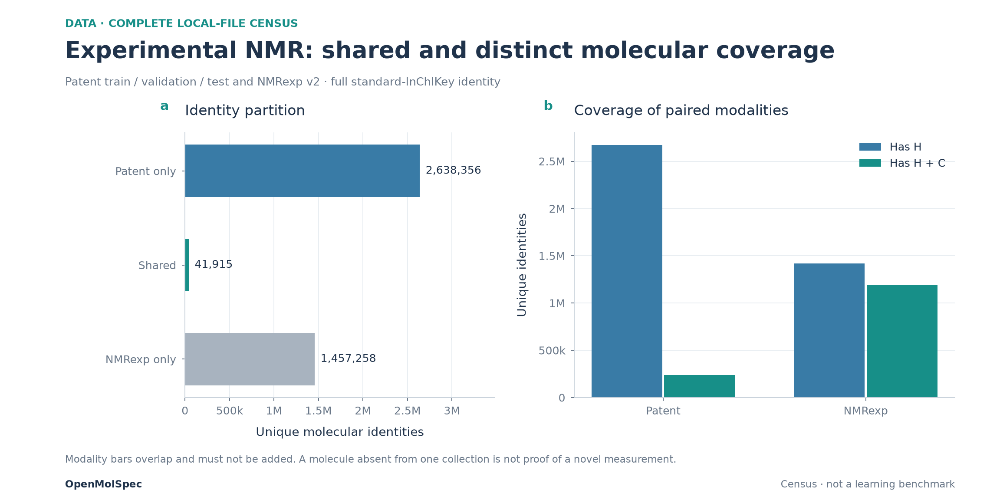

# Experimental data: coverage and overlap

A count of spectra is not a count of unique molecules. We scanned the complete local patent train/validation/test files and the NMRexp v2 `1004` parquet, using a common standard-InChIKey identity. The comparison below separates records, spectral entries and molecular identities.

## Compared resources

| Resource | Data origin | Reported scale and unit | Main distinction |
| --- | --- | --- | --- |
| OpenMolSpec patent view | Experimental, team-curated external patent records | 2,680,271 molecular records; 2,974,948 H/C entries | H-rich corpus; 238,412 records contain both H/C |
| [NMRexp v2](https://zenodo.org/records/17296666) | Experimental journal supporting information, 2010–2024 | 3,372,987 spectral records in our full-file scan | H, C, F, P, B and Si; solvent and frequency metadata |
| [NMRSpec / NMRTrans](https://arxiv.org/html/2602.10158v1) | Experimental literature NMR | Paper benchmark: 239,997 molecular samples | Paired H/C structure generation; [current code](https://github.com/little1d/NMRTrans) reports a separate 21,298-record release test split |
| [NMRGym](https://arxiv.org/abs/2601.15763) | Curated experimental NMR benchmark | Paper: 269,999 unique molecules | Paired H/C, scaffold split and multiple downstream tasks |
| [Multimodal Spectroscopic Dataset](https://rxn4chemistry.github.io/multimodal-spectroscopic-dataset/) | Simulated spectra of patent-derived structures | Project overview: about 790k molecules | NMR, HSQC, IR and MS; simulated observables |

External counts are attributed to the cited versions, not independently recounted except NMRexp. The NMRSpec paper and current model release use different counts; we do not substitute one for the other. Sources inspected 2026-11-17.

## Full-file molecular overlap

[SVG](assets/gallery/corpus-comparison.svg) · [Data](assets/reports/corpus_comparison_20261117.json)

| Identity count | Value |
| --- | ---: |
| Patent unique identities | 2,680,271 |
| NMRexp unique identities | 1,499,173 |
| Shared | 41,915 |
| Patent only relative to this NMRexp version | 2,638,356 |
| NMRexp only relative to this patent view | 1,457,258 |
| Union | 4,137,529 |

1.56% of patent identities and 2.80% of NMRexp identities are shared. An identity absent from this NMRexp version is not automatically a new experimental measurement or absent from every other database.

## Metadata and paired-data checks

| Check | Patent view | NMRexp |
| --- | ---: | ---: |
| H/C spectral entries / 谱条目 | 2,974,948 | 3,122,805 |
| Identities with both H/C / 同时有 H/C 的身份 | 238,412 | 1,190,487 |
| Structured solvent present / 结构化溶剂字段非空 | 2,925,708 / 2,974,948 | 3,372,987 / 3,372,987 |
| Frequency present / 频率字段非空 | 2,894,788 / 2,974,948 | 3,372,987 / 3,372,987 |

20,604 paired patent records have different H and C patent-provenance identifiers. Likewise, aggregating NMRexp entries by identity does not prove matched acquisition conditions. A paired-input benchmark needs solvent, source and acquisition controls beyond molecular identity. Nonempty metadata is not proof of correct extraction.

Stored source labels: Pistachio (1,705,134), USPTO (646,007), EPO (267,916), xiegeo (21,730), patentchem (39,484).

## Contribution and remaining evidence

The defensible contribution is the curated experimental collection together with a consistent access, task and training interface. The current H/C-paired subset is much smaller than the total patent identity count; scale alone does not establish superiority over paired H/C benchmarks. Demonstrating learning value requires fixed source-aware evaluation, training-scale curves, external transfer and multiple seeds. [Current experiments](learning-evidence.md) report what has actually run.

The scan uses stored patent InChI and RDKit-generated NMRexp identities. It does not rederive every patent identity, assess manual extraction accuracy or establish redistribution rights. The local NMRexp file also matches the official v2 MD5. Full SHA-256 file fingerprints, RDKit version and validity flags are in the downloadable report. [Version evidence](assets/reports/corpus_comparison_sources.json).
