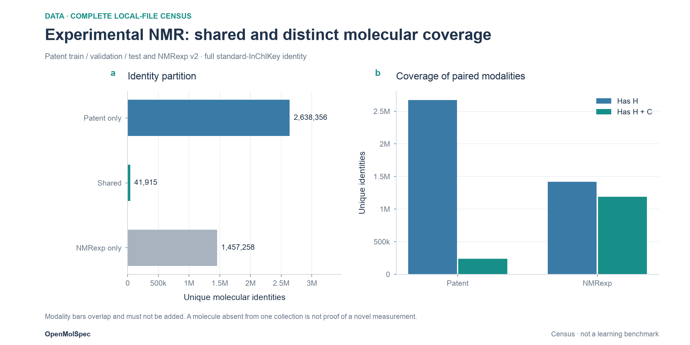

# 实验数据：覆盖范围与重叠

谱记录数不等于独立分子数。我们完整扫描了专利库 train/val/test 和 NMRexp v2 的 `1004` parquet，以 standard-InChIKey 统一结构身份，分别统计分子记录、谱条目和去重身份。

## 与哪些资源比较

| 资源 | 数据来源 | 规模及单位 | 主要区别 |
| --- | --- | --- | --- |
| OpenMolSpec 专利视图 | 团队整理的外部专利实验数据 | 2,680,271 条分子记录，2,974,948 条 H/C 谱条目 | 以 H 为主，238,412 条分子记录同时有 H/C |
| [NMRexp v2](https://zenodo.org/records/17296666) | 2010–2024 年期刊补充材料中的实验谱 | 全文件扫描 3,372,987 条谱记录 | H、C、F、P、B、Si 六核种及溶剂、频率元数据 |
| [NMRSpec / NMRTrans](https://arxiv.org/html/2602.10158v1) | 文献实验 NMR | 论文基准为 239,997 个分子样本 | 配对 H/C 结构生成；[当前代码](https://github.com/little1d/NMRTrans)另报告发布版测试集 21,298 条，不能混为同一版本 |
| [NMRGym](https://arxiv.org/abs/2601.15763) | 整理后的实验 NMR 基准 | 论文报告 269,999 个独立分子 | 配对 H/C、骨架划分及多项下游任务 |
| [Multimodal Spectroscopic Dataset](https://rxn4chemistry.github.io/multimodal-spectroscopic-dataset/) | 专利分子结构的模拟谱 | 项目页约 79 万分子 | NMR、HSQC、IR 和 MS，谱为模拟值 |

外部规模按引用版本标注，除 NMRexp 外没有在此独立重数全库。NMRSpec 论文与当前模型发布版的计数不同，不能互换。来源核对日期：2026-11-17。

## 全文件分子身份交集

[SVG](assets/gallery/corpus-comparison.svg) · [Data](assets/reports/corpus_comparison_20261117.json)

| 身份计数 | 数值 |
| --- | ---: |
| 专利库去重身份 | 2,680,271 |
| NMRexp 去重身份 | 1,499,173 |
| 两库共有 | 41,915 |
| 专利库中未出现在该 NMRexp 版本 | 2,638,356 |
| NMRexp 中未出现在该专利视图 | 1,457,258 |
| 两库身份并集 | 4,137,529 |

交集占专利库身份的 1.56%，占 NMRexp 身份的 2.80%。未出现在这一版 NMRexp 的身份，不等于新实验测量，也不等于其他所有数据库都没有。

## 元数据与配对检查

| 检查项 | 专利视图 | NMRexp |
| --- | ---: | ---: |
| H/C spectral entries / 谱条目 | 2,974,948 | 3,122,805 |
| Identities with both H/C / 同时有 H/C 的身份 | 238,412 | 1,190,487 |
| Structured solvent present / 结构化溶剂字段非空 | 2,925,708 / 2,974,948 | 3,372,987 / 3,372,987 |
| Frequency present / 频率字段非空 | 2,894,788 / 2,974,948 | 3,372,987 / 3,372,987 |

专利配对记录中，20,604 条的 H 与 C 来源专利标识不同。同样，按身份聚合 NMRexp 记录不能证明采集条件一致。配对输入基准还需要控制溶剂、来源和采集条件；字段非空也不代表提取正确。

原文件保留的来源标签：Pistachio (1,705,134), USPTO (646,007), EPO (267,916), xiegeo (21,730), patentchem (39,484).

## 贡献定位与仍需补充的证据

当前可支撑的贡献是整理后的实验数据，以及一致的数据访问、任务和训练接口。H/C 配对子集远小于专利库总身份数，不能仅凭总量声称优于配对 H/C 基准。学习价值需要固定来源控制的评测、训练规模曲线、外部迁移和多随机种子支撑。[当前实验](benchmarks.md)列出已经实际跑过的内容。

扫描采用专利库保存的 InChI，以及 RDKit 从 NMRexp SMILES 生成的身份；没有逐条重建专利身份、人工评估提取精度或确认再分发权限。本地 NMRexp 文件的 MD5 也与官方 v2 一致。完整 SHA-256 文件指纹、RDKit 版本和有效性标记见可下载报告。[版本核对记录](assets/reports/corpus_comparison_sources.json)。
