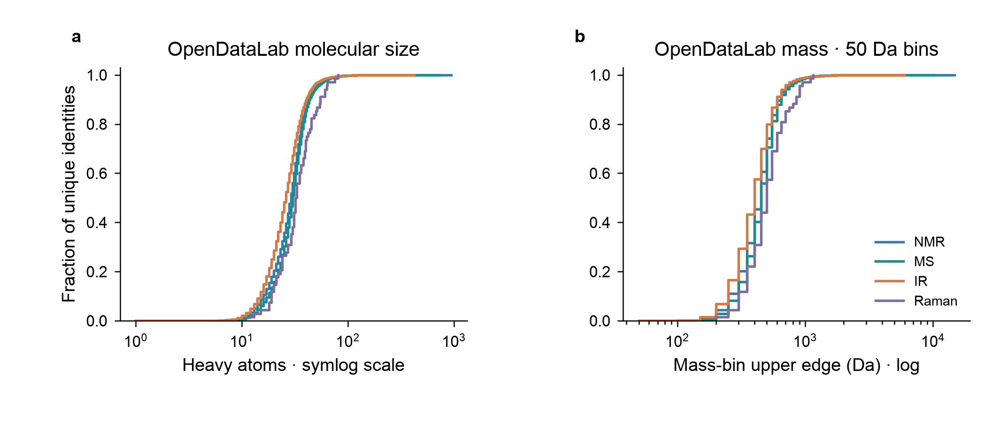

# Data

Explore data by spectroscopy family and by experimental or computed origin. OpenDataLab is the source label for the team-curated patent collection; external resources retain their citations. Record counts, structure identities and geometry frames are different units.

| Collection | What is available |
| --- | --- |
| [NMR](nmr.md) | OpenDataLab experimental NMR and external H/C or heteronuclear resources |
| [MS](ms.md) | OpenDataLab mass records, MassSpecGym v1.5 and other experimental spectra |
| [IR / Raman](vibrational.md) | Experimental peak lists and calculated OpenMolSpec, QM9S, QMe14S spectra |
| [Multimodal](multimodal.md) | Co-occurring measurements and explicitly aligned multimodal views |

[Dataset loading](../api.md) · [Benchmark and custom splits](splits.md) · [Distributions](../datasets.md) · [Corpus comparison](../corpus-comparison.md)

The raw collection contains **34,292,837 characterization entries**, of which **32,901,847** are classified as NMR, MS, IR or Raman. The remainder retains other source labels, including chromatography and other characterization. Task-ready counts depend on the fields and quality tiers on each data card.

## Standard molecular identities

The complete structure/scaffold qualification retains **3,245,902 full standard-InChIKey identities**; **3,235,816** have at least one NMR, MS, IR or Raman entry and receive a fixed v1 benchmark role. These are identity counts, distinct from measurements and the curated H/C view.

[SVG](../assets/gallery/data-opendatalab-chemistry.svg) · [PDF](../assets/gallery/data-opendatalab-chemistry.pdf)

[Qualification and exclusions / 检查与排除范围](../assets/reports/opendatalab_structure_qualification_20261117.json)
