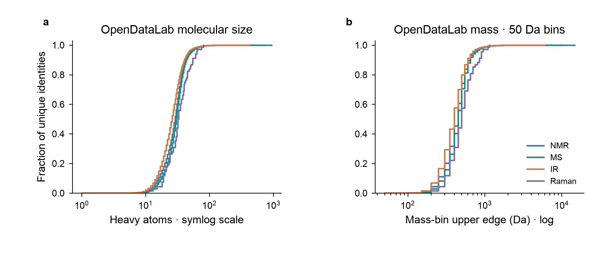

# Data

按谱型及实验／计算来源选择数据。团队整理的专利库标注来源为 OpenDataLab；其他资源保留引用。谱条目、分子结构身份、构象帧是不同计数单位。

| 数据类别 | 内容 |
| --- | --- |
| [核磁共振](nmr.md) | OpenDataLab 实验 NMR 与外部 H/C、杂核资源 |
| [质谱](ms.md) | OpenDataLab 质量记录、MassSpecGym v1.5 与其他实验谱 |
| [红外／拉曼](vibrational.md) | 实验峰表，以及 OpenMolSpec、QM9S、QMe14S 计算谱 |
| [多谱联合](multimodal.md) | 同记录共现测量与明确对齐的多模态视图 |

[Dataset loading](../api.md) · [Benchmark and custom splits](splits.md) · [Distributions](../datasets.md) · [Corpus comparison](../corpus-comparison.md)

原始集合包含 **34,292,837 条表征条目**，其中 **32,901,847 条**归为 NMR、MS、IR 或 Raman；其余保留色谱及其他表征标签。各任务可用数量按数据卡中的字段与质量层级分别报告。

## 标准分子身份

完整结构／骨架资格检查保留 **3,245,902 个完整标准 InChIKey 身份**；其中 **3,235,816 个**至少具有一条 NMR、MS、IR 或 Raman 记录，进入固定 v1 分组。这里统计分子身份，与测量条目数及整理后的 H/C 视图分开。

[SVG](../assets/gallery/data-opendatalab-chemistry.svg) · [PDF](../assets/gallery/data-opendatalab-chemistry.pdf)

[Qualification and exclusions / 检查与排除范围](../assets/reports/opendatalab_structure_qualification_20261117.json)
