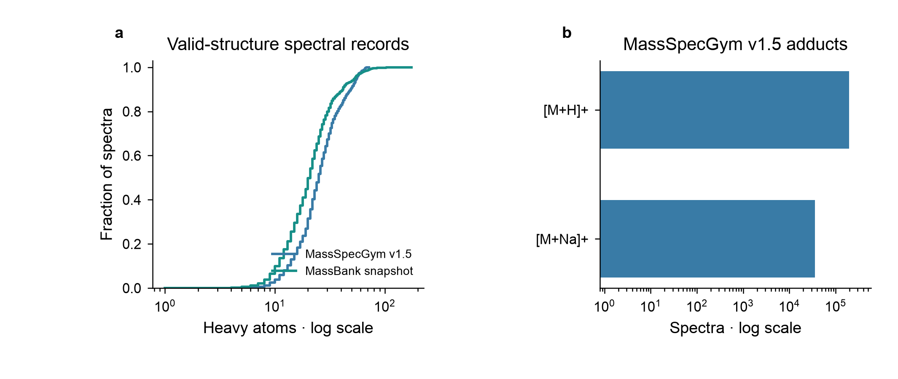

# MS data


[SVG](../assets/gallery/data-ms-availability.svg) · [PDF](../assets/gallery/data-ms-availability.pdf)



[SVG](../assets/gallery/data-ms-distributions.svg) · [PDF](../assets/gallery/data-ms-distributions.pdf)

## OpenDataLab

- **MS: 13,257,689** 条谱条目; **10,356,478** 条附有结构文本。

| Availability check / 字段可用性 | Entries or values / 条目或数值 |
| --- | ---: |
| `MS:unstructured_or_missing` | 13,226,620 |
| `MS:positive_measured_mz` | 13,233,024 |
| `MS:at_least_two_numeric_peaks` | 29,480 |
| `MS:at_least_six_numeric_peaks` | 14,354 |
| `MS:fragment_text_present` | 1,367 |
| `MS:explicit_collision_energy` | 2 |
| `MS:numeric_positions_only` | 12,263 |
| `MS:numeric_position_intensity_pairs` | 17,742 |
| `MS:mixed_or_text_peaks` | 1,064 |

[完整扫描结果](../assets/reports/opendatalab_all_modalities_20261117.json)保留原谱型标签与准确分类规则。

### Qualified molecular identities / 结构资格检查

| Modality | Qualified full InChIKeys | Source entries attached to these identities |
| --- | ---: | ---: |
| MS | 2,167,510 | 10,347,217 |

资格检查要求可生成标准分子身份及受支持的骨架分组，不等同于谱提取正确或已满足任务训练要求。同一分子可以出现于多个模态。[完整检查与排除范围](../assets/reports/opendatalab_structure_qualification_20261117.json)。

单点分子离子 m/z、碎片峰位列表、带数值强度的谱图支持不同任务。完整强度谱评测需要数值强度参考。

## External experimental data / 外部实验数据

- [MassSpecGym v1.5](https://huggingface.co/datasets/roman-bushuiev/MassSpecGym): updated RDKit-standardized molecular structures and benchmark files.
- [MassBank](https://github.com/MassBank/MassBank-data): experimental spectra with per-record acquisition metadata and provenance.

**MassSpecGym v1.5:** 231,104 spectra / 28,923 molecular connectivities. 231,104 valid numerical peak arrays; 121,746 records with finite scalar collision energy.

```python
from openmolspec.dataset import molspectra
data = molspectra("massspecgym_1_5", root="/path/to/versioned-tsv")
print(data["test"].head(1))
```

**MassBank local snapshot:** 142,978 records / 142,978 accessions. MS type and acquisition metadata remain attached to each record.

| MS type | Local records |
| --- | ---: |
| MS2 | 120,949 |
| MS | 21,011 |
| MSn | 19 |
| MS3 | 929 |
| MS4 | 70 |

全峰表检查得到 **142,978 条数值有效谱**，其中 **120,512 条同时具有有效结构和 MS2 标记**；该快照包含 20,375 个有效完整标准 InChIKey。所有记录的声明峰数均与实际峰表一致。

[Numerical qualification and snapshot fingerprint / 数值检查与快照指纹](../assets/reports/massbank_spectrum_qualification_20261117.json)

[Data index](index.md) · [Loading API](../api.md) · [Splits](splits.md) · [Theory](../theory/index.md)

[External complete-file census / 外部数据扫描](../assets/reports/external_data_census_20261117.json)
