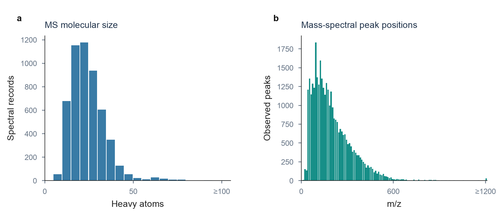

# 质谱数据

质谱数据保存 m/z 位置与强度。MS/MS 预测还使用离子／加合物、碰撞能、仪器及前体质量来定义采集条件。

## OpenDataLab

数值化 m/z–强度峰表及对应分子结构。 5,233 条谱，覆盖 4,980 个分子。

清洗保留至少两个有限正 m/z、强度有限非负且强度总和为正的谱；相同分子身份、谱值及实验条件的重复谱会被去除。



```python
from openmolspec.dataset import molspectra

data = molspectra("opendatalab_ms", root="data/experimental")
record = data["test"].head(1)[0]
print(record["smiles"])
print(record["peaks"][:5])  # [[m/z, intensity], ...]
```

## MassSpecGym

v1.5 前向预测视图包含 119,029 条具有模拟任务所需采集字段的谱。读取器保留 `spec_id`、`smiles`、`peaks`、`adduct`、`collision_energy`、`instrument` 和 `precursor_mz`。TSV 源文件用 `molspectra("massspecgym_1_5", root=...)` 加载；整理好的 CSV 使用 `SpectraSplit(format="massspecgym_csv", ...)` 导入。

## MassBank

数值 MS2 视图包含 120,512 条具有有效结构的谱。使用峰数组时同时保留谱编号、离子模式、仪器、碰撞条件与来源许可信息。

## 参考文献

- OpenDataLab. WanJuan MolSpectra, version 1.0.3. Experimental molecular spectroscopy dataset. [Source](https://opendatalab.com/)
- Bushuiev, R., Bushuiev, A., de Jonge, N. F., Young, A., et al. MassSpecGym: A benchmark for the discovery and identification of molecules. Advances in Neural Information Processing Systems 37, Datasets and Benchmarks Track (2024). arXiv:2410.23326. [Source](https://arxiv.org/abs/2410.23326)
- Horai, H., Arita, M., Kanaya, S., et al. MassBank: a public repository for sharing mass spectral data for life sciences. Journal of Mass Spectrometry 45, 703–714 (2010). doi:10.1002/jms.1777. [Source](https://doi.org/10.1002/jms.1777)
