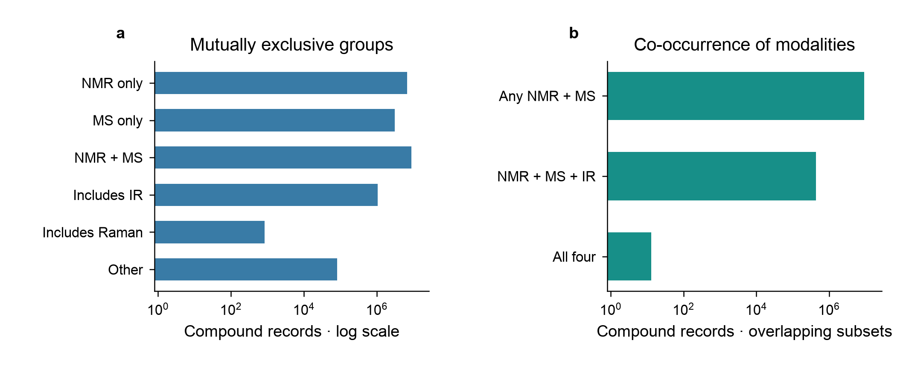

# Multimodal / 多谱联合 data

[SVG](../assets/gallery/data-multimodal-availability.svg) · [PDF](../assets/gallery/data-multimodal-availability.pdf)

## OpenDataLab

| Modality combination / 模态组合 | Compound records / 化合物记录 |
| --- | ---: |
| NMR+MS | 8,241,600 |
| NMR | 6,498,048 |
| MS | 2,795,311 |
| NMR+MS+Other | 660,710 |
| NMR+IR | 401,687 |
| NMR+MS+IR | 401,461 |
| MS+Other | 255,755 |
| NMR+Other | 216,038 |
| IR | 135,948 |
| Other | 80,708 |
| NMR+MS+IR+Other | 35,400 |
| MS+IR | 35,179 |
| NMR+IR+Other | 19,137 |
| IR+Other | 6,561 |
| MS+IR+Other | 2,978 |
| IR+Raman | 265 |
| NMR+Raman | 221 |
| NMR+IR+Raman | 119 |
| IR+Raman+Other | 79 |
| NMR+IR+Raman+Other | 45 |
| Raman | 40 |
| NMR+Raman+Other | 33 |
| NMR+MS+IR+Raman+Other | 10 |
| MS+IR+Raman | 4 |
| Raman+Other | 3 |
| NMR+MS+IR+Raman | 3 |
| NMR+MS+Raman | 3 |
[Full census](../assets/reports/opendatalab_all_modalities_20261117.json) retains raw spectrum labels and exact classification rules.

Co-occurrence means the source compound record contains these modalities. It does not establish same-instrument, same-solvent or same-conformer acquisition. Preserve source document, compound locator and conditions when building aligned tasks. Computed multimodal records likewise retain their geometry and NMR reference definitions.

## Computed paired IR / Raman

QMe14S has **184,252 aligned rows with finite, nonconstant values in both channels**, after the complete filename/array consistency check. These computed pairs are reported separately from experimental co-occurrence; their source is [QMe14S](https://arxiv.org/abs/2501.18876). [Pair-quality counts](../assets/reports/qme14s_alignment_20261117.json).

[Data index](index.md) · [Loading API](../api.md) · [Splits](splits.md) · [Theory](../theory/index.md)

[External complete-file census / 外部数据扫描](../assets/reports/external_data_census_20261117.json)

## Identity-level modality union

These counts merge all occurrences of the same full standard InChIKey. They describe molecular coverage, separate from the source-record co-occurrence table above.

| Molecular modality union | Qualified identities |
| --- | ---: |
| NMR + MS | 1,573,431 |
| NMR | 976,942 |
| MS | 503,312 |
| NMR + MS + IR | 84,033 |
| NMR + IR | 73,080 |
| IR | 18,248 |
| No target modality | 10,065 |
| MS + IR | 6,723 |
| NMR + IR + Raman | 27 |
| IR + Raman | 22 |
| NMR + MS + IR + Raman | 6 |
| NMR + MS + Raman | 5 |
| Raman | 4 |
| NMR + Raman | 4 |

[Complete structure qualification](../assets/reports/opendatalab_structure_qualification_20261117.json)
