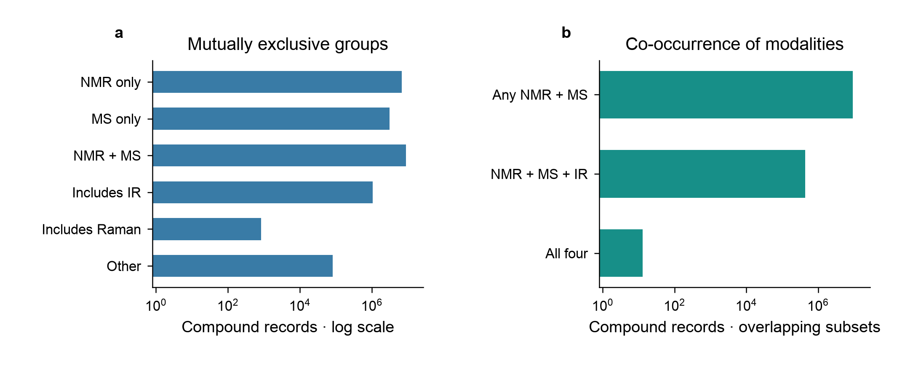

# Multimodal / 多谱联合 data

[SVG](../assets/gallery/data-multimodal-availability.svg) · [PDF](../assets/gallery/data-multimodal-availability.pdf)

## OpenDataLab

| Modality combination / 模态组合 | Compound records / 化合物记录 |
| --- | ---: |
| NMR+MS | 8,241,600 |
| NMR | 6,498,048 |
| MS | 2,795,311 |
| NMR+MS+Other | 660,710 |
| NMR+IR | 401,687 |
| NMR+MS+IR | 401,461 |
| MS+Other | 255,755 |
| NMR+Other | 216,038 |
| IR | 135,948 |
| Other | 80,708 |
| NMR+MS+IR+Other | 35,400 |
| MS+IR | 35,179 |
| NMR+IR+Other | 19,137 |
| IR+Other | 6,561 |
| MS+IR+Other | 2,978 |
| IR+Raman | 265 |
| NMR+Raman | 221 |
| NMR+IR+Raman | 119 |
| IR+Raman+Other | 79 |
| NMR+IR+Raman+Other | 45 |
| Raman | 40 |
| NMR+Raman+Other | 33 |
| NMR+MS+IR+Raman+Other | 10 |
| MS+IR+Raman | 4 |
| Raman+Other | 3 |
| NMR+MS+IR+Raman | 3 |
| NMR+MS+Raman | 3 |
[完整扫描结果](../assets/reports/opendatalab_all_modalities_20261117.json)保留原谱型标签与准确分类规则。

共现统计表示同一原始化合物记录列有这些模态，不自动证明它们在相同仪器、溶剂或构象下采集。构建对齐任务时，应保留来源文档、化合物位置及采集条件；计算多谱记录也保留构象与 NMR 参考定义。

## Computed paired IR / Raman

QMe14S 完成全量文件／数组对应检查后，有 **184,252 行同时具备有限、非常数的 IR 与 Raman 曲线**。这些计算配对与实验共现分开统计，来源为 [QMe14S](https://arxiv.org/abs/2501.18876)。[配对质量统计](../assets/reports/qme14s_alignment_20261117.json)。

[Data index](index.md) · [Loading API](../api.md) · [Splits](splits.md) · [Theory](../theory/index.md)

[External complete-file census / 外部数据扫描](../assets/reports/external_data_census_20261117.json)

## 身份级模态并集

以下按完整标准 InChIKey 合并所有来源出现位置，用于描述分子覆盖范围，与前文的单条来源记录共现分开。

| Molecular modality union | Qualified identities |
| --- | ---: |
| NMR + MS | 1,573,431 |
| NMR | 976,942 |
| MS | 503,312 |
| NMR + MS + IR | 84,033 |
| NMR + IR | 73,080 |
| IR | 18,248 |
| No target modality | 10,065 |
| MS + IR | 6,723 |
| NMR + IR + Raman | 27 |
| IR + Raman | 22 |
| NMR + MS + IR + Raman | 6 |
| NMR + MS + Raman | 5 |
| Raman | 4 |
| NMR + Raman | 4 |

[Complete structure qualification](../assets/reports/opendatalab_structure_qualification_20261117.json)
