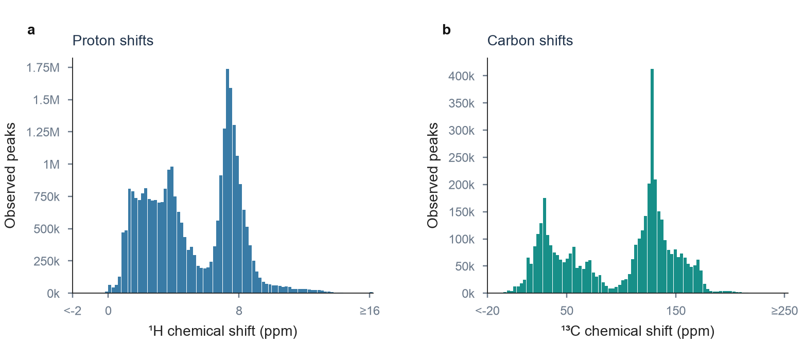

# NMR data

NMR records connect molecular structures to chemical shifts. The cleaned collection covers proton, carbon, boron, fluorine, silicon and phosphorus. Chemical shifts use ppm; acquisition frequencies use MHz.

## Cleaned H/C collection

| Quantity | Count |
| --- | --- |
| Molecular identities | 2,678,511 |
| ¹H spectra | 2,720,828 |
| ¹³C spectra | 252,015 |
| ¹H peaks | 29,270,201 |
| ¹³C peaks | 4,380,626 |
| Molecules with both H and C | 238,226 |

Cleaning validates the molecular structure, checks that the measured nucleus occurs in the molecule, parses numerical shifts and normalizes the molecular formula. Each retained molecule has at least one usable H or C spectrum. Molecular identity and the prepared split role are retained.

| Field | Type / unit | Meaning |
| --- | --- | --- |
| `smiles`, `inchi`, `standard_inchikey` | string | Molecular structure and standard identity. |
| `formula` | string | Molecular formula normalized from the structure. |
| `h_peaks_ppm`, `c_peaks_ppm` | list[float] / ppm | Parsed proton and carbon peak positions. |
| `h_nmr`, `c_nmr` | list[dict] | Spectrum text, nucleus, frequency and source-line metadata. |
| `modality_mask` | [has_H, has_C] | Which NMR channels are available. |
| `h_provenance`, `c_provenance` | dict | Acquisition/source information for each nucleus. |
| `patent_id`, `year`, `source` | string | Original document, publication year and source collection. |

Use the numerical arrays for learning and plotting. Keep the spectral text when studying multiplicity, integration or coupling constants. Select solvent and frequency conditions from the nucleus-specific source record when building a condition-dependent model.



## Heteronuclear views

| Nucleus | Spectra | Molecules |
| --- | --- | --- |
| 11B | 1,140 | 1,017 |
| 19F | 56,679 | 50,402 |
| 29Si | 726 | 636 |
| 31P | 21,662 | 18,238 |

Each record contains `smiles`, `standard_inchikey`, `nucleus`, `peaks_ppm`, `chemical_shift`, `solvent`, `frequency` and the source document. Peak intervals are represented by their center.

```python
from openmolspec.dataset import molspectra

boron = molspectra("opendatalab_11b", root="data/experimental")
record = boron["test"].select(modalities="11B").head(1)[0]
print(record["smiles"], record["peaks_ppm"])
```

## NMRexp

NMRexp provides experimental shifts extracted from the chemical literature in per-nucleus Parquet files. The filtered local views contain the following spectral records.

| Nucleus | Spectra | Molecules |
| --- | --- | --- |
| 1H | 1,651,798 | 1,417,274 |
| 13C | 1,439,328 | 1,265,481 |
| 19F | 195,070 | 179,277 |
| 31P | 32,889 | 30,031 |
| 11B | 16,871 | 15,242 |
| 29Si | 2,384 | 2,310 |

NMRSpec and NMRGym provide complementary test sets for spectral retrieval and structure elucidation. Load their prepared H/C JSONL views with `molspectra("nmrspec_test", root=...)` and `molspectra("nmrgym_test", root=...)`.

## References

- OpenDataLab. WanJuan MolSpectra, version 1.0.3. Experimental molecular spectroscopy dataset. [Source](https://opendatalab.com/)
- Wang, J.-J., Jin, Y., Zhi, C.-Y., et al. NMRexp: A database of 3.3 million experimental NMR spectra. Scientific Data 12, 1954 (2025). doi:10.1038/s41597-025-06245-5. [Source](https://www.nature.com/articles/s41597-025-06245-5)
- Yang, L., Yang, Z., Xie, J., Wang, Y., Gao, B., Fu, T., Wei, X., Sun, J., Wu, J., He, C., Li, Y. & Gu, Q. NMRTrans: Structure Elucidation from Experimental NMR Spectra via Set Transformers. arXiv:2602.10158 (2026). [Source](https://arxiv.org/abs/2602.10158)
- Fang, Z., Yang, C., Yu, H., Luo, H., He, H., Xie, J., Yang, Z. & Xia, J. NMRGym: A Comprehensive Benchmark for Nuclear Magnetic Resonance Based Molecular Structure Elucidation. arXiv:2601.15763 (2026). [Source](https://arxiv.org/abs/2601.15763)
