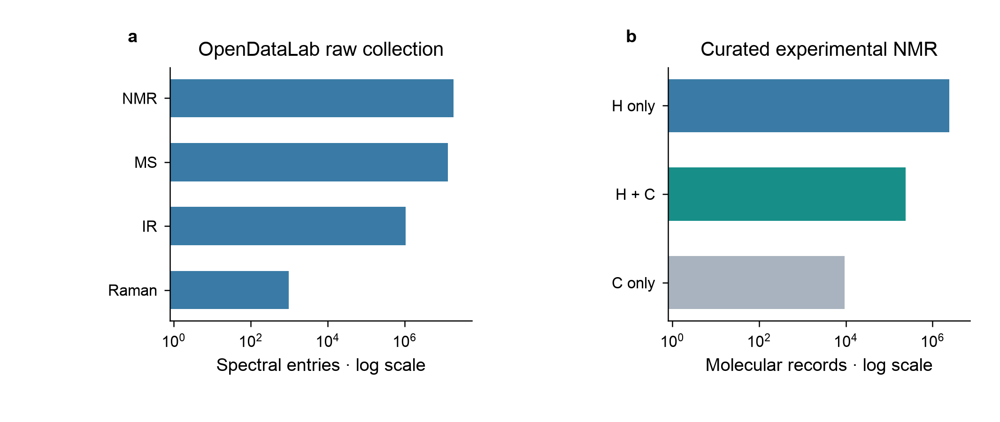
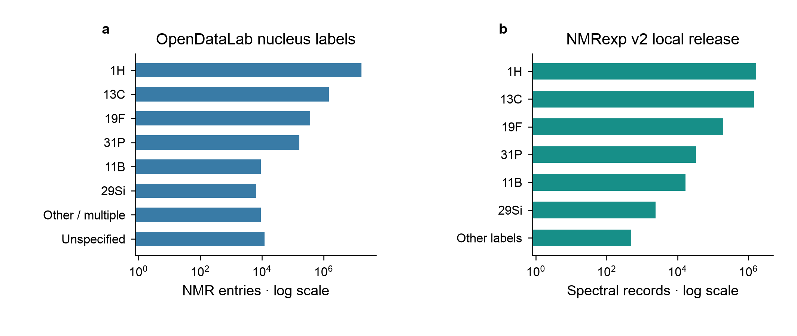
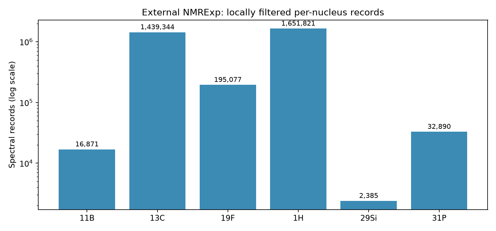

# NMR data

[SVG](../assets/gallery/data-nmr-availability.svg) · [PDF](../assets/gallery/data-nmr-availability.pdf)

[SVG](../assets/gallery/data-nmr-nuclei.svg) · [PDF](../assets/gallery/data-nmr-nuclei.pdf)

## OpenDataLab

- **NMR: 18,588,070** spectral entries; **13,732,773** with structure text.

| Availability check / 字段可用性 | Entries or values / 条目或数值 |
| --- | ---: |
| `NMR:nonempty_shift_text` | 18,511,179 |
| `NMR:shift_text_contains_number` | 18,499,239 |
| `NMR:solvent_present` | 18,167,918 |
| `NMR:positive_frequency` | 17,349,294 |

[Full census](../assets/reports/opendatalab_all_modalities_20261117.json) retains raw spectrum labels and exact classification rules.

### Qualified molecular identities / 结构资格检查

| Modality | Qualified full InChIKeys | Source entries attached to these identities |
| --- | ---: | ---: |
| NMR | 2,707,528 | 13,716,645 |

Qualification requires a standard molecular identity and a supported scaffold group; it does not establish spectral extraction accuracy or task eligibility. A molecule can occur in several modalities. [Full qualification and exclusion scope](../assets/reports/opendatalab_structure_qualification_20261117.json).

### OpenDataLab nucleus labels / 核种标签

| Nucleus label | Source entries |
| --- | ---: |
| 1H | 16,572,405 |
| 13C | 1,456,877 |
| 19F | 360,167 |
| 31P | 161,534 |
| 11B | 9,154 |
| 29Si | 6,571 |
| Other / multiple nuclei | 9,253 |
| Unspecified | 12,109 |

The curated H/C view contains 2,680,271 standard-InChI identities and 238,412 H/C-paired records. It preserves the original prepared train/validation/test roles. Pairing by molecular identity does not ensure matched acquisition conditions.

## External experimental data / 外部实验数据

**NMRexp v2 complete local release:** 3,372,987 spectral records / 1,499,173 valid standard-InChIKey identities.

| Resource | Modalities | Citation |
| --- | --- | --- |
| NMRexp v2 | ¹H, ¹³C, ¹⁹F, ³¹P, ¹¹B, ²⁹Si | [Dataset](https://zenodo.org/records/17296666) |
| NMRSpec / NMRTrans | Paired ¹H / ¹³C | [Paper](https://arxiv.org/abs/2602.10158) |
| NMRGym | Paired ¹H / ¹³C | [Paper](https://arxiv.org/abs/2601.15763) |
| NMRShiftDB | Assigned shifts and experimental conditions | [Project](https://nmrshiftdb.nmr.uni-koeln.de/) |

### NMRexp local nucleus views / 本地核种视图

| View | Spectral records |
| --- | ---: |
| `nmrexp_11B_usable` | 16,871 |
| `nmrexp_13C_usable` | 1,439,344 |
| `nmrexp_19F_usable` | 195,077 |
| `nmrexp_1H_usable` | 1,651,821 |
| `nmrexp_29Si_usable` | 2,385 |
| `nmrexp_31P_usable` | 32,890 |

These filtered views overlap the complete NMRexp release and are not additional spectra.

[Data index](index.md) · [Loading API](../api.md) · [Splits](splits.md) · [Theory](../theory/index.md)

[External complete-file census / 外部数据扫描](../assets/reports/external_data_census_20261117.json)
