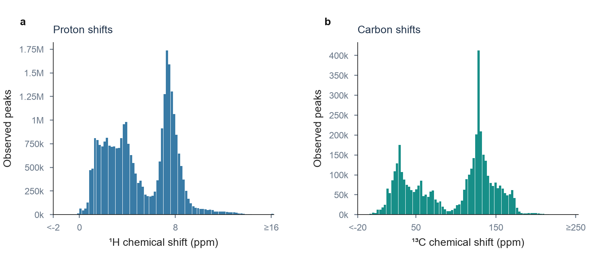

# NMR 数据

NMR 记录将分子结构与化学位移连接起来。清洗后的数据覆盖氢、碳、硼、氟、硅和磷；化学位移单位为 ppm，采集频率单位为 MHz。

## 清洗后的 H/C 集合

| 项目 | 数量 |
| --- | --- |
| 分子身份 | 2,678,511 |
| ¹H spectra | 2,720,828 |
| ¹³C spectra | 252,015 |
| ¹H peaks | 29,270,201 |
| ¹³C peaks | 4,380,626 |
| 同时有 H/C 的分子 | 238,226 |

清洗包括验证结构、检查分子中存在对应核种、解析数值化学位移，以及规范分子式。保留的每个分子至少具有一条可用的氢谱或碳谱，并保留分子身份和原有划分角色。

| 字段 | 类型／单位 | 含义 |
| --- | --- | --- |
| `smiles`, `inchi`, `standard_inchikey` | string | 分子结构与标准身份。 |
| `formula` | string | 由结构规范化的分子式。 |
| `h_peaks_ppm`, `c_peaks_ppm` | list[float] / ppm | 解析后的氢谱与碳谱峰位置。 |
| `h_nmr`, `c_nmr` | list[dict] | 谱文本、核种、频率和来源行信息。 |
| `modality_mask` | [has_H, has_C] | 可用的 NMR 通道。 |
| `h_provenance`, `c_provenance` | dict | 各核种对应的采集与来源信息。 |
| `patent_id`, `year`, `source` | string | 原文献、发表年份与来源库。 |

训练和绘图使用数值数组；研究多重性、积分或耦合常数时保留谱文本。构建条件相关模型时，从对应核种的原记录中选择溶剂和频率。



## 杂核视图

| 核种 | 谱数 | 分子数 |
| --- | --- | --- |
| 11B | 1,140 | 1,017 |
| 19F | 56,679 | 50,402 |
| 29Si | 726 | 636 |
| 31P | 21,662 | 18,238 |

每条记录包含 `smiles`、`standard_inchikey`、`nucleus`、`peaks_ppm`、`chemical_shift`、`solvent`、`frequency` 与来源文献。区间峰用中心位置表示。

```python
from openmolspec.dataset import molspectra

boron = molspectra("opendatalab_11b", root="data/experimental")
record = boron["test"].select(modalities="11B").head(1)[0]
print(record["smiles"], record["peaks_ppm"])
```

## NMRexp

NMRexp 提供从化学文献提取的实验化学位移，按核种保存在 Parquet 文件中。筛选后的本地视图包含以下谱记录。

| 核种 | 谱数量 | 分子数量 |
| --- | --- | --- |
| 1H | 1,651,798 | 1,417,274 |
| 13C | 1,439,328 | 1,265,481 |
| 19F | 195,070 | 179,277 |
| 31P | 32,889 | 30,031 |
| 11B | 16,871 | 15,242 |
| 29Si | 2,384 | 2,310 |

NMRSpec 和 NMRGym 提供谱结构检索及结构解析测试集。整理后的 H/C JSONL 视图分别用 `molspectra("nmrspec_test", root=...)` 与 `molspectra("nmrgym_test", root=...)` 加载。

## 参考文献

- OpenDataLab. WanJuan MolSpectra, version 1.0.3. Experimental molecular spectroscopy dataset. [Source](https://opendatalab.com/)
- Wang, J.-J., Jin, Y., Zhi, C.-Y., et al. NMRexp: A database of 3.3 million experimental NMR spectra. Scientific Data 12, 1954 (2025). doi:10.1038/s41597-025-06245-5. [Source](https://www.nature.com/articles/s41597-025-06245-5)
- Yang, L., Yang, Z., Xie, J., Wang, Y., Gao, B., Fu, T., Wei, X., Sun, J., Wu, J., He, C., Li, Y. & Gu, Q. NMRTrans: Structure Elucidation from Experimental NMR Spectra via Set Transformers. arXiv:2602.10158 (2026). [Source](https://arxiv.org/abs/2602.10158)
- Fang, Z., Yang, C., Yu, H., Luo, H., He, H., Xie, J., Yang, Z. & Xia, J. NMRGym: A Comprehensive Benchmark for Nuclear Magnetic Resonance Based Molecular Structure Elucidation. arXiv:2601.15763 (2026). [Source](https://arxiv.org/abs/2601.15763)
