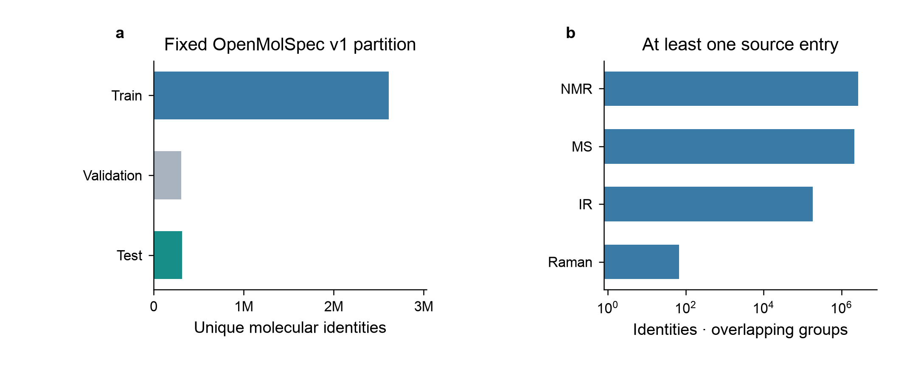

# Benchmark and custom splits

Registered benchmark views retain their source split roles. Use those fixed identities for comparable benchmark scores. To create a separate user dataset, explicitly export a new random or scaffold split; source data and published benchmark files remain intact.

```python
from openmolspec.dataset import molspectra
from openmolspec.split import split_records

data = molspectra('opendatalab_nmr', root='/path/to/data')
fixed = data.get_split()
# Export a NEW user dataset from your chosen input pool:
manifest = split_records(fixed['train'], 'my-scaffold-dataset',
    method='scaffold', seed=2026, ratios=(.8, .1, .1),
    source='OpenDataLab', domain='experimental')
# method='random' uses molecular-connectivity groups.
print(manifest['files'])
```

Scaffold splitting round-trips standard InChI before extracting achiral Bemis–Murcko scaffolds; acyclic molecules fall back to connectivity identities. Random splitting also groups identical connectivity, keeping repeated spectra and stereoisomers together. Stable SHA-256 assignment is independent of row order and modality. Ratios are expected proportions; large groups can produce unequal final row counts. Each export records the seed, grouping policy, RDKit version, original roles and file hashes. Empty splits are possible for small or highly homogeneous pools; inspect the manifest before training.

## Fixed OpenMolSpec v1 partition

This new identity partition spans the qualified OpenDataLab NMR/MS/IR/Raman collection. Every occurrence of a molecular connectivity and every supported scaffold stays in one role across modalities. It does not overwrite the existing curated H/C benchmark or external source folds.

The availability counts include 22 identities from 10 connectivity groups that yielded multiple normalized scaffolds; 21 of these identities have target-modality entries. All these forms are excluded from the fixed benchmark. Custom scaffold exports reject conflicting connectivity roles atomically; use grouped random splitting or resolve the structural forms.

| Role | Molecular identities | Attached source compound records |
| --- | ---: | ---: |
| train | 2,613,861 | 12,000,572 |
| val | 304,152 | 1,359,771 |
| test | 317,803 | 1,473,960 |



[Manifest with SHA-256](https://github.com/jiaqingxie/openmolspec-studio-frontend/releases/download/v1.0/manifest.json) · [Train](https://github.com/jiaqingxie/openmolspec-studio-frontend/releases/download/v1.0/train.csv.gz) · [Validation](https://github.com/jiaqingxie/openmolspec-studio-frontend/releases/download/v1.0/val.csv.gz) · [Test](https://github.com/jiaqingxie/openmolspec-studio-frontend/releases/download/v1.0/test.csv.gz)

Downloads contain identity membership, scaffold-group hashes and source entry counts. They contain no spectral arrays; task-specific numerical fields, acquisition conditions and eligibility must be checked against source records. The manifest attests zero cross-split scaffold or connectivity groups.
