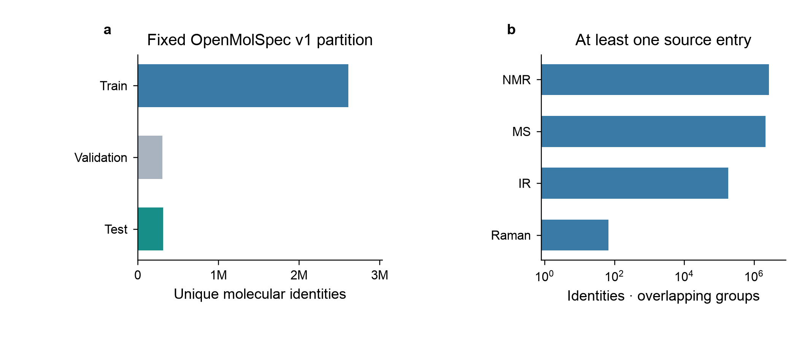

# 统一基准与自定义划分

注册的 benchmark 视图保留来源划分；可比评分使用固定测试身份。需要用户自定义划分时，显式导出新的随机或骨架版本，并保留来源与原始划分信息。

```python
from openmolspec.dataset import molspectra
from openmolspec.split import split_records

data = molspectra('opendatalab_nmr', root='/path/to/data')
fixed = data.get_split()
# Export a NEW user dataset from your chosen input pool:
manifest = split_records(fixed['train'], 'my-scaffold-dataset',
    method='scaffold', seed=2026, ratios=(.8, .1, .1),
    source='OpenDataLab', domain='experimental')
# method='random' uses molecular-connectivity groups.
print(manifest['files'])
```

骨架划分先按标准 InChI 还原，再提取不含手性的 Bemis–Murcko 骨架；无环分子按连接关系分组。随机划分同样按连接关系分组，使重复谱和立体异构体保留在同一集合。SHA-256 分配不受行顺序与模态影响。比例是期望值，较大的分组会影响最终行数。导出清单记录 seed、分组策略、RDKit 版本、原始角色和文件哈希。小规模或同质数据池可能产生空集合，训练前应检查清单。

## 固定 OpenMolSpec v1 分组

新身份分组覆盖通过资格检查且具有 NMR／MS／IR／Raman 条目的 OpenDataLab 集合。相同连接关系与受支持骨架的分子在各模态保留同一角色；原整理 H/C benchmark 及外部来源划分单独保留。

可用性统计中的 10 个连接关系组产生了多个标准骨架，涉及 22 个身份，其中 21 个有目标模态条目；这些身份不进入固定 benchmark。自定义骨架导出遇到相同连接关系的角色冲突时整体拒绝写出，可选择按连接关系随机分组或先处理结构形式。

| Role | Molecular identities | Attached source compound records |
| --- | ---: | ---: |
| train | 2,613,861 | 12,000,572 |
| val | 304,152 | 1,359,771 |
| test | 317,803 | 1,473,960 |



[Manifest with SHA-256](https://github.com/jiaqingxie/openmolspec-studio-frontend/releases/download/v1.0/manifest.json) · [Train](https://github.com/jiaqingxie/openmolspec-studio-frontend/releases/download/v1.0/train.csv.gz) · [Validation](https://github.com/jiaqingxie/openmolspec-studio-frontend/releases/download/v1.0/val.csv.gz) · [Test](https://github.com/jiaqingxie/openmolspec-studio-frontend/releases/download/v1.0/test.csv.gz)

下载文件包含身份归属、骨架分组哈希和来源条目数，不包含谱数组；具体任务还需在原记录中检查数值字段、采集条件与资格。清单验证骨架和连接关系均无跨集合分组。
