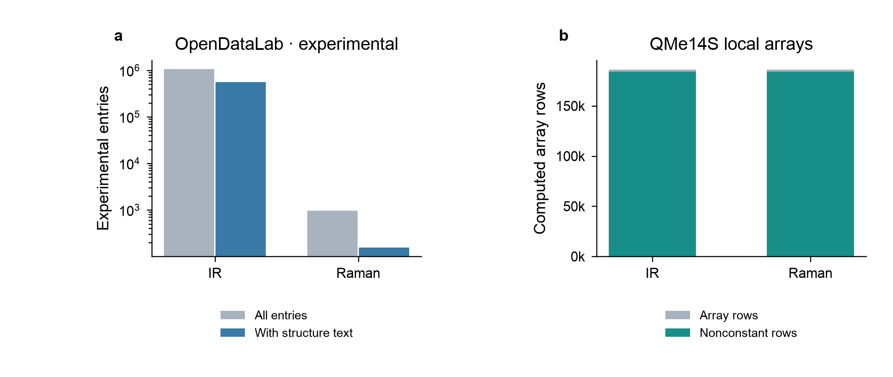
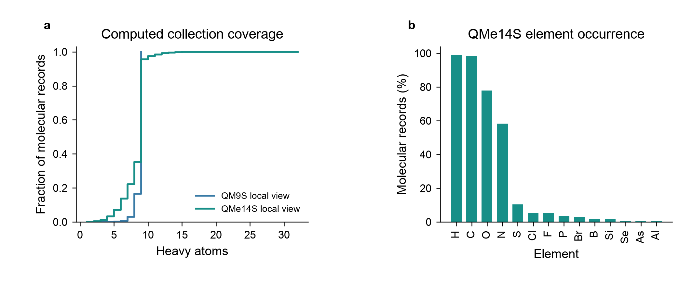

# IR / Raman data

[SVG](../assets/gallery/data-vibrational-availability.svg) · [PDF](../assets/gallery/data-vibrational-availability.pdf)

[SVG](../assets/gallery/data-vibrational-distributions.svg) · [PDF](../assets/gallery/data-vibrational-distributions.pdf)

## OpenDataLab

- **IR: 1,055,125** spectral entries; **556,448** with structure text.
- **Raman: 963** spectral entries; **156** with structure text.

| Availability check / 字段可用性 | Entries or values / 条目或数值 |
| --- | ---: |
| `IR:numeric_positions_only` | 1,044,173 |
| `IR:numeric_peak_positions` | 7,991,587 |
| `IR:unstructured_or_missing` | 10,366 |
| `Raman:numeric_positions_only` | 772 |
| `Raman:numeric_peak_positions` | 6,890 |
| `IR:mixed_or_text_peaks` | 586 |
| `Raman:unstructured_or_missing` | 179 |
| `Raman:mixed_or_text_peaks` | 12 |

[Full census](../assets/reports/opendatalab_all_modalities_20261117.json) retains raw spectrum labels and exact classification rules.

### Qualified molecular identities / 结构资格检查

| Modality | Qualified full InChIKeys | Source entries attached to these identities |
| --- | ---: | ---: |
| IR | 182,139 | 555,122 |
| RAMAN | 68 | 156 |

Qualification requires a standard molecular identity and a supported scaffold group; it does not establish spectral extraction accuracy or task eligibility. A molecule can occur in several modalities. [Full qualification and exclusion scope](../assets/reports/opendatalab_structure_qualification_20261117.json).

Experimental peak positions and full numerical curves are separate representations. Do not treat a broadened peak list as an experimental intensity trace.

## Computed data / 计算数据

| Dataset | Local form | Citation |
| --- | --- | --- |
| OpenMolSpec computed observables | IR/Raman, H/C and molecular properties; geometry/reference metadata retained | [Project](https://github.com/X1nyuLu/openSpec-alpha) |
| QM9S | Calculated IR/Raman and molecular properties | [Paper](https://www.nature.com/articles/s43588-023-00550-y) |
| QMe14S | Calculated spectra across 14 elements; local processed arrays have 186,102 rows per channel | [Paper](https://arxiv.org/abs/2501.18876) |

**QM9S local view:** 129,817 mapped records, 129,734 canonical isomeric structures, 129,817 corresponding CSV files. These are local-view counts, distinct from the original publication total.

Complete numerical scans of both QM9S bulk CSVs found **129,817 finite, nonconstant curves per channel**, with 3,501 points over 500–4000 cm⁻¹. Bulk row indices are **not yet verified against molecular mapping IDs**; this count establishes curve quality, not molecule–spectrum pairing. [Numerical report](../assets/reports/qm9s_array_qualification_20261118.json).

**QMe14S processed arrays:** 186,102 rows × 3,600 samples per channel, 500–4000 cm⁻¹. Each channel contains 1,850 constant rows; 184,252 are nonconstant.

The complete raw-file check found **181,920 standard-InChIKey identities** across the 186,102 rows. IR/Raman structure-text disagreements: 0. Both arrays agree with the filename-index mapping under the report’s explicit interpolation grid and 0.2% relative maximum-error tolerance. This checks numerical consistency; the original processing code is not attested.

[Complete structure/array alignment report / 完整结构与数组核对](../assets/reports/qme14s_alignment_20261117.json)

[Data index](index.md) · [Loading API](../api.md) · [Splits](splits.md) · [Theory](../theory/index.md)

[External complete-file census / 外部数据扫描](../assets/reports/external_data_census_20261117.json)
