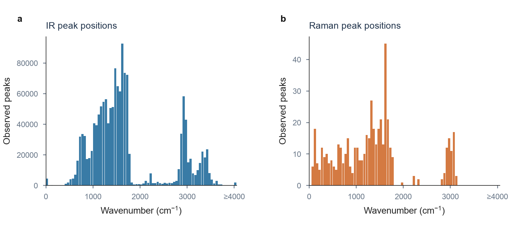

# IR 与 Raman 数据

实验视图保存测得的峰位置；计算视图提供密集光谱及相关量子化学性质，用于谱预测、检索与分子结构生成。

## 实验光谱

| 模态 | 谱数 | 分子数 |
| --- | --- | --- |
| IR | 177,759 | 168,197 |
| Raman | 42 | 39 |

记录包含 `wavenumber_cm1`、分子结构、原谱型标签和采集信息；有实测强度时同时保存 `intensities`。每条谱至少有两个有限正峰位置。构建密集输入时，应选择波数网格和展宽宽度，并将参数与数组一起保存。



```python
from openmolspec.dataset import molspectra

data = molspectra("opendatalab_ir", root="data/experimental")
spectrum = data["train"].head(1)[0]
print(spectrum["wavenumber_cm1"])
```

## OpenMolSpec 计算测试视图

openSpec 测试视图包含 20,390 条记录。每条提供 400–4,000 cm⁻¹ 网格上的 1,024 点 IR 与 Raman 强度、分子结构和性质目标。H/C 位移保留权重对应的参考标识。LMDB 中能隙单位为 Hartree，乘一次 27.211386245988 得到 eV；`GapModel.predict` 返回 eV。

```python
from openmolspec.dataset import molspectra

data = molspectra("openspec_test", root="data/openspec_test.lmdb", trusted=True)
record = data["test"].head(1)[0]
print(len(record["ir"]), len(record["raman"]))  # 1024 1024
```

## QMe14S

对齐视图包含 184,252 对 IR/Raman，两通道均为有限且非常数值。原资源覆盖 14 种元素，并提供研究结构与光谱关系所需的响应信息。数值数组已与分子文件名对应。

## 参考文献

- OpenDataLab. WanJuan MolSpectra, version 1.0.3. Experimental molecular spectroscopy dataset. [Source](https://opendatalab.com/)
- Yuan, M., Zou, Z. & Hu, W. QMe14S, A Comprehensive and Efficient Spectral Dataset for Small Organic Molecules. arXiv:2501.18876 (2025). [Source](https://arxiv.org/abs/2501.18876)
- Zou, Z., Zhang, Y., Liang, L., Wei, M., Leng, J., Jiang, J., Luo, Y. & Hu, W. A deep learning model for predicting selected organic molecular spectra. Nature Computational Science 3, 957–964 (2023). doi:10.1038/s43588-023-00550-y. [Source](https://www.nature.com/articles/s43588-023-00550-y)
- OpenMolSpec contributors. OpenMolSpec: Chemical spectroscopy datasets, models and learning workflows. Software release v1.0 (2026). [Source](https://github.com/jiaqingxie/openmolspec-studio-frontend/releases/tag/v1.0)
