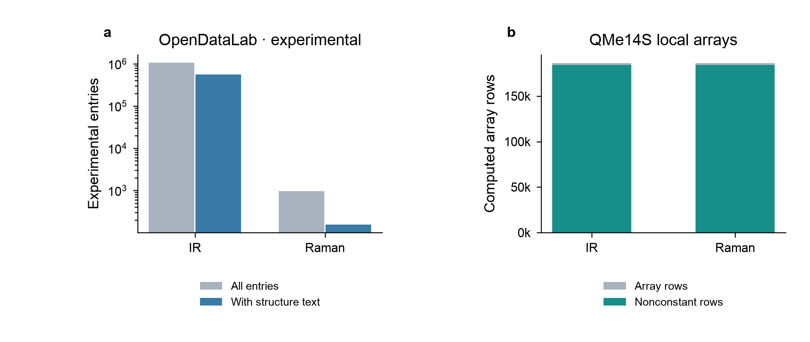
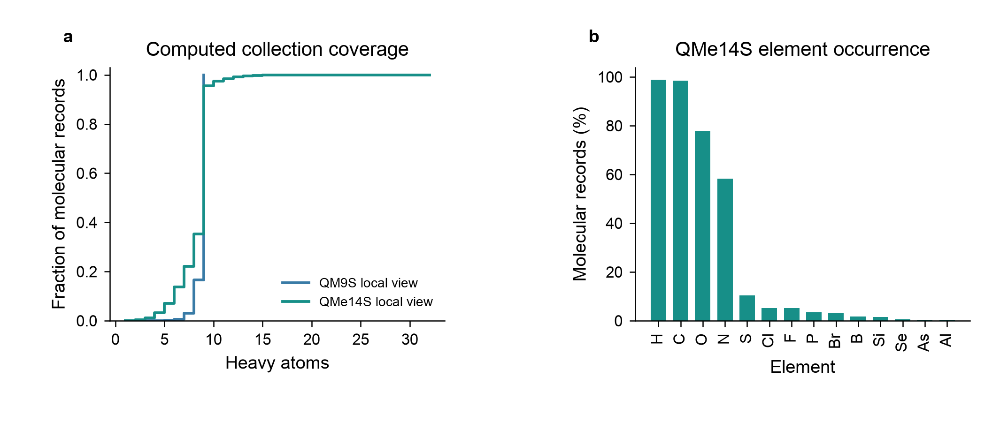

# IR / Raman data

[SVG](../assets/gallery/data-vibrational-availability.svg) · [PDF](../assets/gallery/data-vibrational-availability.pdf)

[SVG](../assets/gallery/data-vibrational-distributions.svg) · [PDF](../assets/gallery/data-vibrational-distributions.pdf)

## OpenDataLab

- **IR: 1,055,125** 条谱条目; **556,448** 条附有结构文本。
- **Raman: 963** 条谱条目; **156** 条附有结构文本。

| Availability check / 字段可用性 | Entries or values / 条目或数值 |
| --- | ---: |
| `IR:numeric_positions_only` | 1,044,173 |
| `IR:numeric_peak_positions` | 7,991,587 |
| `IR:unstructured_or_missing` | 10,366 |
| `Raman:numeric_positions_only` | 772 |
| `Raman:numeric_peak_positions` | 6,890 |
| `IR:mixed_or_text_peaks` | 586 |
| `Raman:unstructured_or_missing` | 179 |
| `Raman:mixed_or_text_peaks` | 12 |

[完整扫描结果](../assets/reports/opendatalab_all_modalities_20261117.json)保留原谱型标签与准确分类规则。

### Qualified molecular identities / 结构资格检查

| Modality | Qualified full InChIKeys | Source entries attached to these identities |
| --- | ---: | ---: |
| IR | 182,139 | 555,122 |
| RAMAN | 68 | 156 |

资格检查要求可生成标准分子身份及受支持的骨架分组，不等同于谱提取正确或已满足任务训练要求。同一分子可以出现于多个模态。[完整检查与排除范围](../assets/reports/opendatalab_structure_qualification_20261117.json)。

实验峰位与完整数值曲线是不同表示，不能把展宽后的峰列表当作原始实验强度曲线。

## Computed data / 计算数据

| Dataset | Local form | Citation |
| --- | --- | --- |
| OpenMolSpec computed observables | IR/Raman, H/C and molecular properties; geometry/reference metadata retained | [Project](https://github.com/X1nyuLu/openSpec-alpha) |
| QM9S | Calculated IR/Raman and molecular properties | [Paper](https://www.nature.com/articles/s43588-023-00550-y) |
| QMe14S | Calculated spectra across 14 elements; local processed arrays have 186,102 rows per channel | [Paper](https://arxiv.org/abs/2501.18876) |

**QM9S local view:** 129,817 mapped records, 129,734 canonical isomeric structures, 129,817 corresponding CSV files. These are local-view counts, distinct from the original publication total.

QM9S 两个完整 CSV 数值扫描均得到 **129,817 条有限、非常数曲线**，每条 3,501 点，覆盖 500–4000 cm⁻¹。批量 CSV 行号**尚未与分子映射 ID 核实**；这里确认曲线质量，不能据此宣称分子—谱配对已验证。[数值检查报告](../assets/reports/qm9s_array_qualification_20261118.json)。

**QMe14S processed arrays:** 186,102 rows × 3,600 samples per channel, 500–4000 cm⁻¹. Each channel contains 1,850 constant rows; 184,252 are nonconstant.

全部原文件检查得到 **181,920 个标准 InChIKey 身份**，对应 186,102 行；IR/Raman 结构文本不一致数为 0。两通道数组均通过“文件名编号对应数组行”的数值一致性检查，使用报告声明的插值网格及 0.2% 相对最大误差容差。该检查验证数值对应关系，不代表已核查原始处理代码。

[Complete structure/array alignment report / 完整结构与数组核对](../assets/reports/qme14s_alignment_20261117.json)

[Data index](index.md) · [Loading API](../api.md) · [Splits](splits.md) · [Theory](../theory/index.md)

[External complete-file census / 外部数据扫描](../assets/reports/external_data_census_20261117.json)
