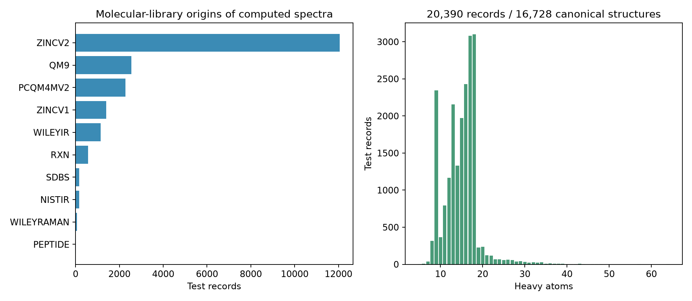
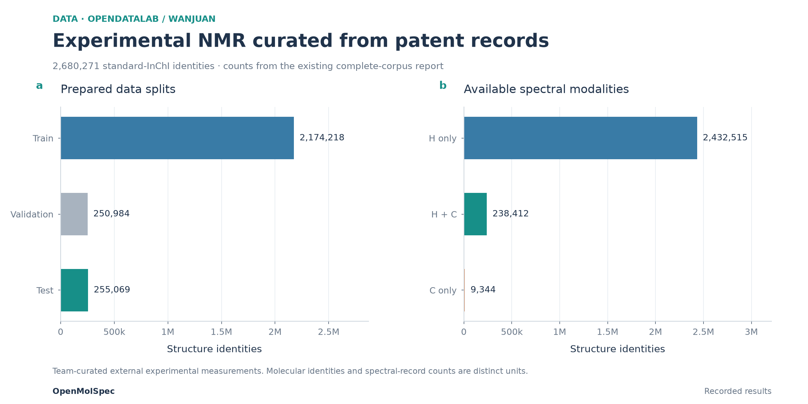
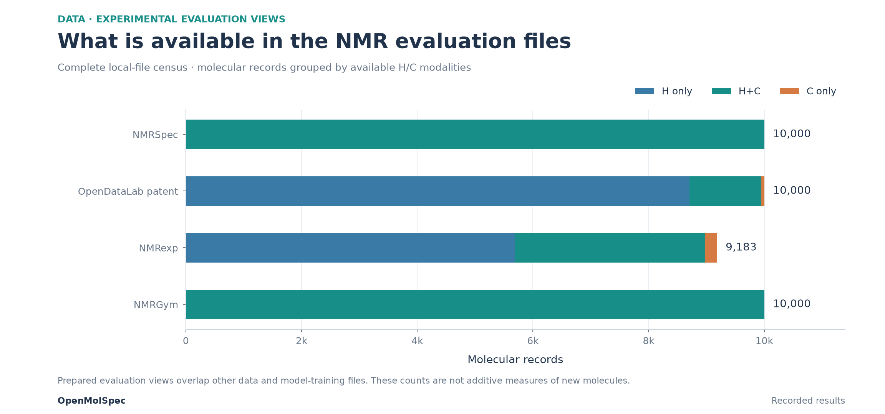
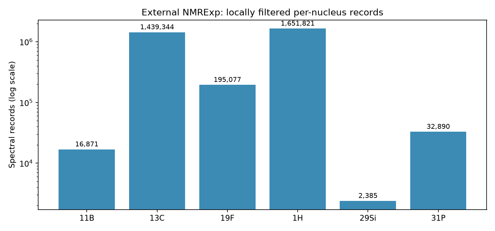

# Datasets: contents, scale and provenance

OpenMolSpec brings together experimental spectra curated from OpenDataLab / WanJuan, calculated spectra produced by the team, and externally maintained benchmarks. The OpenDataLab-derived corpus is experimental, as confirmed by the project owner; curation does not imply that our team performed the original measurements. A locally prepared file is not automatically a dataset created by us. Counts below use explicit units and verification scopes.

## 1. OpenMolSpec calculated data

The documented frozen-candidate release contains **1,158,074 full molecules** deduplicated by full InChIKey, **1,030,780 aligned molecules** with IR/Raman/NMR, and **32,333,251 optimization trajectory frames** with energies/forces. Frames are not additional molecules. These are release-snapshot figures from the project data description; the full release files are not mounted in this workspace and were not independently recounted here.

| Aligned split | Molecules in release snapshot |
| --- | ---: |
| Train | 1,000,000 |
| Validation | 10,390 |
| Test | 20,390 |

The local test LMDB **was fully scanned**: 20,390 records and 16,728 distinct RDKit canonical isomeric SMILES. The stored-model representation and identity definition differ from the release InChIKey counts; these two numbers must not be substituted for each other. There are 20,388 H+C records and two C-only records. All 20,390 contain IR and Raman arrays.

The source labels (QM9, ZINC, SDBS, etc.) identify the original molecular libraries. IR/Raman/NMR observables in this LMDB are calculated; a source label does not turn them into experimental spectra.

| Field | Shape / unit / meaning |
| --- | --- |
| `sample_id`, `source_dataset`, `inchikey` | Record identity, molecular-library origin, stored structural identifier |
| `ir`, `raman` | 1024 normalized values per channel; 400–4000 cm⁻¹ |
| `nmr_h_shifts_ppm`, `nmr_c_shifts_ppm` | Variable-length per-atom ppm arrays; unassigned, no J splitting |
| `nmr_reference_id` | Reference convention required to match the checkpoint |
| `gap`, `homo`, `lumo`, `energy` | Stored quantum-chemical quantities; gap in Hartree, converted once to eV for evaluation |

## 2. Team-curated experimental NMR from OpenDataLab / WanJuan

This experimental corpus is curated from OpenDataLab / WanJuan patent measurements. Original measurements and citations remain attributable to their sources. The public provider version and redistribution scope still require release-level verification. The standard-InChI view has **2,680,271 identities**: 2,174,218 train, 250,984 validation and 255,069 test. It preserves **2,722,790 H records** and **252,158 C records**; one molecule can have several measurements. Counts come from the existing complete-corpus verification report, whose digest is included in this audit.

The view groups by standard InChI, selects a representative SMILES, retains the most informative H/C records separately, and assigns scaffold-based splits. Its 10,000-record evaluation subset is part of the parent corpus and must not be added to that total.

## 3. Prepared evaluation views of external NMR

Every file below was fully scanned in this update. Each row has `smiles`, `formula`, `h_nmr`, `c_nmr` and a `[has_H, has_C]` mask. H/C records retain peak text; available fields can include shifts, multiplicity, integration, couplings and acquisition frequency. Missing conditions are not fabricated.

| Local view | Original source | Records | Unique canonical structures | H only | C only | H+C |
| --- | --- | ---: | ---: | ---: | ---: | ---: |
| `nmrspec_test` | NMRSpec / NMRTrans benchmark | 10,000 | 10,000 | 0 | 0 | 10,000 |
| `patent_test_10k` | OpenDataLab / WanJuan experimental patent corpus; team-curated InChI view | 10,000 | 10,000 | 8,707 | 52 | 1,241 |
| `nmrexp_exp_10k` | NMRExp | 9,183 | 9,183 | 5,690 | 201 | 3,292 |
| `nmrgym_test` | NMRGym | 10,000 | 10,000 | 0 | 0 | 10,000 |

The directory name `nmrexp_exp_10k` is a target-size label: it actually contains **9,183** records after filtering. NMRSpec here is the NMRTrans test benchmark. NMRGym and NMRExp remain external sources even after conversion to our interface.

## 4. External full/local filtered sources

| External local view | Count | Counting unit / method |
| --- | ---: | --- |
| `nmrexp_11B_usable` | 16,871 | Parquet spectral rows (metadata) |
| `nmrexp_13C_usable` | 1,439,344 | Parquet spectral rows (metadata) |
| `nmrexp_19F_usable` | 195,077 | Parquet spectral rows (metadata) |
| `nmrexp_1H_usable` | 1,651,821 | Parquet spectral rows (metadata) |
| `nmrexp_29Si_usable` | 2,385 | Parquet spectral rows (metadata) |
| `nmrexp_31P_usable` | 32,890 | Parquet spectral rows (metadata) |
| `MassSpecGym_test_full` | 17,556 | CSV spectra (complete scan) |

MassSpecGym test: **17,556 spectra / 3,170 distinct stored SMILES strings**.

MassSpecGym is an external dataset. Our GLACIER/ICEBERG evaluation selected 32 distinct molecules and scored 31 spectra per model, skipping one missing-condition record. Those 31 are a small evaluated subset, not the dataset size.

## Access and reproducibility

- [MassSpecGym original distribution](https://huggingface.co/datasets/roman-bushuiev/MassSpecGym)
- [NMRNet data / weights](https://zenodo.org/records/19142375)
- [NMRNet++ data / weights](https://zenodo.org/records/18232165)
- [This audit: counts, histograms, schemas, file hashes and real examples](assets/dataset_audit.json)

A verified public full OpenMolSpec release URL is not available here yet. The downloadable audit and task examples are available now; they do not replace full data distribution. Public redistribution must follow the original sources. Our computed release snapshot, curated patent view and external evaluation subsets overlap conceptually and must not be summed into a single "total molecules" number.

**Evaluation limitation:** molecular overlap with checkpoint-recorded training data is confirmed for several NMR views. The final generator also has a training-file fingerprint discrepancy. These runs do not establish independent generalization.  [Training-history audit / 训练历史审计](training-overlap.md)
