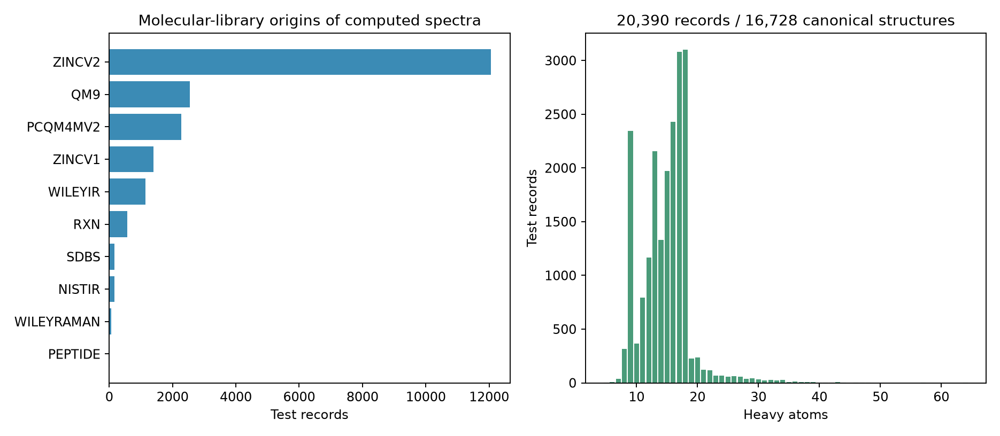
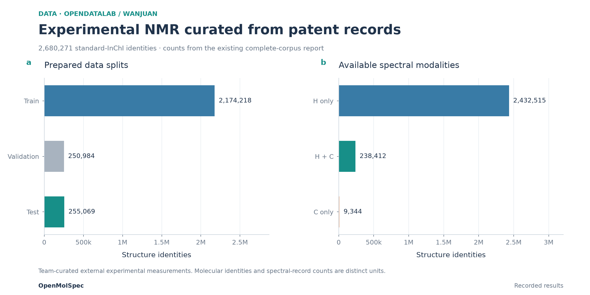
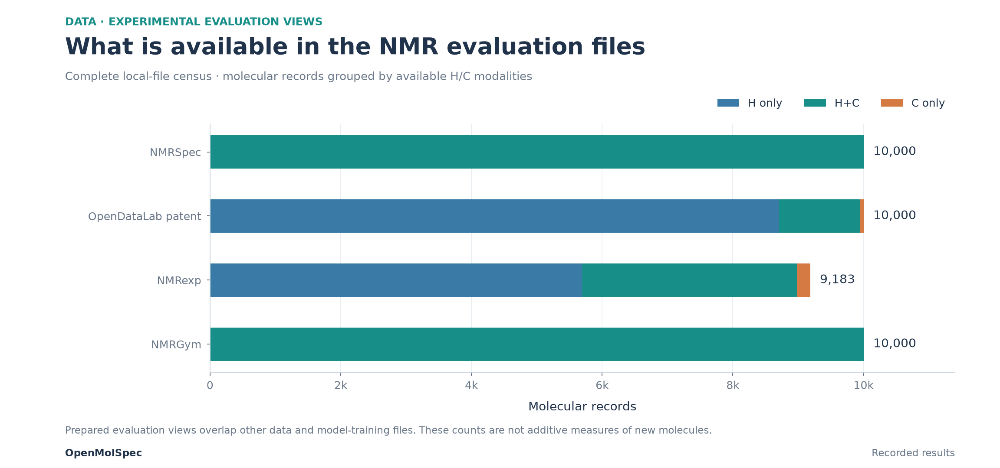
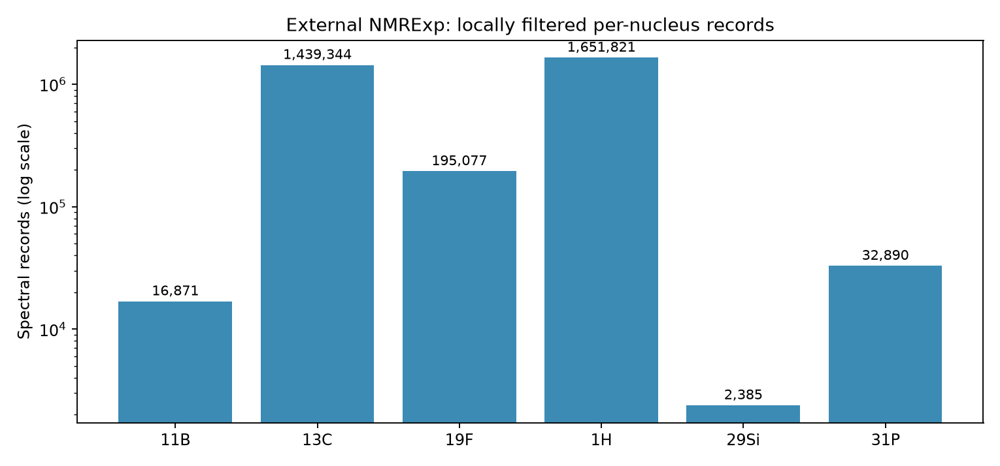

# 数据集：内容、规模与来源

OpenMolSpec 包括从 OpenDataLab / WanJuan 清洗整理的实验谱、团队构建的计算谱，以及接入的外部基准。项目负责人已明确 OpenDataLab 这条数据主线来自实验测量；团队贡献是清洗整理，不是原始测量。本地整理的文件不会自动变成“我们自建的数据”。下列数字均标明计数单位和核验范围。

## 1. OpenMolSpec 自建计算数据

项目冻结候选版本记录：按完整 InChIKey 去重的 **1,158,074 个 full 分子**，同时具有 IR/Raman/NMR 的 **1,030,780 个 align 分子**，以及带能量/力的 **32,333,251 个优化轨迹帧**。轨迹帧不能另算成分子。以上是项目数据说明中的版本快照；当前工作区未挂载完整 release 文件，因此本次没有把这些总量重新全盘计数。

| Aligned split | Molecules in release snapshot |
| --- | ---: |
| Train | 1,000,000 |
| Validation | 10,390 |
| Test | 20,390 |

本次**完整扫描**了本地测试 LMDB：实际有 **20,390 条记录**、**16,728 个不同的 RDKit 规范异构 SMILES**。模型文件中的表示及身份口径与 release 的 InChIKey 口径不同，二者不能互换。20,388 条同时具有 H/C，另有 2 条仅含 C；20,390 条都包含 IR 与 Raman 数组。

QM9、ZINC、SDBS 等 source 标签表示原始分子库来源。这份 LMDB 的 IR/Raman/NMR 观测量是计算得到的，不能因为来源叫 SDBS 或 NISTIR 就称为实测谱。

| 字段 | 形状 / 单位 / 含义 |
| --- | --- |
| `sample_id`、`source_dataset`、`inchikey` | 记录 ID、原分子库来源、保存的结构标识 |
| `ir`、`raman` | 每通道 1024 个归一化值；400–4000 cm⁻¹ |
| `nmr_h_shifts_ppm`、`nmr_c_shifts_ppm` | 变长逐原子 ppm 数组；未指认，不含 J 裂分 |
| `nmr_reference_id` | 必须与 checkpoint 一致的参考约定 |
| `gap`、`homo`、`lumo`、`energy` | 保存的量化性质；gap 原单位 Hartree，评测时仅转换一次为 eV |

## 2. OpenDataLab / WanJuan：团队整理的实验 NMR

这条实验数据主线来自 OpenDataLab / WanJuan 专利测量，团队负责清洗和整理，原始测量及引用仍归属其来源。正式发布还需核实提供方版本和可再分发范围。standard-InChI 视图有 **2,680,271 个结构身份**：训练 2,174,218、验证 250,984、测试 255,069。保留 **2,722,790 条 H 记录**和 **252,158 条 C 记录**，一个分子可能有多条测量。这些数字来自已有的全库核验报告，报告哈希也保存在本次审计中。

这个视图按 standard InChI 分组，选择代表 SMILES，分别保留信息较充分的 H/C 记录，再按 scaffold 划分。用于评测的 10,000 条专利子集属于父数据，不能再加到总量里。

## 3. 从外部 NMR 整理的评测视图

下列文件在本次更新中均已完整扫描。每行包含 `smiles`、`formula`、`h_nmr`、`c_nmr` 和 `[has_H, has_C]` 掩码。H/C 保留峰文本，原记录有时还含多重性、积分、J 值和频率；缺失条件不会补造。

| Local view | Original source | Records | Unique canonical structures | H only | C only | H+C |
| --- | --- | ---: | ---: | ---: | ---: | ---: |
| `nmrspec_test` | NMRSpec / NMRTrans benchmark | 10,000 | 10,000 | 0 | 0 | 10,000 |
| `patent_test_10k` | OpenDataLab / WanJuan experimental patent corpus; team-curated InChI view | 10,000 | 10,000 | 8,707 | 52 | 1,241 |
| `nmrexp_exp_10k` | NMRExp | 9,183 | 9,183 | 5,690 | 201 | 3,292 |
| `nmrgym_test` | NMRGym | 10,000 | 10,000 | 0 | 0 | 10,000 |

目录名 `nmrexp_exp_10k` 只是目标规模，过滤后实际是 **9,183 条**。这里的 NMRSpec 是 NMRTrans 测试 benchmark。NMRGym 和 NMRExp 即使转成统一接口，仍属于外部来源。

## 4. 外部原始／本地过滤数据

| External local view | Count | Counting unit / method |
| --- | ---: | --- |
| `nmrexp_11B_usable` | 16,871 | Parquet spectral rows (metadata) |
| `nmrexp_13C_usable` | 1,439,344 | Parquet spectral rows (metadata) |
| `nmrexp_19F_usable` | 195,077 | Parquet spectral rows (metadata) |
| `nmrexp_1H_usable` | 1,651,821 | Parquet spectral rows (metadata) |
| `nmrexp_29Si_usable` | 2,385 | Parquet spectral rows (metadata) |
| `nmrexp_31P_usable` | 32,890 | Parquet spectral rows (metadata) |
| `MassSpecGym_test_full` | 17,556 | CSV spectra (complete scan) |

MassSpecGym test: **17,556 spectra / 3,170 distinct stored SMILES strings**.

MassSpecGym 是外部数据。本项目 GLACIER/ICEBERG 实验选择 32 个不同分子，每个模型评分 31 条谱，因条件缺失跳过 1 条。31 只是实际评测子集大小，不是全数据量。

## 获取与复现

- [MassSpecGym original distribution](https://huggingface.co/datasets/roman-bushuiev/MassSpecGym)
- [NMRNet data / weights](https://zenodo.org/records/19142375)
- [NMRNet++ data / weights](https://zenodo.org/records/18232165)
- [This audit: counts, histograms, schemas, file hashes and real examples](assets/dataset_audit.json)

这里尚无经过验证的 OpenMolSpec 完整公开数据下载地址。当前可下载审计统计和任务真实示例，但它们不等于完整数据发布。数据分发应遵循原始来源要求。计算数据版本、专利整理视图和外部评测子集有不同口径及父子关系，不能简单相加成一个“总分子数”。

**评测限制：**多个 NMR 视图已确认与 checkpoint 记录的训练数据存在分子重叠，最终生成模型还存在训练文件哈希不一致。现有运行不能证明独立泛化能力。 [Training-history audit / 训练历史审计](training-overlap.md)
