# Photo Gallery — real results

Every image is generated from saved model outputs or audited dataset counts. Click a figure to open the task, its real example and interpretation. Blue/orange curves are identified in each panel; failed predictions and weak baselines are retained. Figures are generated with Matplotlib and RDKit.

## NMR

<figure><a href="tasks/nmr-forward-1H.html">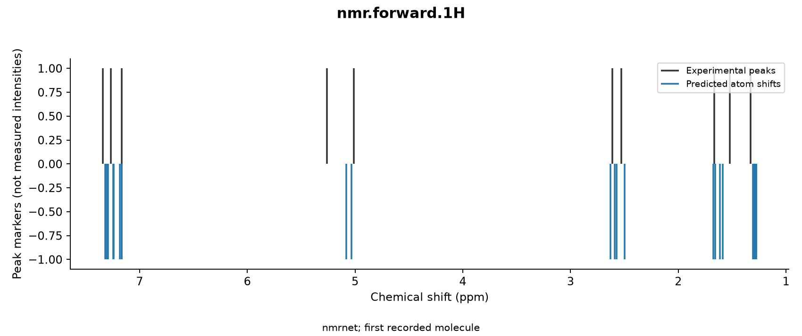</a><figcaption><a href="tasks/nmr-forward-1H.html">Structure to 1H NMR</a> <a href="assets/gallery/nmr-forward-1H.svg">SVG</a> · <a href="assets/examples/nmr-forward-1H.json">Data / 数据</a></figcaption></figure>
<figure><a href="tasks/nmr-forward-13C.html">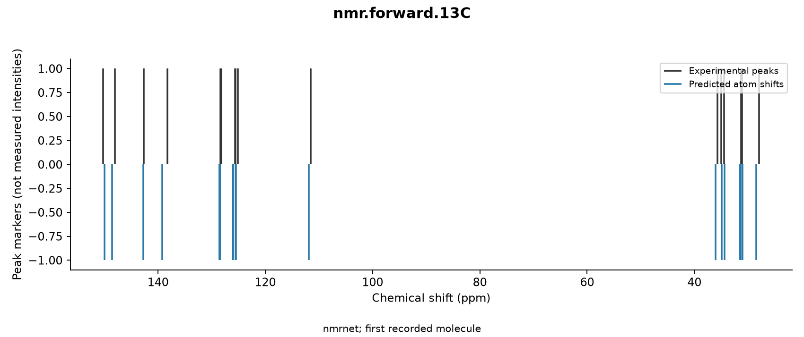</a><figcaption><a href="tasks/nmr-forward-13C.html">Structure to 13C NMR</a> <a href="assets/gallery/nmr-forward-13C.svg">SVG</a> · <a href="assets/examples/nmr-forward-13C.json">Data / 数据</a></figcaption></figure>
<figure><a href="tasks/nmr-forward-19F.html">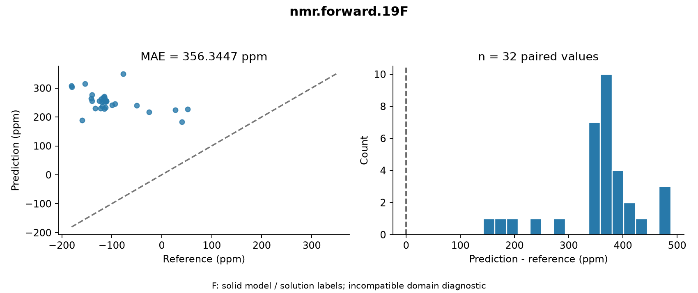</a><figcaption><a href="tasks/nmr-forward-19F.html">Structure to 19F NMR: alignment audit</a> <a href="assets/gallery/nmr-forward-19F.svg">SVG</a> · <a href="assets/examples/nmr-forward-19F.json">Data / 数据</a></figcaption></figure>
<figure><a href="tasks/nmr-forward-31P.html">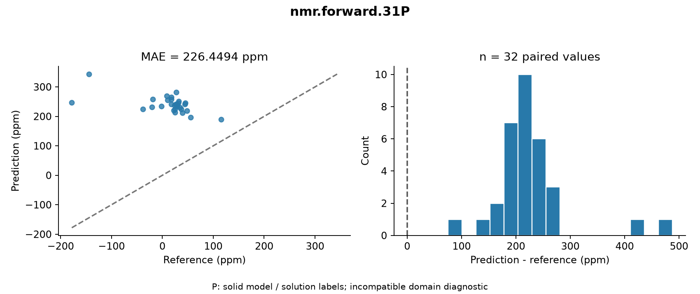</a><figcaption><a href="tasks/nmr-forward-31P.html">Structure to 31P NMR: alignment audit</a> <a href="assets/gallery/nmr-forward-31P.svg">SVG</a> · <a href="assets/examples/nmr-forward-31P.json">Data / 数据</a></figcaption></figure>
<figure><a href="tasks/nmr-forward-11B.html">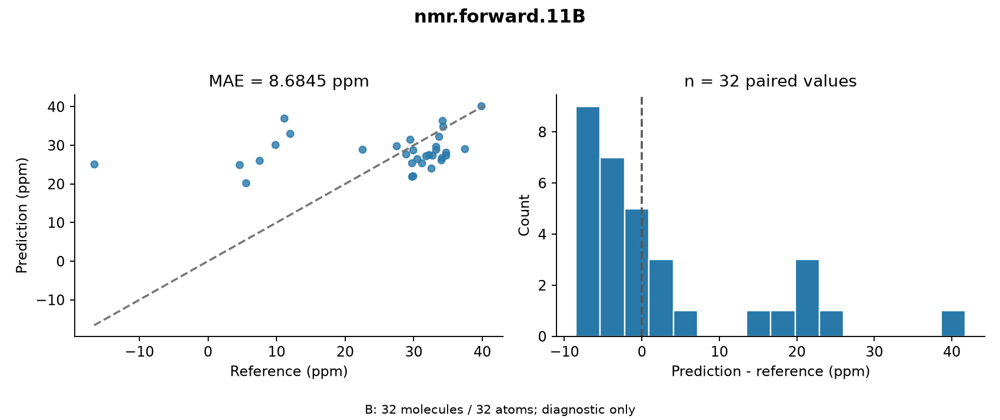</a><figcaption><a href="tasks/nmr-forward-11B.html">Structure to 11B NMR: frozen diagnostic</a> <a href="assets/gallery/nmr-forward-11B.svg">SVG</a> · <a href="assets/examples/nmr-forward-11B.json">Data / 数据</a></figcaption></figure>
<figure><a href="tasks/nmr-forward-29Si.html">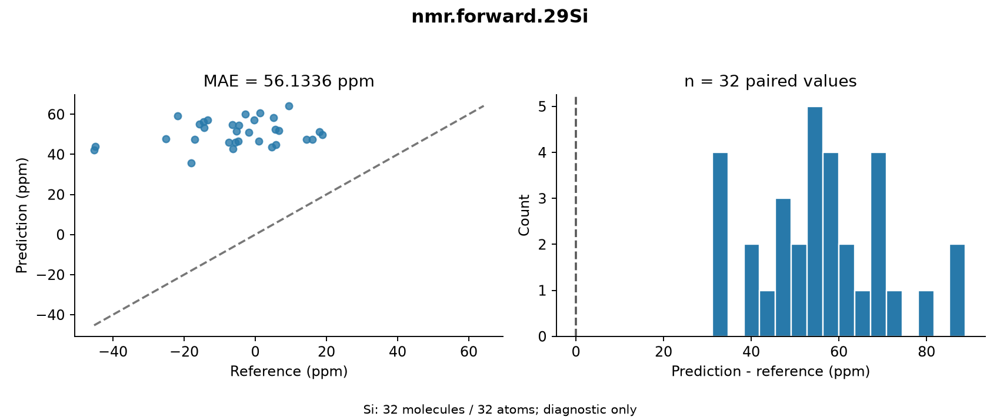</a><figcaption><a href="tasks/nmr-forward-29Si.html">Structure to 29Si NMR: frozen diagnostic</a> <a href="assets/gallery/nmr-forward-29Si.svg">SVG</a> · <a href="assets/examples/nmr-forward-29Si.json">Data / 数据</a></figcaption></figure>
<figure><a href="tasks/nmr-retrieval-h-s2m.html">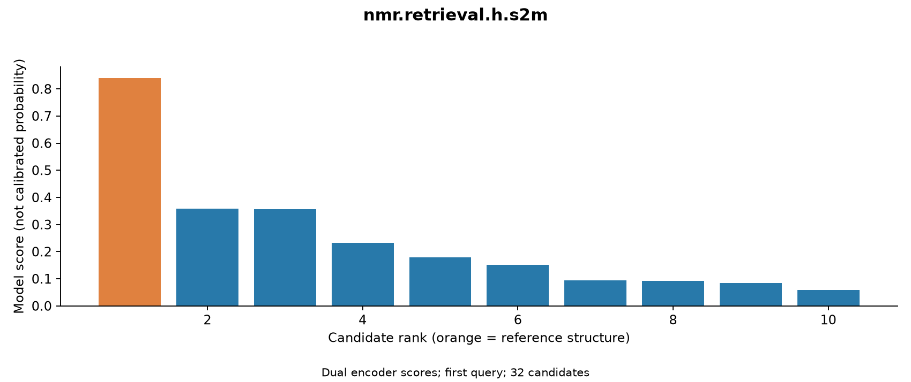</a><figcaption><a href="tasks/nmr-retrieval-h-s2m.html">NMR retrieval: H, s2m</a> <a href="assets/gallery/nmr-retrieval-h-s2m.svg">SVG</a> · <a href="assets/examples/nmr-retrieval-h-s2m.json">Data / 数据</a></figcaption></figure>
<figure><a href="tasks/nmr-retrieval-h-m2s.html">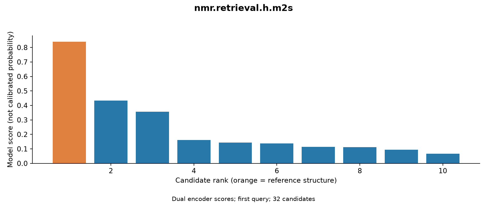</a><figcaption><a href="tasks/nmr-retrieval-h-m2s.html">NMR retrieval: H, m2s</a> <a href="assets/gallery/nmr-retrieval-h-m2s.svg">SVG</a> · <a href="assets/examples/nmr-retrieval-h-m2s.json">Data / 数据</a></figcaption></figure>
<figure><a href="tasks/nmr-generation-h.html">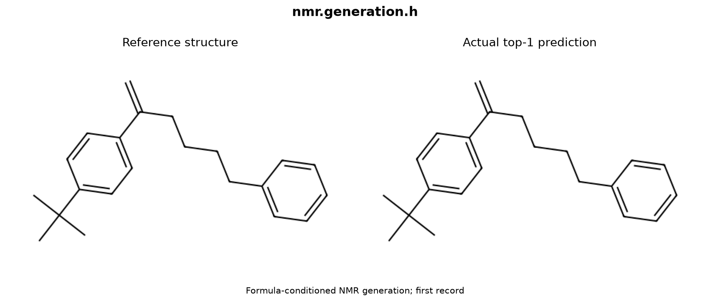</a><figcaption><a href="tasks/nmr-generation-h.html">NMR-to-SMILES generation: H</a> <a href="assets/gallery/nmr-generation-h.svg">SVG</a> · <a href="assets/examples/nmr-generation-h.json">Data / 数据</a></figcaption></figure>
<figure><a href="tasks/nmr-retrieval-c-s2m.html">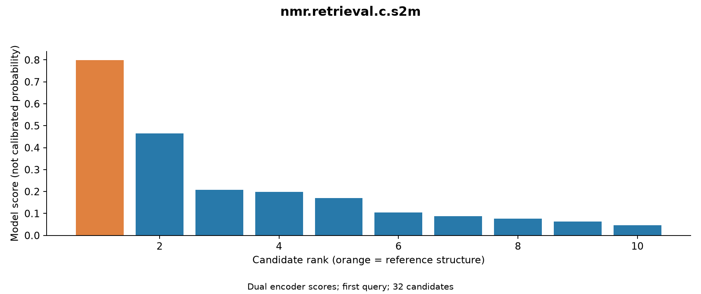</a><figcaption><a href="tasks/nmr-retrieval-c-s2m.html">NMR retrieval: C, s2m</a> <a href="assets/gallery/nmr-retrieval-c-s2m.svg">SVG</a> · <a href="assets/examples/nmr-retrieval-c-s2m.json">Data / 数据</a></figcaption></figure>
<figure><a href="tasks/nmr-retrieval-c-m2s.html">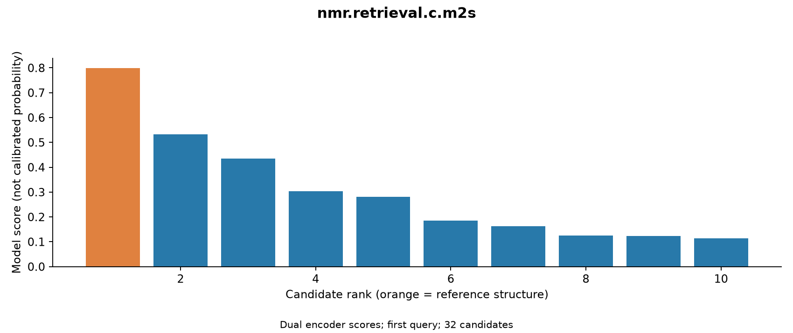</a><figcaption><a href="tasks/nmr-retrieval-c-m2s.html">NMR retrieval: C, m2s</a> <a href="assets/gallery/nmr-retrieval-c-m2s.svg">SVG</a> · <a href="assets/examples/nmr-retrieval-c-m2s.json">Data / 数据</a></figcaption></figure>
<figure><a href="tasks/nmr-generation-c.html">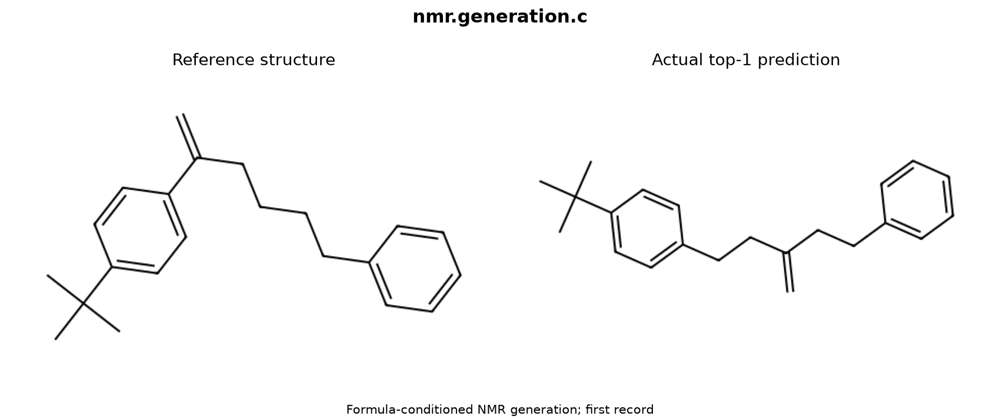</a><figcaption><a href="tasks/nmr-generation-c.html">NMR-to-SMILES generation: C</a> <a href="assets/gallery/nmr-generation-c.svg">SVG</a> · <a href="assets/examples/nmr-generation-c.json">Data / 数据</a></figcaption></figure>
<figure><a href="tasks/nmr-retrieval-hc-s2m.html">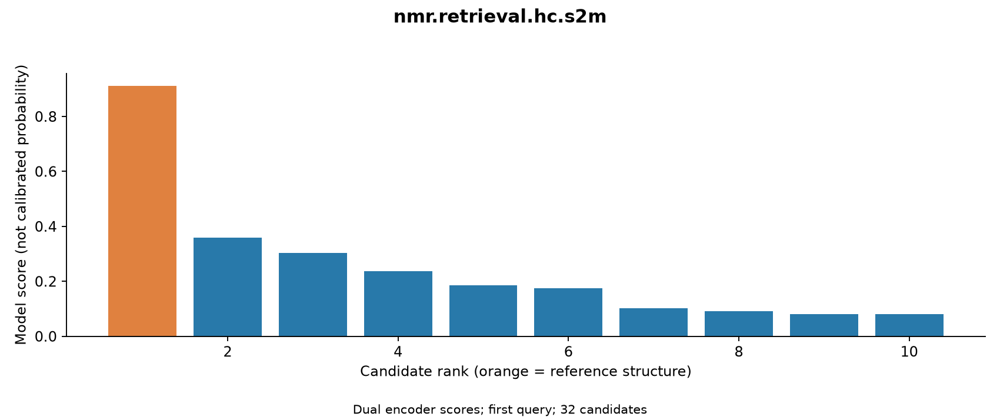</a><figcaption><a href="tasks/nmr-retrieval-hc-s2m.html">NMR retrieval: HC, s2m</a> <a href="assets/gallery/nmr-retrieval-hc-s2m.svg">SVG</a> · <a href="assets/examples/nmr-retrieval-hc-s2m.json">Data / 数据</a></figcaption></figure>
<figure><a href="tasks/nmr-retrieval-hc-m2s.html">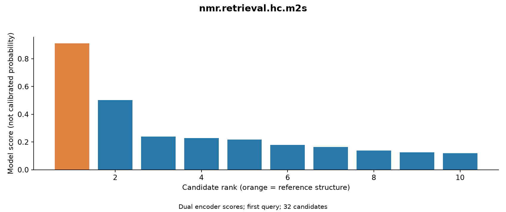</a><figcaption><a href="tasks/nmr-retrieval-hc-m2s.html">NMR retrieval: HC, m2s</a> <a href="assets/gallery/nmr-retrieval-hc-m2s.svg">SVG</a> · <a href="assets/examples/nmr-retrieval-hc-m2s.json">Data / 数据</a></figcaption></figure>
<figure><a href="tasks/nmr-generation-hc.html">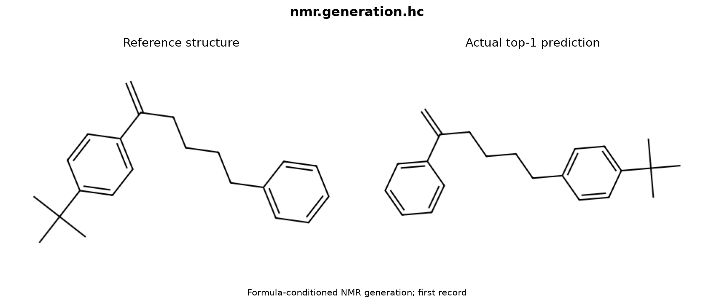</a><figcaption><a href="tasks/nmr-generation-hc.html">NMR-to-SMILES generation: HC</a> <a href="assets/gallery/nmr-generation-hc.svg">SVG</a> · <a href="assets/examples/nmr-generation-hc.json">Data / 数据</a></figcaption></figure>
<figure><a href="tasks/nmr-assignment.html">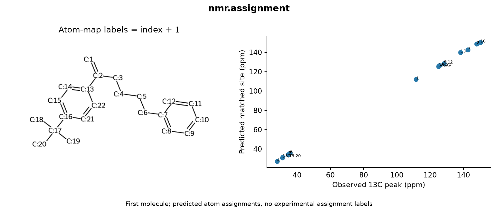</a><figcaption><a href="tasks/nmr-assignment.html">H/C peak-to-atom assignment</a> <a href="assets/gallery/nmr-assignment.svg">SVG</a> · <a href="assets/examples/nmr-assignment.json">Data / 数据</a></figcaption></figure>
<figure><a href="tasks/nmr-solvent_transfer.html">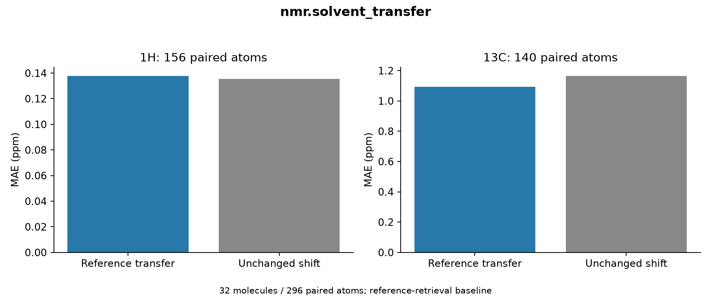</a><figcaption><a href="tasks/nmr-solvent_transfer.html">H/C cross-solvent transfer: experimental-reference baseline</a> <a href="assets/gallery/nmr-solvent_transfer.svg">SVG</a> · <a href="assets/examples/nmr-solvent_transfer.json">Data / 数据</a></figcaption></figure>

## Mass spectrometry

<figure><a href="tasks/ms-forward-glacier.html">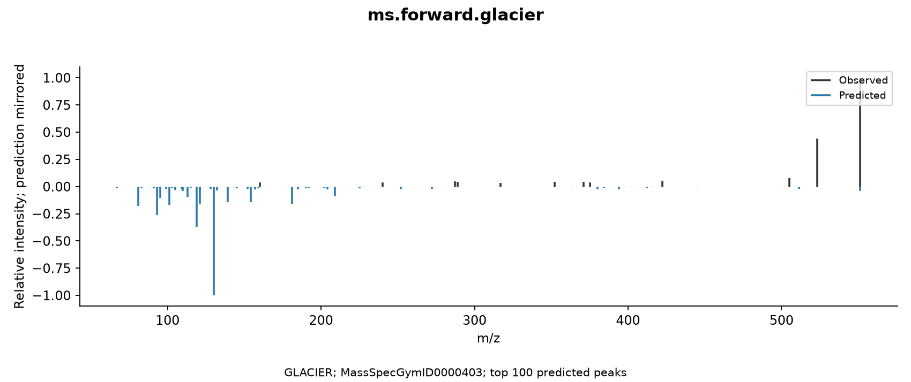</a><figcaption><a href="tasks/ms-forward-glacier.html">Molecule to MS/MS with GLACIER</a> <a href="assets/gallery/ms-forward-glacier.svg">SVG</a> · <a href="assets/examples/ms-forward-glacier.json">Data / 数据</a></figcaption></figure>
<figure><a href="tasks/ms-forward-iceberg.html">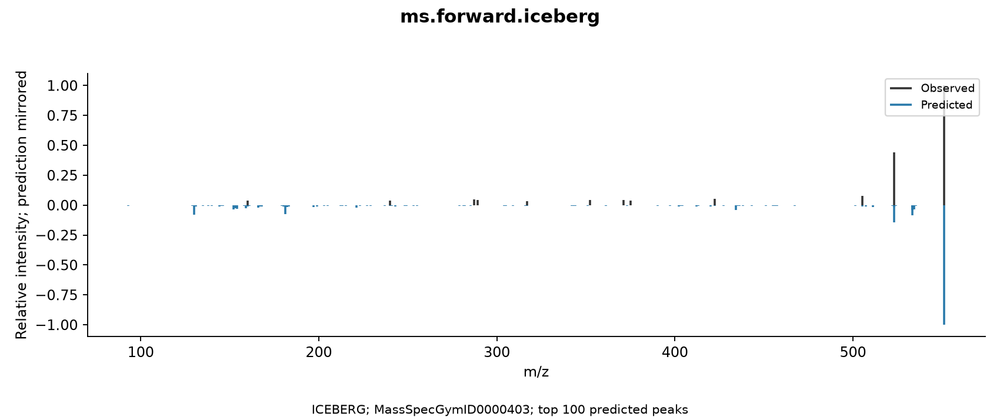</a><figcaption><a href="tasks/ms-forward-iceberg.html">Molecule to MS/MS with ICEBERG</a> <a href="assets/gallery/ms-forward-iceberg.svg">SVG</a> · <a href="assets/examples/ms-forward-iceberg.json">Data / 数据</a></figcaption></figure>
<figure><a href="tasks/ms-annotation-magma.html">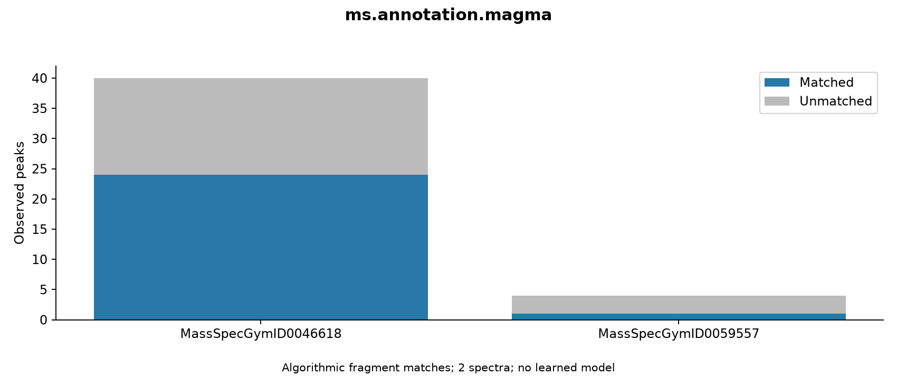</a><figcaption><a href="tasks/ms-annotation-magma.html">MS/MS peak annotation with MAGMa</a> <a href="assets/gallery/ms-annotation-magma.svg">SVG</a> · <a href="assets/examples/ms-annotation-magma.json">Data / 数据</a></figcaption></figure>

## IR / Raman

<figure><a href="tasks/vibrational-gap-ir.html">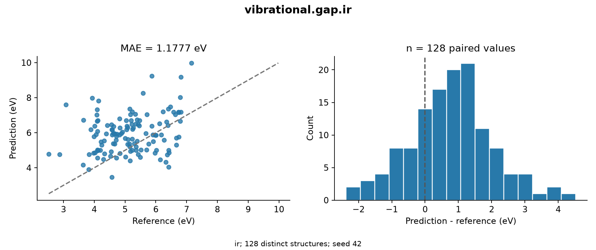</a><figcaption><a href="tasks/vibrational-gap-ir.html">HOMO–LUMO gap prediction: IR</a> <a href="assets/gallery/vibrational-gap-ir.svg">SVG</a> · <a href="assets/examples/vibrational-gap-ir.json">Data / 数据</a></figcaption></figure>
<figure><a href="tasks/vibrational-gap-raman.html">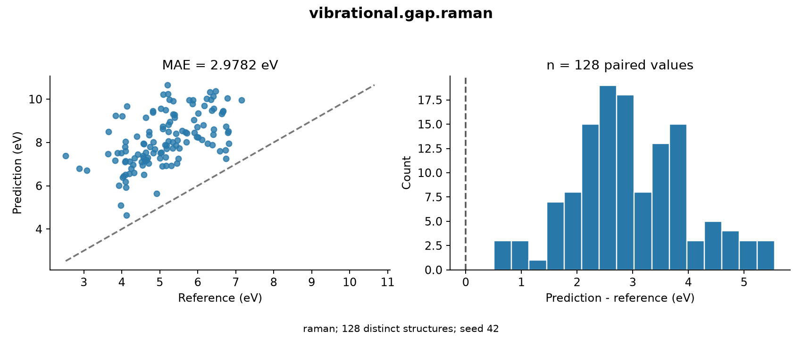</a><figcaption><a href="tasks/vibrational-gap-raman.html">HOMO–LUMO gap prediction: RAMAN</a> <a href="assets/gallery/vibrational-gap-raman.svg">SVG</a> · <a href="assets/examples/vibrational-gap-raman.json">Data / 数据</a></figcaption></figure>
<figure><a href="tasks/vibrational-gap-ir_raman.html">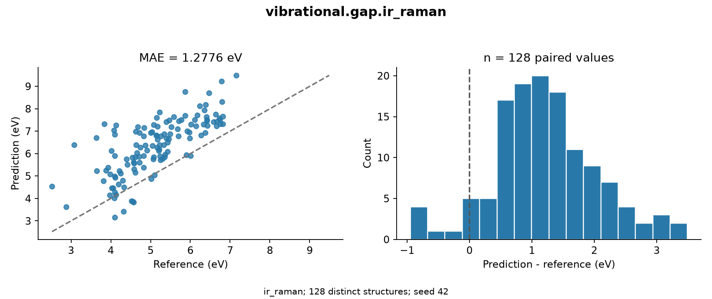</a><figcaption><a href="tasks/vibrational-gap-ir_raman.html">HOMO–LUMO gap prediction: IR_RAMAN</a> <a href="assets/gallery/vibrational-gap-ir_raman.svg">SVG</a> · <a href="assets/examples/vibrational-gap-ir_raman.json">Data / 数据</a></figcaption></figure>
<figure><figcaption><a href="tasks/vibrational-forward.html">Conformer to IR and Raman</a> <a href="assets/gallery/vibrational-forward.svg">SVG</a> · <a href="assets/examples/vibrational-forward.json">Data / 数据</a></figcaption></figure>
<figure><a href="tasks/vibrational-retrieval.html">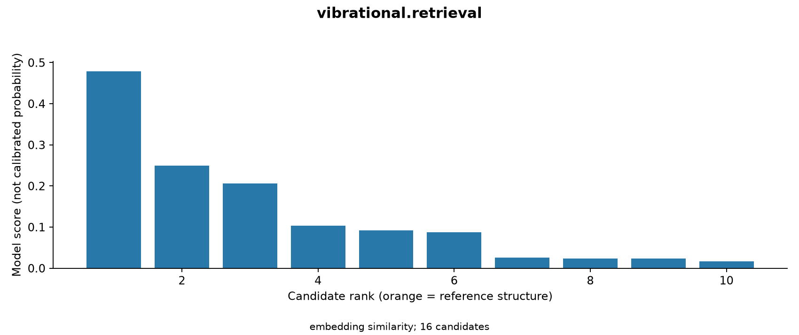</a><figcaption><a href="tasks/vibrational-retrieval.html">Vib2Mol bidirectional retrieval with IR/Raman only</a> <a href="assets/gallery/vibrational-retrieval.svg">SVG</a> · <a href="assets/examples/vibrational-retrieval.json">Data / 数据</a></figcaption></figure>
<figure><a href="tasks/vibrational-generation.html">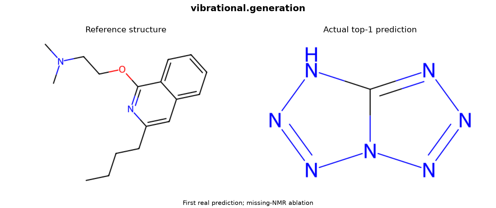</a><figcaption><a href="tasks/vibrational-generation.html">Vib2Mol generation with IR/Raman only</a> <a href="assets/gallery/vibrational-generation.svg">SVG</a> · <a href="assets/examples/vibrational-generation.json">Data / 数据</a></figcaption></figure>
<figure><a href="tasks/spectroscopy-reranking.html">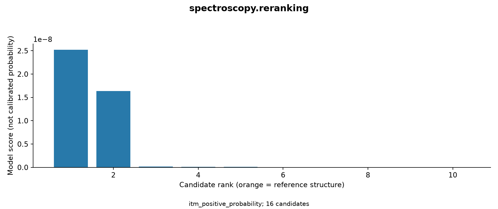</a><figcaption><a href="tasks/spectroscopy-reranking.html">Vib2Mol candidate reranking with IR/Raman only</a> <a href="assets/gallery/spectroscopy-reranking.svg">SVG</a> · <a href="assets/examples/spectroscopy-reranking.json">Data / 数据</a></figcaption></figure>

## Multimodal spectroscopy

<figure><a href="tasks/vibrational-gap-ir_raman_hc.html">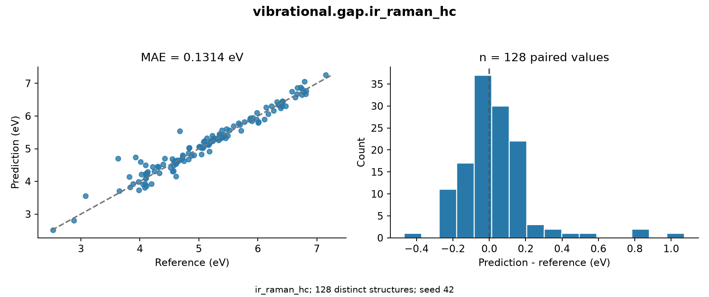</a><figcaption><a href="tasks/vibrational-gap-ir_raman_hc.html">HOMO–LUMO gap prediction: IR + Raman + H/C</a> <a href="assets/gallery/vibrational-gap-ir_raman_hc.svg">SVG</a> · <a href="assets/examples/vibrational-gap-ir_raman_hc.json">Data / 数据</a></figcaption></figure>
<figure><a href="tasks/vibrational-retrieval-hc.html">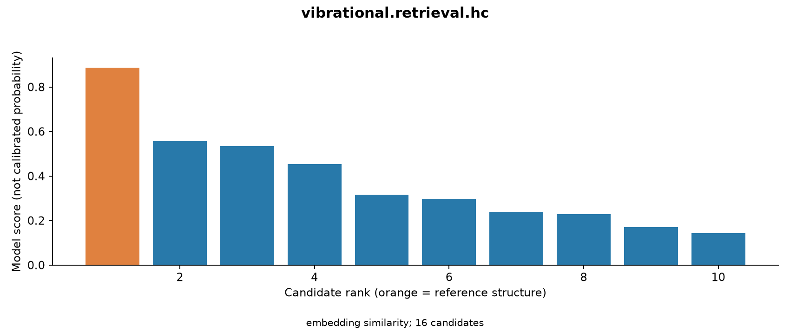</a><figcaption><a href="tasks/vibrational-retrieval-hc.html">Vib2Mol bidirectional retrieval with H/C</a> <a href="assets/gallery/vibrational-retrieval-hc.svg">SVG</a> · <a href="assets/examples/vibrational-retrieval-hc.json">Data / 数据</a></figcaption></figure>
<figure><a href="tasks/vibrational-generation-hc.html">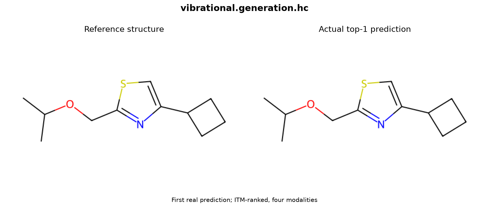</a><figcaption><a href="tasks/vibrational-generation-hc.html">Vib2Mol generation with H/C</a> <a href="assets/gallery/vibrational-generation-hc.svg">SVG</a> · <a href="assets/examples/vibrational-generation-hc.json">Data / 数据</a></figcaption></figure>
<figure><a href="tasks/spectroscopy-reranking-hc.html">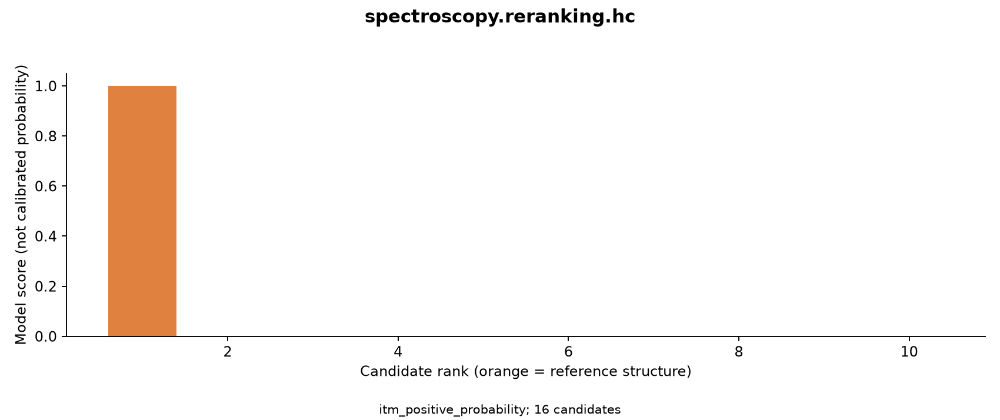</a><figcaption><a href="tasks/spectroscopy-reranking-hc.html">Vib2Mol candidate reranking with H/C</a> <a href="assets/gallery/spectroscopy-reranking-hc.svg">SVG</a> · <a href="assets/examples/spectroscopy-reranking-hc.json">Data / 数据</a></figcaption></figure>

## Dataset distributions

[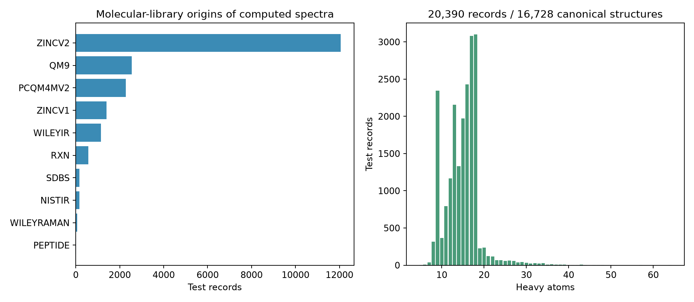](datasets.md)

[SVG](assets/gallery/dataset-openspec-test.svg) · [Data](assets/dataset_audit.json)

[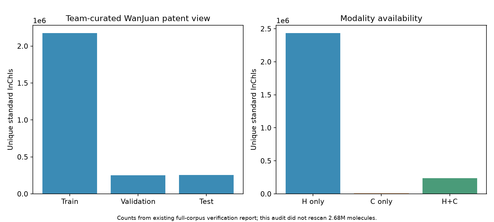](datasets.md)

[SVG](assets/gallery/dataset-patent-corpus.svg) · [Data](assets/dataset_audit.json)

[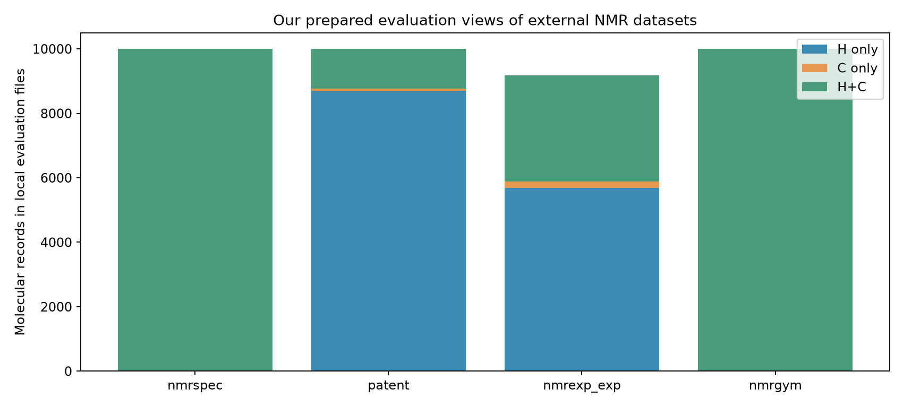](datasets.md)

[SVG](assets/gallery/dataset-nmr-views.svg) · [Data](assets/dataset_audit.json)

[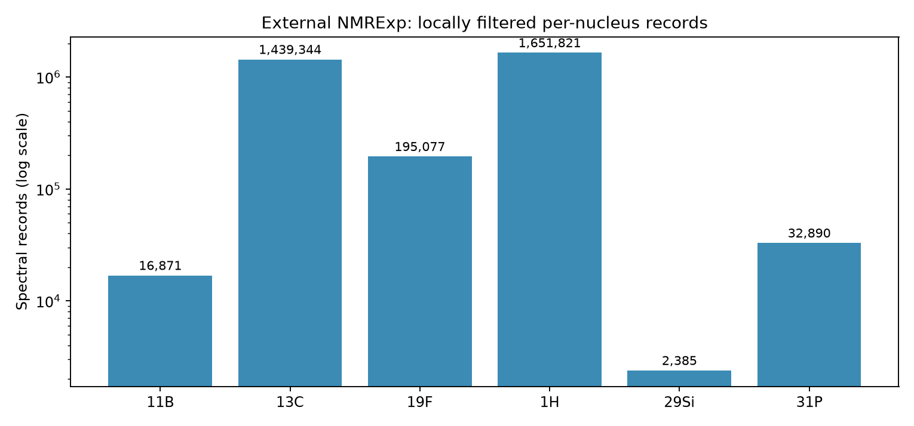](datasets.md)

[SVG](assets/gallery/dataset-nmrexp-nuclei.svg) · [Data](assets/dataset_audit.json)
