# 图集

浏览模型预测、候选结构与清洗后的数据分布。打开任务即可查看输入、输出和教程。

<nav class="oms-gallery-nav" aria-label="Gallery categories"><a href="#gallery-nmr">核磁共振 NMR</a><a href="#gallery-ms">质谱 MS</a><a href="#gallery-vibrational">红外 / 拉曼 IR / Raman</a><a href="#gallery-multimodal">多谱联合</a></nav>

## 核磁共振 NMR

<figure><a href="tasks/nmr-forward-1H.html">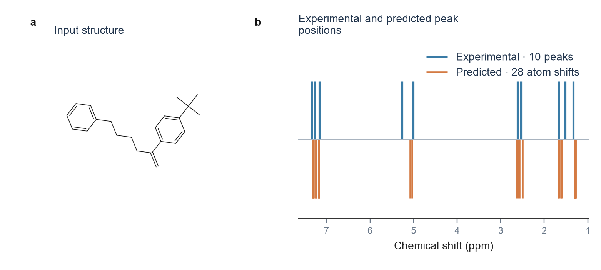</a><figcaption><strong><a href="tasks/nmr-forward-1H.html">结构 → 1H 峰列表</a></strong>实测与预测化学位移，单位为 ppm。<a href="notebooks/nmr-forward-1H.html">Notebook</a> · <a href="assets/gallery/nmr-forward-1H.svg">SVG</a> · <a href="assets/gallery/nmr-forward-1H.png">PNG</a> · <a href="assets/examples/nmr-forward-1H.json">Data / 数据</a></figcaption></figure>
<figure><a href="tasks/nmr-forward-13C.html">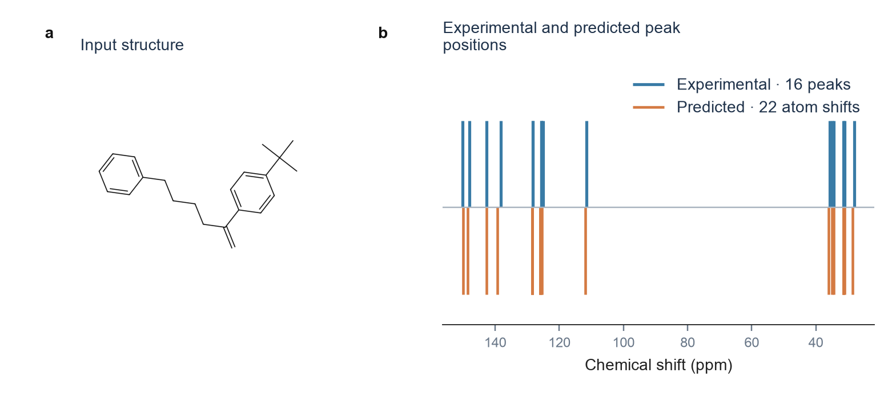</a><figcaption><strong><a href="tasks/nmr-forward-13C.html">结构 → 13C 峰列表</a></strong>实测与预测化学位移，单位为 ppm。<a href="notebooks/nmr-forward-13C.html">Notebook</a> · <a href="assets/gallery/nmr-forward-13C.svg">SVG</a> · <a href="assets/gallery/nmr-forward-13C.png">PNG</a> · <a href="assets/examples/nmr-forward-13C.json">Data / 数据</a></figcaption></figure>
<figure><a href="tasks/nmr-forward-19F.html">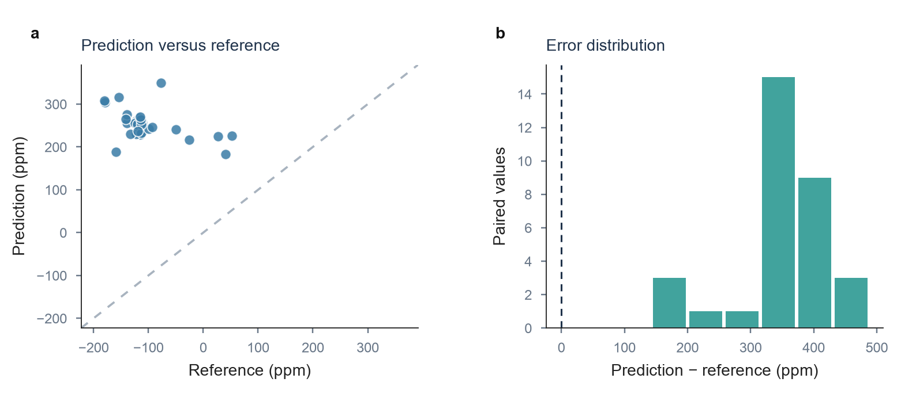</a><figcaption><strong><a href="tasks/nmr-forward-19F.html">结构 → 19F 峰列表</a></strong>预测值与参考值。<a href="notebooks/nmr-forward-19F.html">Notebook</a> · <a href="assets/gallery/nmr-forward-19F.svg">SVG</a> · <a href="assets/gallery/nmr-forward-19F.png">PNG</a> · <a href="assets/examples/nmr-forward-19F.json">Data / 数据</a></figcaption></figure>
<figure><a href="tasks/nmr-forward-31P.html">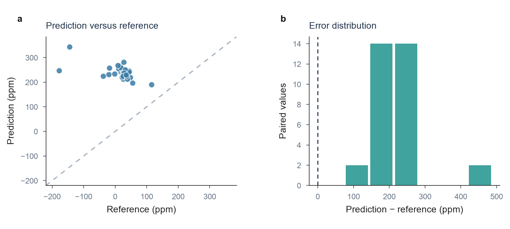</a><figcaption><strong><a href="tasks/nmr-forward-31P.html">结构 → 31P 峰列表</a></strong>预测值与参考值。<a href="notebooks/nmr-forward-31P.html">Notebook</a> · <a href="assets/gallery/nmr-forward-31P.svg">SVG</a> · <a href="assets/gallery/nmr-forward-31P.png">PNG</a> · <a href="assets/examples/nmr-forward-31P.json">Data / 数据</a></figcaption></figure>
<figure><a href="tasks/nmr-forward-11B.html">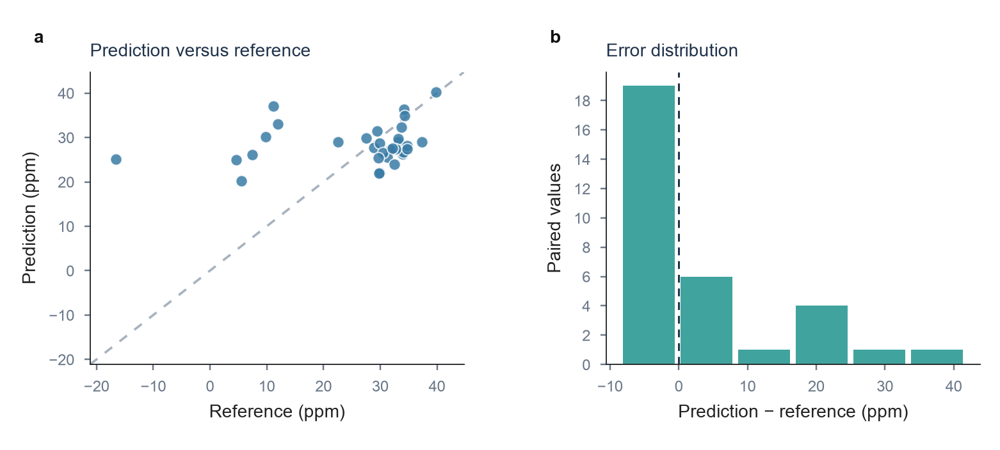</a><figcaption><strong><a href="tasks/nmr-forward-11B.html">结构 → 11B 峰列表</a></strong>预测值与参考值。<a href="notebooks/nmr-forward-11B.html">Notebook</a> · <a href="assets/gallery/nmr-forward-11B.svg">SVG</a> · <a href="assets/gallery/nmr-forward-11B.png">PNG</a> · <a href="assets/examples/nmr-forward-11B.json">Data / 数据</a></figcaption></figure>
<figure><a href="tasks/nmr-forward-29Si.html">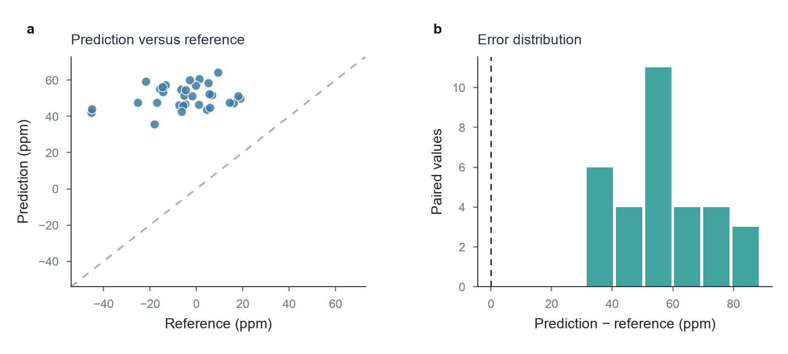</a><figcaption><strong><a href="tasks/nmr-forward-29Si.html">结构 → 29Si 峰列表</a></strong>预测值与参考值。<a href="notebooks/nmr-forward-29Si.html">Notebook</a> · <a href="assets/gallery/nmr-forward-29Si.svg">SVG</a> · <a href="assets/gallery/nmr-forward-29Si.png">PNG</a> · <a href="assets/examples/nmr-forward-29Si.json">Data / 数据</a></figcaption></figure>
<figure><a href="tasks/nmr-retrieval-h-s2m.html">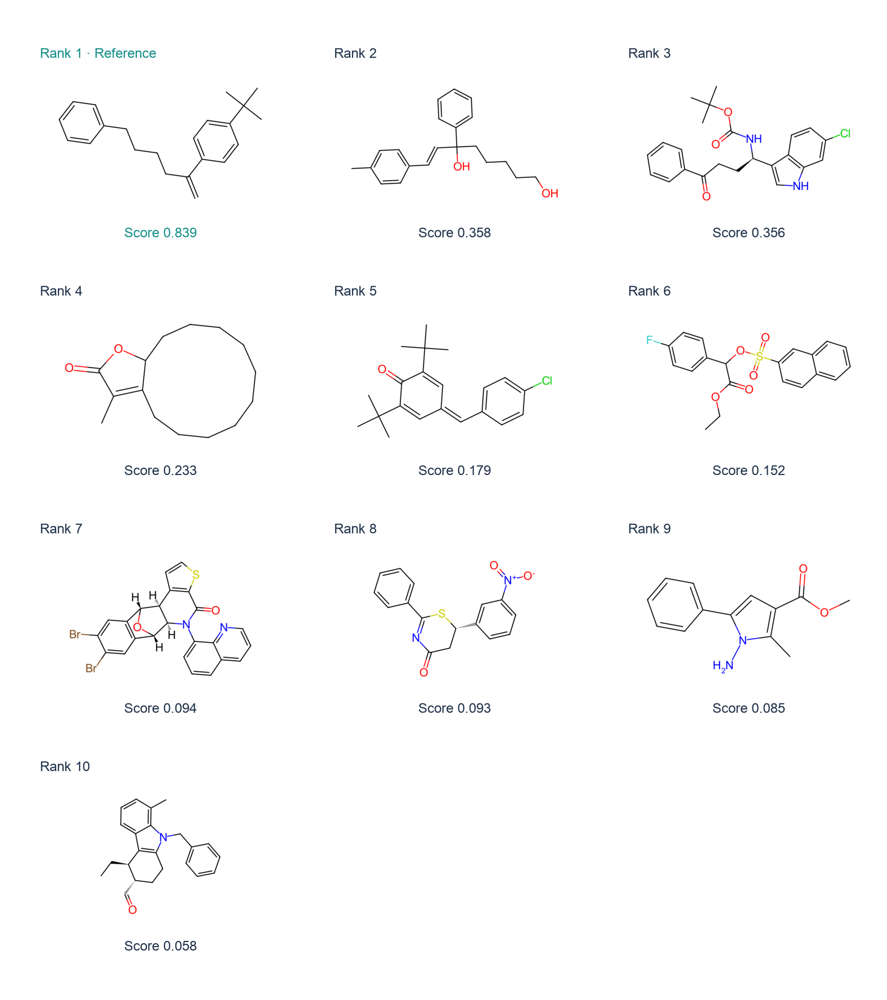</a><figcaption><strong><a href="tasks/nmr-retrieval-h-s2m.html">谱图 → 结构检索 · H</a></strong>按谱相似度排序的分子候选。<a href="notebooks/nmr-retrieval-h-s2m.html">Notebook</a> · <a href="assets/gallery/nmr-retrieval-h-s2m.svg">SVG</a> · <a href="assets/gallery/nmr-retrieval-h-s2m.png">PNG</a> · <a href="assets/examples/nmr-retrieval-h-s2m.json">Data / 数据</a></figcaption></figure>
<figure><a href="tasks/nmr-retrieval-h-m2s.html">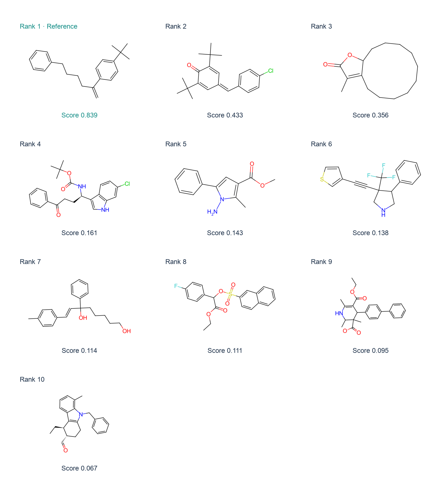</a><figcaption><strong><a href="tasks/nmr-retrieval-h-m2s.html">结构 → 谱图检索 · H</a></strong>按谱相似度排序的分子候选。<a href="notebooks/nmr-retrieval-h-m2s.html">Notebook</a> · <a href="assets/gallery/nmr-retrieval-h-m2s.svg">SVG</a> · <a href="assets/gallery/nmr-retrieval-h-m2s.png">PNG</a> · <a href="assets/examples/nmr-retrieval-h-m2s.json">Data / 数据</a></figcaption></figure>
<figure><a href="tasks/nmr-generation-h.html">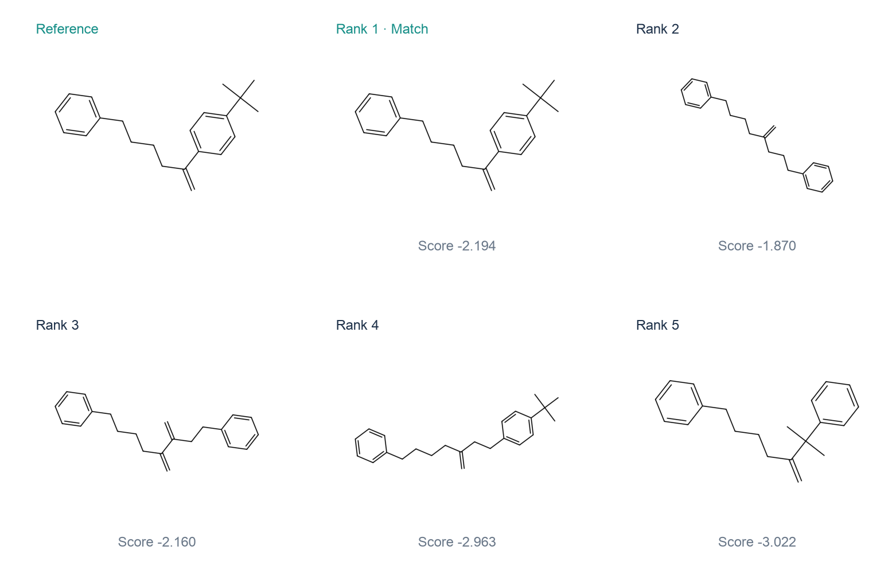</a><figcaption><strong><a href="tasks/nmr-generation-h.html">谱图 → SMILES · H</a></strong>参考结构与生成候选。<a href="notebooks/nmr-generation-h.html">Notebook</a> · <a href="assets/gallery/nmr-generation-h.svg">SVG</a> · <a href="assets/gallery/nmr-generation-h.png">PNG</a> · <a href="assets/examples/nmr-generation-h.json">Data / 数据</a></figcaption></figure>
<figure><a href="tasks/nmr-retrieval-c-s2m.html">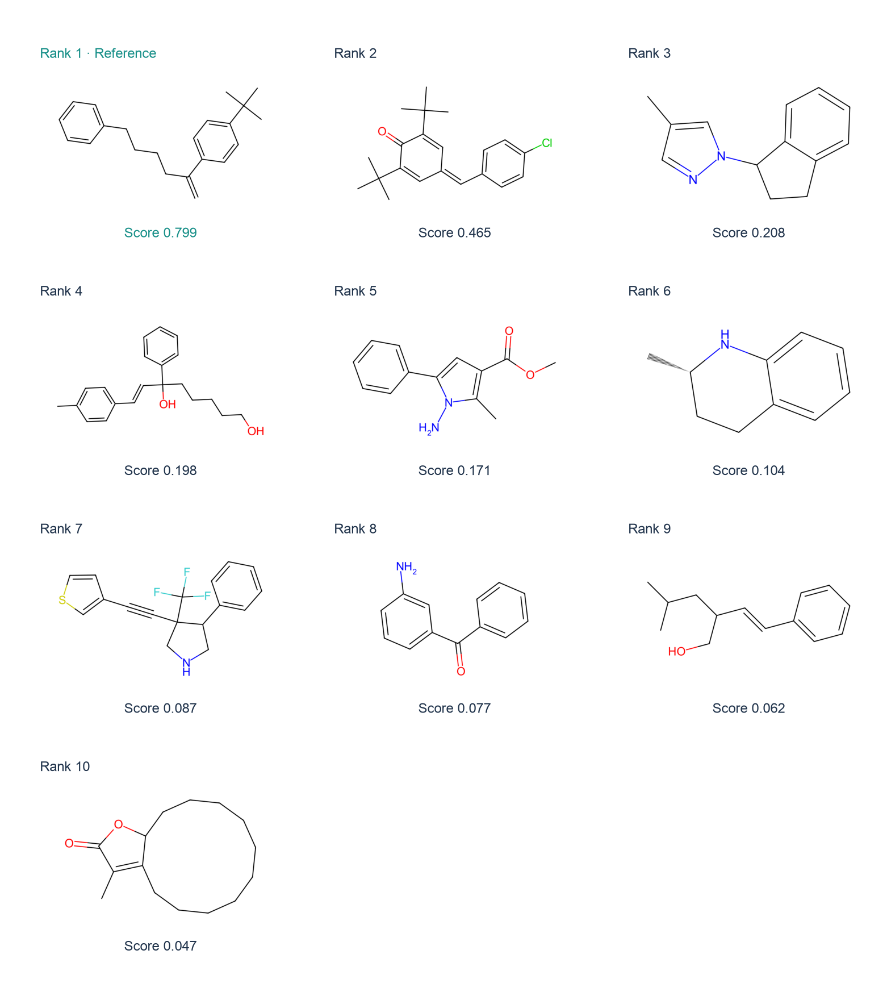</a><figcaption><strong><a href="tasks/nmr-retrieval-c-s2m.html">谱图 → 结构检索 · C</a></strong>按谱相似度排序的分子候选。<a href="notebooks/nmr-retrieval-c-s2m.html">Notebook</a> · <a href="assets/gallery/nmr-retrieval-c-s2m.svg">SVG</a> · <a href="assets/gallery/nmr-retrieval-c-s2m.png">PNG</a> · <a href="assets/examples/nmr-retrieval-c-s2m.json">Data / 数据</a></figcaption></figure>
<figure><a href="tasks/nmr-retrieval-c-m2s.html">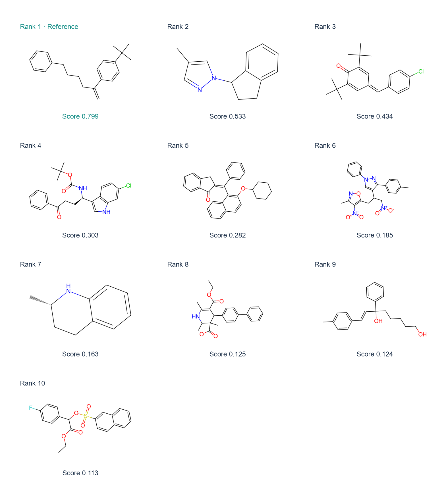</a><figcaption><strong><a href="tasks/nmr-retrieval-c-m2s.html">结构 → 谱图检索 · C</a></strong>按谱相似度排序的分子候选。<a href="notebooks/nmr-retrieval-c-m2s.html">Notebook</a> · <a href="assets/gallery/nmr-retrieval-c-m2s.svg">SVG</a> · <a href="assets/gallery/nmr-retrieval-c-m2s.png">PNG</a> · <a href="assets/examples/nmr-retrieval-c-m2s.json">Data / 数据</a></figcaption></figure>
<figure><a href="tasks/nmr-generation-c.html">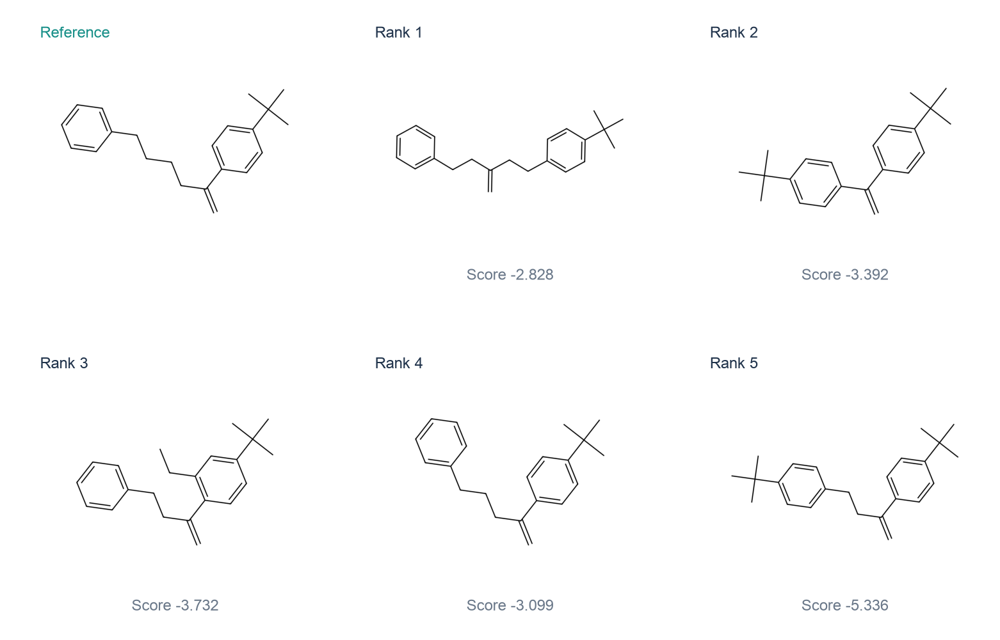</a><figcaption><strong><a href="tasks/nmr-generation-c.html">谱图 → SMILES · C</a></strong>参考结构与生成候选。<a href="notebooks/nmr-generation-c.html">Notebook</a> · <a href="assets/gallery/nmr-generation-c.svg">SVG</a> · <a href="assets/gallery/nmr-generation-c.png">PNG</a> · <a href="assets/examples/nmr-generation-c.json">Data / 数据</a></figcaption></figure>
<figure><a href="tasks/nmr-retrieval-hc-s2m.html">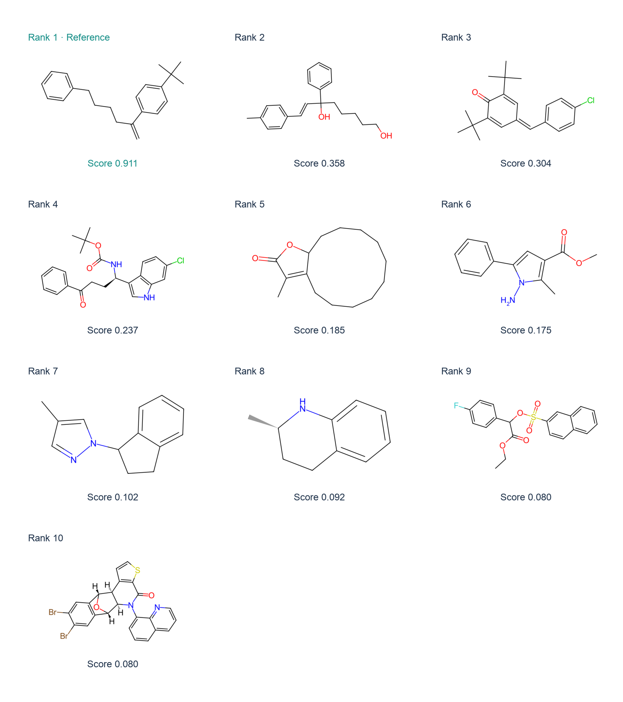</a><figcaption><strong><a href="tasks/nmr-retrieval-hc-s2m.html">谱图 → 结构检索 · HC</a></strong>按谱相似度排序的分子候选。<a href="notebooks/nmr-retrieval-hc-s2m.html">Notebook</a> · <a href="assets/gallery/nmr-retrieval-hc-s2m.svg">SVG</a> · <a href="assets/gallery/nmr-retrieval-hc-s2m.png">PNG</a> · <a href="assets/examples/nmr-retrieval-hc-s2m.json">Data / 数据</a></figcaption></figure>
<figure><a href="tasks/nmr-retrieval-hc-m2s.html">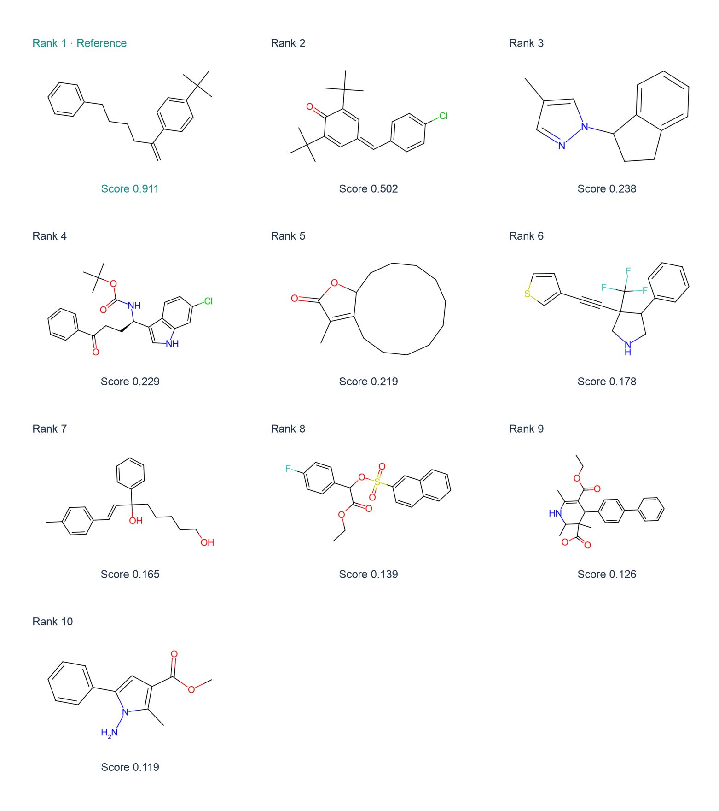</a><figcaption><strong><a href="tasks/nmr-retrieval-hc-m2s.html">结构 → 谱图检索 · HC</a></strong>按谱相似度排序的分子候选。<a href="notebooks/nmr-retrieval-hc-m2s.html">Notebook</a> · <a href="assets/gallery/nmr-retrieval-hc-m2s.svg">SVG</a> · <a href="assets/gallery/nmr-retrieval-hc-m2s.png">PNG</a> · <a href="assets/examples/nmr-retrieval-hc-m2s.json">Data / 数据</a></figcaption></figure>
<figure><a href="tasks/nmr-generation-hc.html">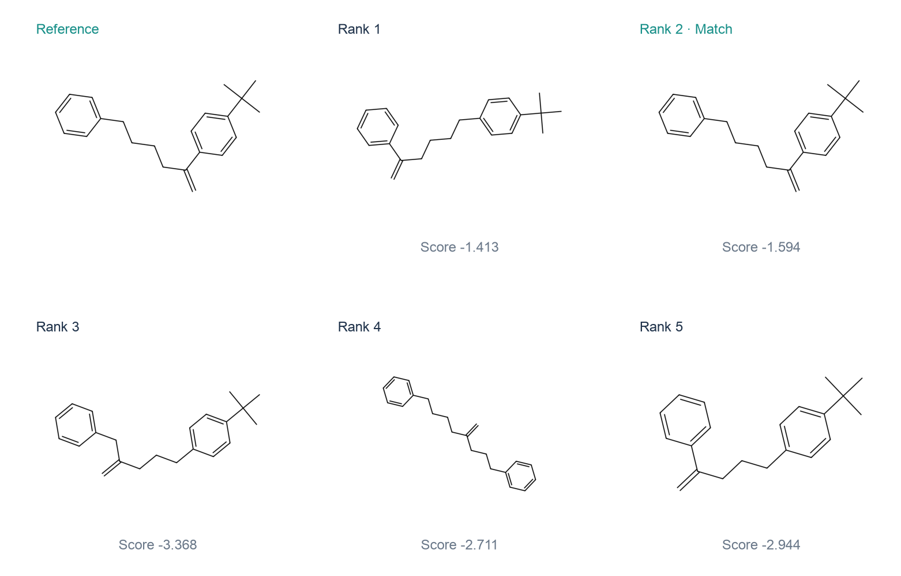</a><figcaption><strong><a href="tasks/nmr-generation-hc.html">谱图 → SMILES · HC</a></strong>参考结构与生成候选。<a href="notebooks/nmr-generation-hc.html">Notebook</a> · <a href="assets/gallery/nmr-generation-hc.svg">SVG</a> · <a href="assets/gallery/nmr-generation-hc.png">PNG</a> · <a href="assets/examples/nmr-generation-hc.json">Data / 数据</a></figcaption></figure>
<figure><a href="tasks/nmr-assignment.html">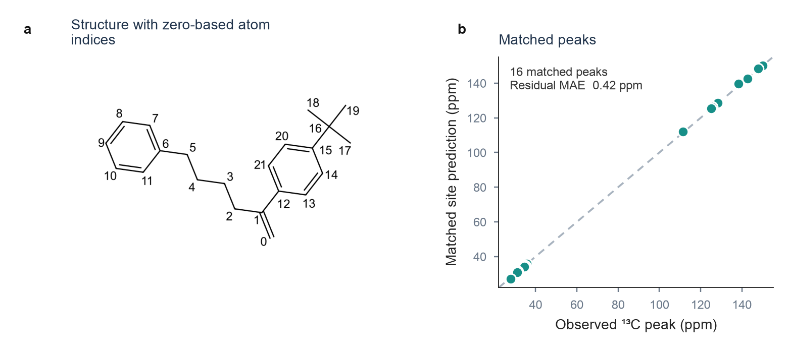</a><figcaption><strong><a href="tasks/nmr-assignment.html">H/C 峰 → 原子指认</a></strong>分子结构上的峰指认。<a href="notebooks/nmr-assignment.html">Notebook</a> · <a href="assets/gallery/nmr-assignment.svg">SVG</a> · <a href="assets/gallery/nmr-assignment.png">PNG</a> · <a href="assets/examples/nmr-assignment.json">Data / 数据</a></figcaption></figure>
<figure><a href="tasks/nmr-solvent_transfer.html">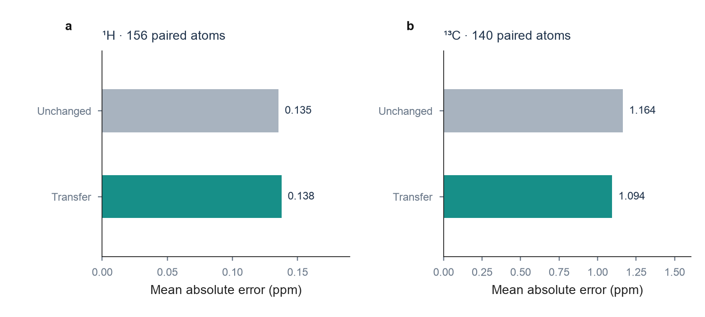</a><figcaption><strong><a href="tasks/nmr-solvent_transfer.html">H/C 跨溶剂位移 · 参考检索基线</a></strong>溶剂间的化学位移迁移。<a href="notebooks/nmr-solvent_transfer.html">Notebook</a> · <a href="assets/gallery/nmr-solvent_transfer.svg">SVG</a> · <a href="assets/gallery/nmr-solvent_transfer.png">PNG</a> · <a href="assets/examples/nmr-solvent_transfer.json">Data / 数据</a></figcaption></figure>

## 质谱 MS

<figure><a href="tasks/ms-forward-glacier.html">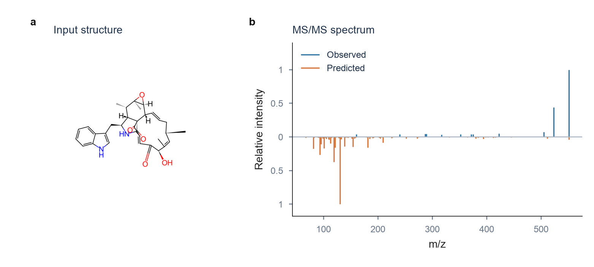</a><figcaption><strong><a href="tasks/ms-forward-glacier.html">分子 → MS/MS（GLACIER）</a></strong>实测与预测 MS/MS 谱。<a href="notebooks/ms-forward-glacier.html">Notebook</a> · <a href="assets/gallery/ms-forward-glacier.svg">SVG</a> · <a href="assets/gallery/ms-forward-glacier.png">PNG</a> · <a href="assets/examples/ms-forward-glacier.json">Data / 数据</a></figcaption></figure>
<figure><a href="tasks/ms-forward-iceberg.html">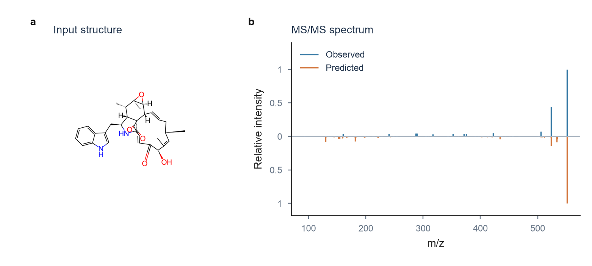</a><figcaption><strong><a href="tasks/ms-forward-iceberg.html">分子 → MS/MS（ICEBERG）</a></strong>实测与预测 MS/MS 谱。<a href="notebooks/ms-forward-iceberg.html">Notebook</a> · <a href="assets/gallery/ms-forward-iceberg.svg">SVG</a> · <a href="assets/gallery/ms-forward-iceberg.png">PNG</a> · <a href="assets/examples/ms-forward-iceberg.json">Data / 数据</a></figcaption></figure>
<figure><a href="tasks/ms-annotation-magma.html">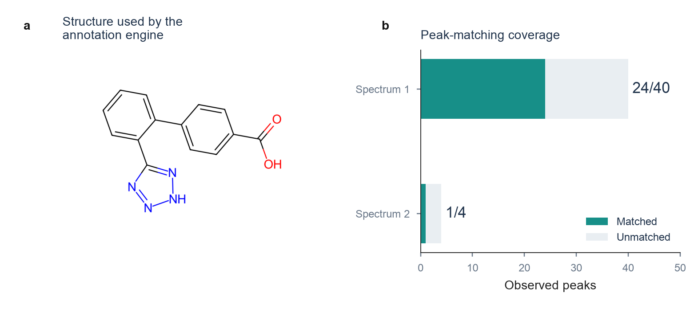</a><figcaption><strong><a href="tasks/ms-annotation-magma.html">MS/MS 峰 → MAGMa 候选碎片标注</a></strong>实测 MS/MS 峰对应的碎片结构。<a href="notebooks/ms-annotation-magma.html">Notebook</a> · <a href="assets/gallery/ms-annotation-magma.svg">SVG</a> · <a href="assets/gallery/ms-annotation-magma.png">PNG</a> · <a href="assets/examples/ms-annotation-magma.json">Data / 数据</a></figcaption></figure>

## 红外 / 拉曼 IR / Raman

<figure><a href="tasks/vibrational-gap-ir.html">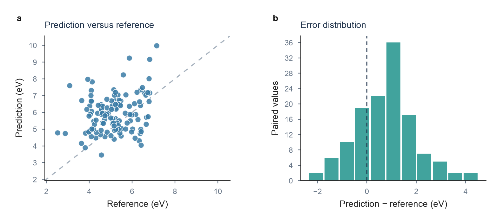</a><figcaption><strong><a href="tasks/vibrational-gap-ir.html">IR → HOMO–LUMO gap</a></strong>预测值与参考值。<a href="notebooks/vibrational-gap-ir.html">Notebook</a> · <a href="assets/gallery/vibrational-gap-ir.svg">SVG</a> · <a href="assets/gallery/vibrational-gap-ir.png">PNG</a> · <a href="assets/examples/vibrational-gap-ir.json">Data / 数据</a></figcaption></figure>
<figure><a href="tasks/vibrational-gap-raman.html">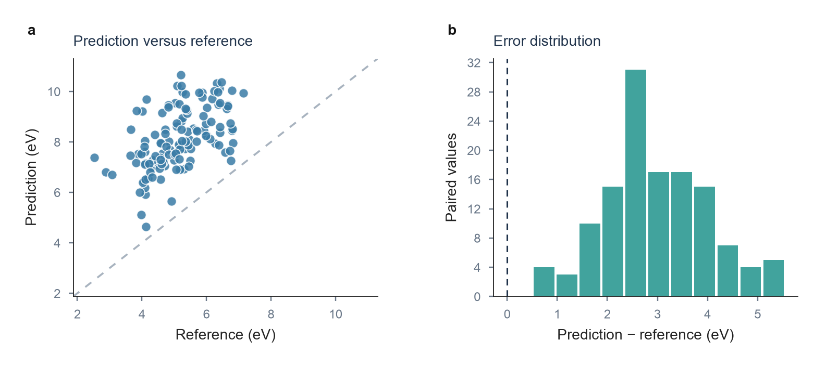</a><figcaption><strong><a href="tasks/vibrational-gap-raman.html">RAMAN → HOMO–LUMO gap</a></strong>预测值与参考值。<a href="notebooks/vibrational-gap-raman.html">Notebook</a> · <a href="assets/gallery/vibrational-gap-raman.svg">SVG</a> · <a href="assets/gallery/vibrational-gap-raman.png">PNG</a> · <a href="assets/examples/vibrational-gap-raman.json">Data / 数据</a></figcaption></figure>
<figure><a href="tasks/vibrational-gap-ir_raman.html">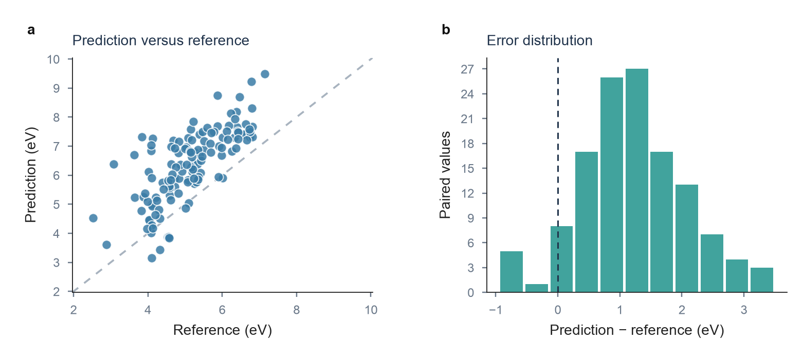</a><figcaption><strong><a href="tasks/vibrational-gap-ir_raman.html">IR_RAMAN → HOMO–LUMO gap</a></strong>预测值与参考值。<a href="notebooks/vibrational-gap-ir_raman.html">Notebook</a> · <a href="assets/gallery/vibrational-gap-ir_raman.svg">SVG</a> · <a href="assets/gallery/vibrational-gap-ir_raman.png">PNG</a> · <a href="assets/examples/vibrational-gap-ir_raman.json">Data / 数据</a></figcaption></figure>
<figure><figcaption><strong><a href="tasks/vibrational-forward.html">构象 → IR / Raman</a></strong>所示分子构象的 IR 与 Raman 光谱。<a href="notebooks/vibrational-forward.html">Notebook</a> · <a href="assets/gallery/vibrational-forward.svg">SVG</a> · <a href="assets/gallery/vibrational-forward.png">PNG</a> · <a href="assets/examples/vibrational-forward.json">Data / 数据</a></figcaption></figure>
<figure><a href="tasks/vibrational-retrieval.html">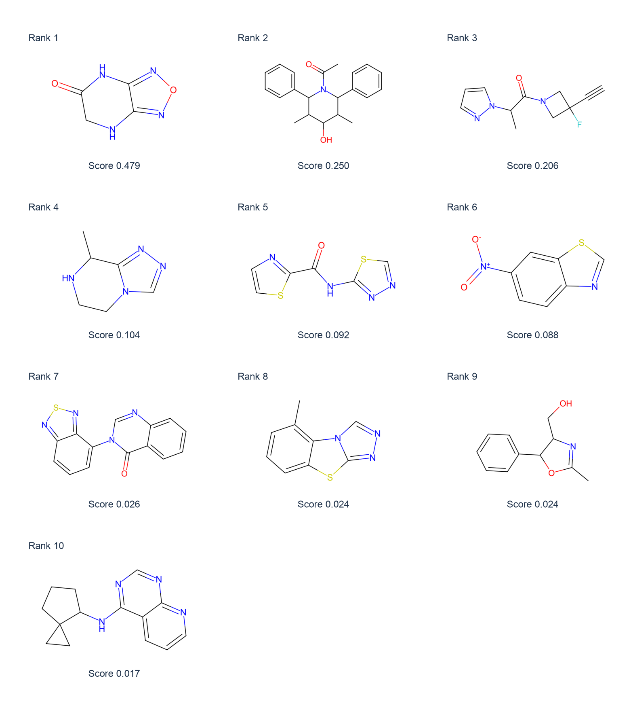</a><figcaption><strong><a href="tasks/vibrational-retrieval.html">IR / Raman → 结构检索</a></strong>按谱相似度排序的分子候选。<a href="notebooks/vibrational-retrieval.html">Notebook</a> · <a href="assets/gallery/vibrational-retrieval.svg">SVG</a> · <a href="assets/gallery/vibrational-retrieval.png">PNG</a> · <a href="assets/examples/vibrational-retrieval.json">Data / 数据</a></figcaption></figure>
<figure><a href="tasks/vibrational-generation.html">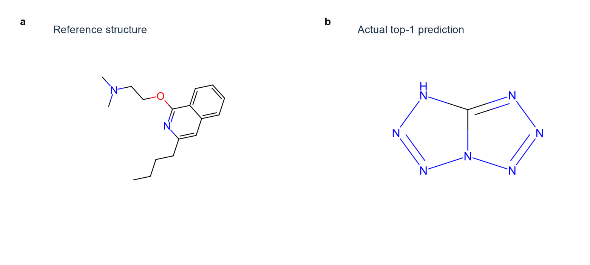</a><figcaption><strong><a href="tasks/vibrational-generation.html">IR / Raman → SMILES</a></strong>参考结构与生成候选。<a href="notebooks/vibrational-generation.html">Notebook</a> · <a href="assets/gallery/vibrational-generation.svg">SVG</a> · <a href="assets/gallery/vibrational-generation.png">PNG</a> · <a href="assets/examples/vibrational-generation.json">Data / 数据</a></figcaption></figure>
<figure><a href="tasks/spectroscopy-reranking.html">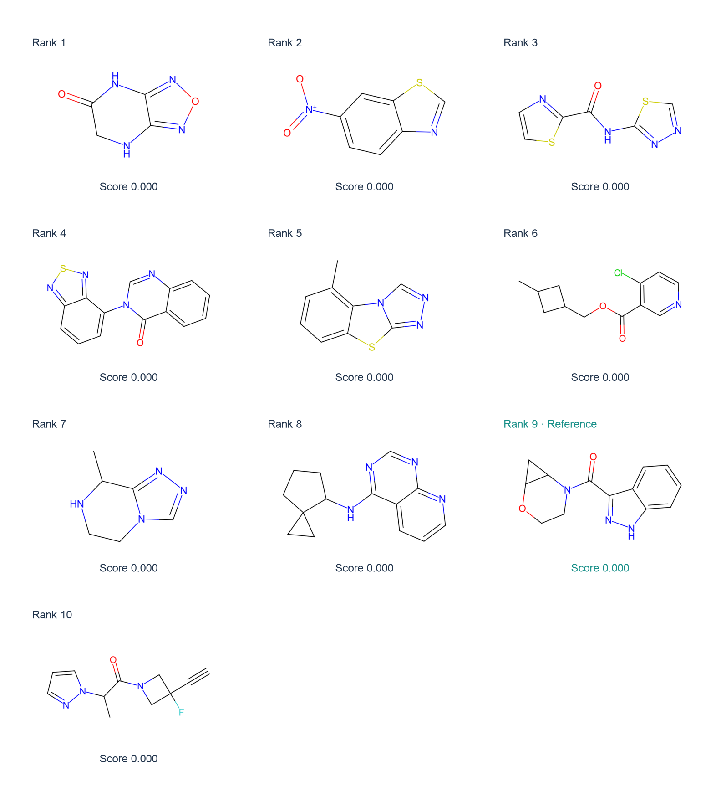</a><figcaption><strong><a href="tasks/spectroscopy-reranking.html">谱图 + 候选结构 → 重排</a></strong>按谱相似度排序的分子候选。<a href="notebooks/spectroscopy-reranking.html">Notebook</a> · <a href="assets/gallery/spectroscopy-reranking.svg">SVG</a> · <a href="assets/gallery/spectroscopy-reranking.png">PNG</a> · <a href="assets/examples/spectroscopy-reranking.json">Data / 数据</a></figcaption></figure>

## 多谱联合

<figure><a href="tasks/vibrational-gap-ir_raman_hc.html">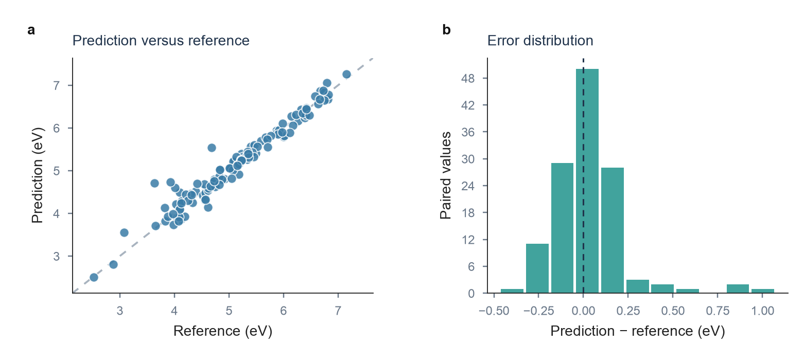</a><figcaption><strong><a href="tasks/vibrational-gap-ir_raman_hc.html">IR + Raman + H/C NMR → HOMO–LUMO gap</a></strong>预测值与参考值。<a href="notebooks/vibrational-gap-ir_raman_hc.html">Notebook</a> · <a href="assets/gallery/vibrational-gap-ir_raman_hc.svg">SVG</a> · <a href="assets/gallery/vibrational-gap-ir_raman_hc.png">PNG</a> · <a href="assets/examples/vibrational-gap-ir_raman_hc.json">Data / 数据</a></figcaption></figure>
<figure><a href="tasks/vibrational-retrieval-hc.html">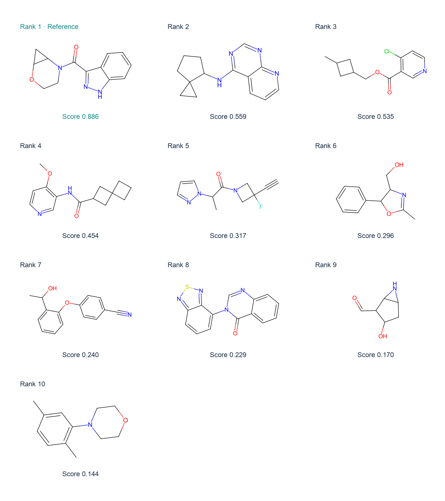</a><figcaption><strong><a href="tasks/vibrational-retrieval-hc.html">IR + Raman + H/C → 结构检索</a></strong>按谱相似度排序的分子候选。<a href="notebooks/vibrational-retrieval-hc.html">Notebook</a> · <a href="assets/gallery/vibrational-retrieval-hc.svg">SVG</a> · <a href="assets/gallery/vibrational-retrieval-hc.png">PNG</a> · <a href="assets/examples/vibrational-retrieval-hc.json">Data / 数据</a></figcaption></figure>
<figure><a href="tasks/vibrational-generation-hc.html">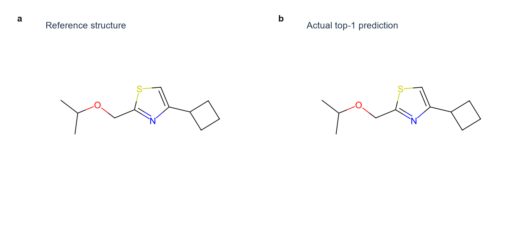</a><figcaption><strong><a href="tasks/vibrational-generation-hc.html">IR + Raman + H/C → SMILES（Xinyu 协议）</a></strong>参考结构与生成候选。<a href="notebooks/vibrational-generation-hc.html">Notebook</a> · <a href="assets/gallery/vibrational-generation-hc.svg">SVG</a> · <a href="assets/gallery/vibrational-generation-hc.png">PNG</a> · <a href="assets/examples/vibrational-generation-hc.json">Data / 数据</a></figcaption></figure>
<figure><a href="tasks/spectroscopy-reranking-hc.html">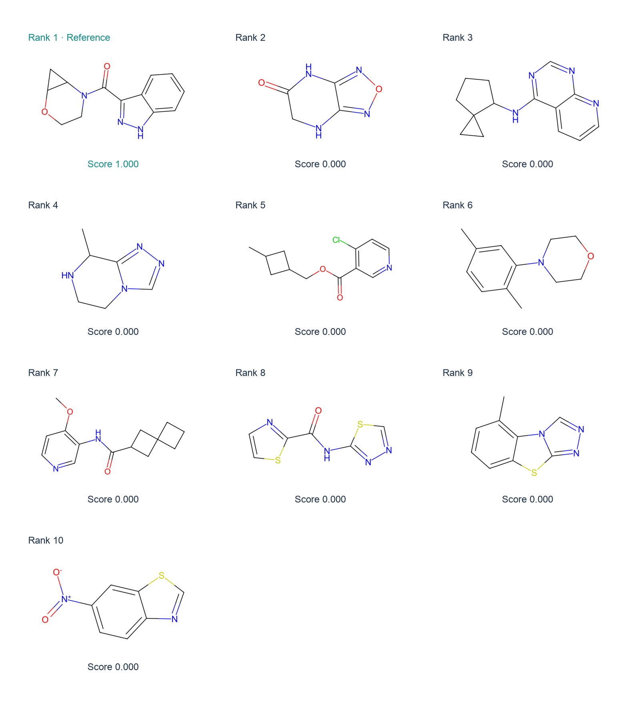</a><figcaption><strong><a href="tasks/spectroscopy-reranking-hc.html">IR + Raman + H/C + 候选 → ITM 重排</a></strong>按谱相似度排序的分子候选。<a href="notebooks/spectroscopy-reranking-hc.html">Notebook</a> · <a href="assets/gallery/spectroscopy-reranking-hc.svg">SVG</a> · <a href="assets/gallery/spectroscopy-reranking-hc.png">PNG</a> · <a href="assets/examples/spectroscopy-reranking-hc.json">Data / 数据</a></figcaption></figure>

[Corpus comparison](corpus-comparison.md) · [Controlled learning evaluations](learning-evidence.md)

## 数据分布

[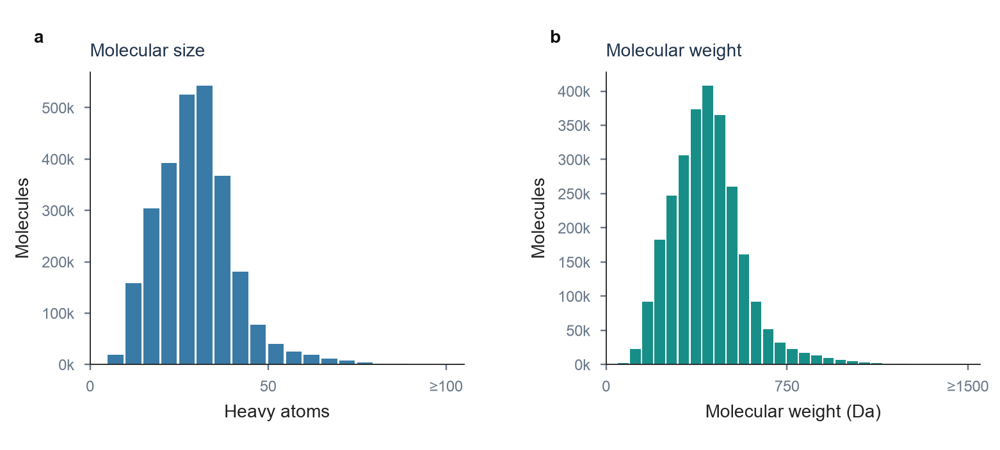](data/index.md)

[SVG](assets/gallery/data-cleaned-nmr.svg) · [Data](assets/cleaned-data-summary.json)

[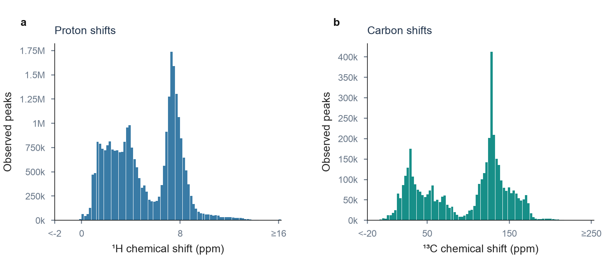](data/index.md)

[SVG](assets/gallery/data-cleaned-nmr-shifts.svg) · [Data](assets/cleaned-data-summary.json)

[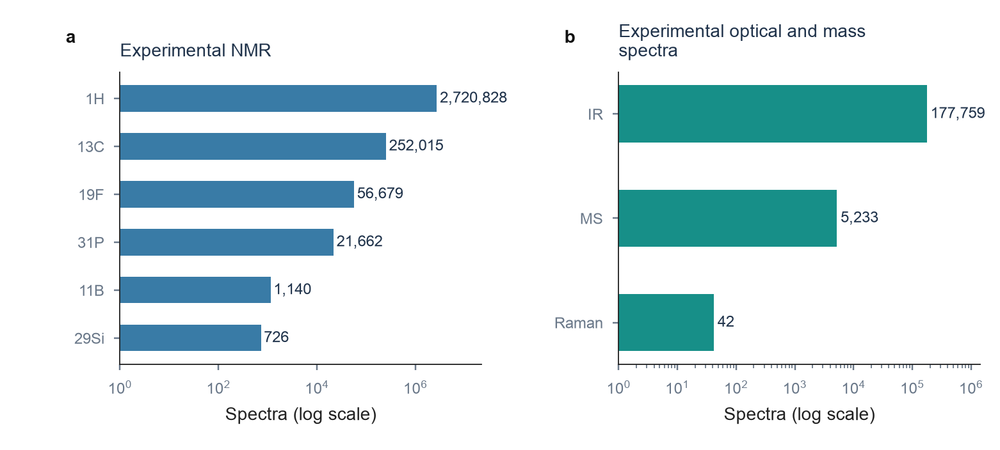](data/index.md)

[SVG](assets/gallery/data-cleaned-experimental.svg) · [Data](assets/cleaned-data-summary.json)

[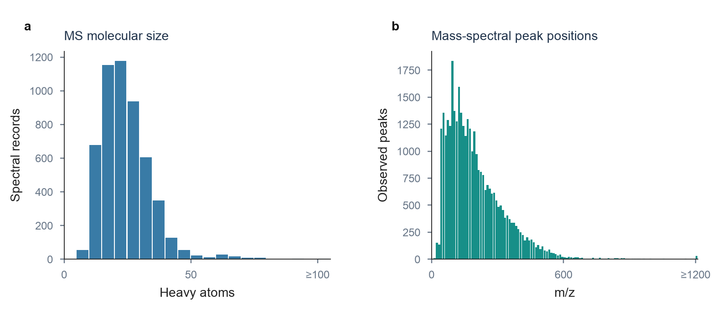](data/index.md)

[SVG](assets/gallery/data-cleaned-ms.svg) · [Data](assets/cleaned-data-summary.json)

[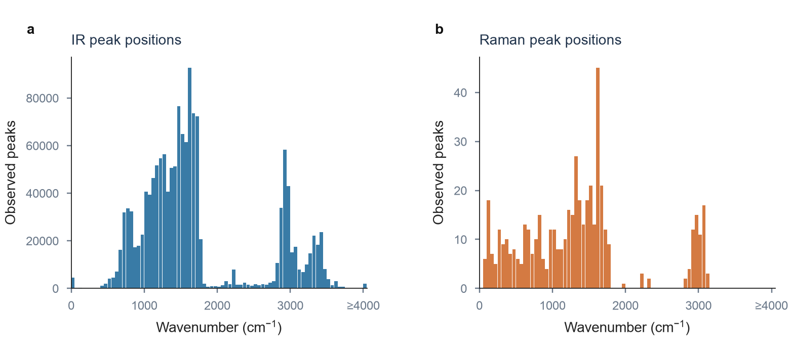](data/index.md)

[SVG](assets/gallery/data-cleaned-vibrational.svg) · [Data](assets/cleaned-data-summary.json)
