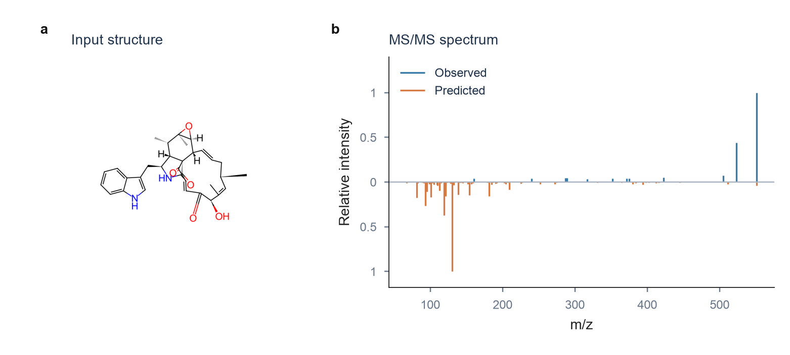

# Examples

These examples show requests and predictions for the three model families. Download the JSON files to reuse the inputs and configure the model paths for your environment.

## [NMR Spectra Harness](nmr.md)

`nmr.forward.13C`

```json
[
  {
    "smiles": "CCO",
    "nucleus": "13C",
    "atom_indices": [
      0,
      1
    ],
    "prediction_ppm": [
      17.774131774902344,
      57.77375793457031
    ]
  }
]
```

## [MS Spectra Harness](ms.md)

`ms.forward.glacier`



## [Vibrational Spectra Harness](vibrational.md)

`vibrational.gap.ir_raman_hc`

```json
{
  "gap_ev": 5.394753155772362,
  "unit": "eV"
}
```


## References

- DeepSeek-AI. DeepSeek Harness: modular agent tools and execution infrastructure. Software repository. Accessed 18 November 2026. [Source](https://github.com/deepseek-ai/deepseek-harness)
- Xu, F., Guo, W., Wang, F., Yao, L., Wang, H., Tang, F., Gao, Z., Zhang, L., E, W., Tian, Z.-Q., et al. Toward a unified benchmark and framework for deep learning-based prediction of nuclear magnetic resonance chemical shifts. Nature Computational Science 5, 292–300 (2025). doi:10.1038/s43588-025-00783-z. [Source](https://doi.org/10.1038/s43588-025-00783-z)
- Wang, R.-X., Wang, R. & Coley, C. W. GLACIER: Rethinking Mass Spectrum Prediction as an Object Detection Problem. NeurIPS 2026. arXiv:2606.29161 (2026). [Source](https://arxiv.org/abs/2606.29161)
- Wang, R., Manjrekar, M., Mahjour, B., Avila-Pacheco, J., et al. Neural Spectral Prediction for Structure Elucidation with Tandem Mass Spectrometry. bioRxiv (2025). doi:10.1101/2025.05.28.656653. [Source](https://doi.org/10.1101/2025.05.28.656653)
- OpenMolSpec contributors. openSpec models and benchmark training workflows. Source archive, v1.0 (2026). [Source](https://github.com/jiaqingxie/openmolspec-studio-frontend/tree/release/openmolspec-v1/documentation/assets/benchmarks)
