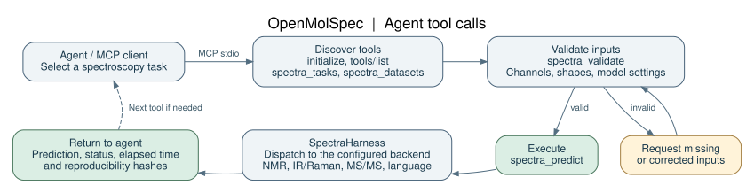

# MCP tools

Connect Spectra Harness to an MCP-compatible agent with the stdio server. Install the MCP extra in the environment used to start the server.

```bash
python -m pip install ".[mcp]"
python -m openmolspec.mcp
```



```json
{
  "mcpServers": {
    "openmolspec": {
      "command": "/path/to/environment/bin/python",
      "args": [
        "-m",
        "openmolspec.mcp"
      ]
    }
  }
}
```

## Tools

| Tool | Purpose | Arguments |
| --- | --- | --- |
| `spectra_tasks` | Discover model tasks and spectral channels. | None |
| `spectra_datasets` | Read dataset cards. | Optional `name` |
| `spectra_validate` | Check input fields and shapes. | `task`, `inputs`, `model_settings` |
| `spectra_predict` | Run a model and return its prediction. | `task`, `inputs`, `model_settings`, `repeats` |

## Example tool call

```json
{
  "tool": "spectra_predict",
  "arguments": {
    "task": "nmr.forward.13C",
    "inputs": {
      "smiles": "CCO"
    },
    "repeats": 2,
    "model_settings": {
      "root": "/path/to/models",
      "python": "/path/to/nmr-env/bin/python"
    }
  }
}
```

The agent reads the predicted shifts from `result.records`. Use `spectra_validate` with the same task, inputs and settings before prediction.

```json
{
  "completed": true,
  "result": {
    "records": [
      {
        "smiles": "CCO",
        "nucleus": "13C",
        "atom_indices": [
          0,
          1
        ],
        "prediction_ppm": [
          17.774131774902344,
          57.77375793457031
        ]
      }
    ]
  },
  "repeat_predictions_equal": true
}
```


## References

- DeepSeek-AI. DeepSeek Harness: modular agent tools and execution infrastructure. Software repository. Accessed 18 November 2026. [Source](https://github.com/deepseek-ai/deepseek-harness)
- Xu, F., Guo, W., Wang, F., Yao, L., Wang, H., Tang, F., Gao, Z., Zhang, L., E, W., Tian, Z.-Q., et al. Toward a unified benchmark and framework for deep learning-based prediction of nuclear magnetic resonance chemical shifts. Nature Computational Science 5, 292–300 (2025). doi:10.1038/s43588-025-00783-z. [Source](https://doi.org/10.1038/s43588-025-00783-z)
- Wang, R.-X., Wang, R. & Coley, C. W. GLACIER: Rethinking Mass Spectrum Prediction as an Object Detection Problem. NeurIPS 2026. arXiv:2606.29161 (2026). [Source](https://arxiv.org/abs/2606.29161)
- Wang, R., Manjrekar, M., Mahjour, B., Avila-Pacheco, J., et al. Neural Spectral Prediction for Structure Elucidation with Tandem Mass Spectrometry. bioRxiv (2025). doi:10.1101/2025.05.28.656653. [Source](https://doi.org/10.1101/2025.05.28.656653)
- OpenMolSpec contributors. openSpec models and benchmark training workflows. Source archive, v1.0 (2026). [Source](https://github.com/jiaqingxie/openmolspec-studio-frontend/tree/release/openmolspec-v1/documentation/assets/benchmarks)
