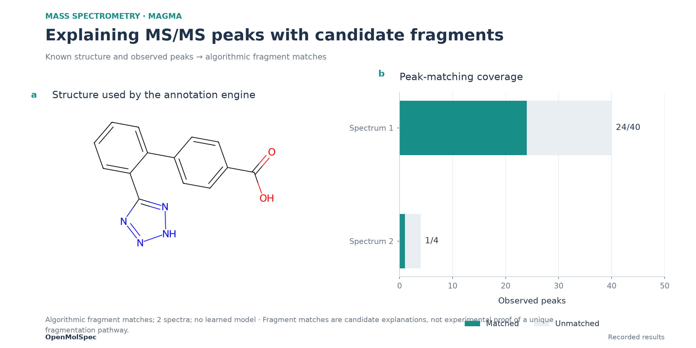

# MS/MS fragment annotation

[Mass coverage on identical observed peaks](../benchmarks/ms.md) compares MechFrag-MS and MAGMa at 10 ppm.

Find molecular fragments that explain the measured MS/MS peaks.

## Expanded spectrum benchmark

MAGMa annotated 64 MassSpecGym test spectra at 10 ppm with a 24-heavy-atom limit. The benchmark checked 70,498 candidate fragment mappings against the parent structure. At least one candidate matched the mass of 49.80% of observed peaks. Fragment identities require independent labels to score structural correctness.

## What goes in

| Field | Meaning |
| --- | --- |
| `smiles / peaks` | Known structure, measured MS/MS peaks [m/z, relative intensity], and adduct. |
| `ppm_tolerance` | Mass tolerance, default 10 ppm; not an NMR chemical-shift tolerance. |

## What comes out

| Field | Meaning |
| --- | --- |
| `peak_annotations` | Candidate fragments, formulas, mass errors and atom/bond indices on engine_smiles. |
| `interpretation` | Candidate fragment structures and matching mass errors. |

## A real recorded example

Inspect the input, prediction and reference for the example below. Download the JSON for the complete numerical arrays and additional examples.



[SVG](../assets/gallery/ms-annotation-magma.svg) · [PNG](../assets/gallery/ms-annotation-magma.png) · [Full input/output JSON](../assets/examples/ms-annotation-magma.json)

<details><summary>Inspect the actual input and output fields</summary>

```json
{
  "input": {
    "smiles": "C1=CC=C(C(=C1)C2=CC=C(C=C2)C(=O)O)C3=NNN=N3",
    "adduct": "[M+H]+",
    "observed_peaks": {
      "length": 40,
      "first_values": [
        [
          86.0158,
          0.14814814814814814
        ],
        [
          87.0237,
          0.16016016016016016
        ],
        [
          97.0082,
          0.06906906906906907
        ],
        [
          98.0159,
          1.0
        ]
      ]
    }
  },
  "sample_id": "MassSpecGymID0046618",
  "output": {
    "engine_smiles": "O=C(O)c1ccc(-c2ccccc2-c2nn[nH]n2)cc1",
    "peak_annotations": {
      "length": 40,
      "first_values": [
        {
          "peak_id": 7,
          "mz": 86.0158,
          "intensity": 0.14814814814814814,
          "matched": true,
          "matched_fragment": {
            "fragment_id": 16256,
            "atom_indices": {
              "length": 7,
              "first_values": [
                7,
                8,
                9,
                10
              ]
            },
            "bond_indices_cut": [
              6,
              13,
              21
            ],
            "bond_atom_pairs_cut": [
              [
                6,
                7
              ],
              [
                13,
                14
              ],
              [
                17,
                13
              ]
            ],
            "formula": "C7H4",
            "matched_mass": 85.007825032,
            "ppm_diff": 8.21707883641277,
            "score": 5.0,
            "h_shift": -3,
            "tree_depth": 3,
            "parent_fragment_ids": [
              130944,
              245632,
              802815
            ],
            "lineage_root_to_fragment": [
              1048575,
              262016,
              245632,
              16256
            ]
          }
        },
        {
          "peak_id": 8,
          "mz": 87.0237,
          "intensity": 0.16016016016016016,
          "matched": true,
          "matched_fragment": {
            "fragment_id": 786554,
            "atom_indices": {
              "length": 7,
              "first_values": [
                1,
                3,
                4,
                5
              ]
            },
            "bond_indices_cut": [
              0,
              1,
              6
            ],
            "bond_atom_pairs_cut": [
              [
                0,
                1
              ],
              [
                1,
                2
              ],
              [
                6,
                7
              ]
            ],
            "formula": "C7H4",
            "matched_mass": 86.015650064,
            "ppm_diff": 8.992363592338872,
            "score": 5.0,
            "h_shift": -2,
            "tree_depth": 3,
            "parent_fragment_ids": [
              786555,
              786558,
              1048570
            ],
            "lineage_root_to_fragment": [
              1048575,
              1048574,
              1048570,
              786554
            ]
          }
        },
        {
          "peak_id": 10,
          "mz": 97.0082,
          "intensity": 0.06906906906906907,
          "matched": true,
          "matched_fragment": {
            "fragment_id": 8160,
            "atom_indices": {
              "length": 8,
              "first_values": [
                5,
                6,
                7,
                8
              ]
            },
            "bond_indices_cut": [
              4,
              12,
              17
            ],
            "bond_atom_pairs_cut": [
              [
                4,
                5
              ],
              [
                12,
                13
              ],
              [
                6,
                18
              ]
            ],
            "formula": "C8H5",
            "matched_mass": 96.0,
            "ppm_diff": 9.620291666697275,
            "score": 6.0,
            "h_shift": -5,
            "tree_depth": 3,
            "parent_fragment_ids": [
              262112,
              532479,
              794607
            ],
            "lineage_root_to_fragment": [
              1048575,
              1048559,
              794607,
              8160
            ]
          }
        },
        {
          "peak_id": 11,
          "mz": 98.0159,
          "intensity": 1.0,
          "matched": true,
          "matched_fragment": {
            "fragment_id": 786936,
            "atom_indices": {
              "length": 8,
              "first_values": [
                3,
                4,
                5,
                6
              ]
            },
            "bond_indices_cut": [
              2,
              8,
              20
            ],
            "bond_atom_pairs_cut": [
              [
                1,
                3
              ],
              [
                8,
                9
              ],
              [
                12,
                7
              ]
            ],
            "formula": "C8H5",
            "matched_mass": 97.007825032,
            "ppm_diff": 8.23145967595748,
            "score": 6.0,
            "h_shift": -4,
            "tree_depth": 3,
            "parent_fragment_ids": [
              786943,
              790520,
              1048056
            ],
            "lineage_root_to_fragment": [
              1048575,
              1048568,
              1048056,
              786936
            ]
          }
        }
      ]
    }
  }
}
```

</details>

## Actual evaluation results

| Dataset / scope | Model / variant | Metric | Value |
| --- | --- | --- | ---: |
| recorded evaluation | recorded model | matched_peak_fraction | 0.568182 |
| recorded evaluation | recorded model | annotated_spectra | 2 |
| recorded evaluation | recorded model | checked_fragments | 1534 |

## Model and method

MAGMa enumerates fragments of the molecular graph and matches their masses to the measured peaks. Each annotation contains its fragment formula, mass error and atom/bond indices.

Report matched-peak coverage and mass errors in ppm.

## Reproduce

[Notebook with executed figures](../notebooks/ms-annotation-magma.ipynb) · [Quick Start](../quickstart.md)

```bash
python -m openmolspec_bench run --workspace /path/to/OpenMolSpec \
  --tasks ms.annotation.magma --limit 8 --output results/ms-annotation-magma-new.json
```

## Call and adapt this model

```python
from openmolspec.benchmark import Benchmark
benchmark = Benchmark(workspace='/path/to/workspace',
    python='/path/to/task-env/bin/python',
    magma_source='/path/to/MAGMA-source',
    ms_input_csv='/path/to/measured-ms.csv',
    ms_metadata_tsv='/path/to/acquisition-metadata.tsv')
result = benchmark.run('ms.annotation.magma', output='new-algorithm-results.json', limit=32)
```

This task is an algorithmic workflow. Adapt its reference library or matching rules; there are no neural parameters or training loss. The task’s matching objective and provenance are described above.

<details><summary>Source reports and SHA-256 fingerprints</summary>

- [magma_real_test_verified_20261115.json](https://github.com/jiaqingxie/openmolspec-studio-frontend/blob/release/openmolspec-v1/results/magma_real_test_verified_20261115.json) — SHA-256 `e65563b00863389105f5eae392d493167d693ac4ca38b9f1abfbd40942d1946b`

</details>


[Model implementation / 模型实现](https://github.com/Dsadd4/MassSpecGym-MAGMA-annotation) · [Model review / 模型检查](../model-audit.md)

## References

- Ridder, L., van der Hooft, J. J. J. & Verhoeven, S. Automatic Compound Annotation from Mass Spectrometry Data Using MAGMa. Mass Spectrometry 3, S0033 (2014). doi:10.5702/massspectrometry.S0033. [Source](https://doi.org/10.5702/massspectrometry.S0033)
- Bushuiev, R., Bushuiev, A., de Jonge, N. F., Young, A., et al. MassSpecGym: A benchmark for the discovery and identification of molecules. Advances in Neural Information Processing Systems 37, Datasets and Benchmarks Track (2024). arXiv:2410.23326. [Source](https://arxiv.org/abs/2410.23326)
