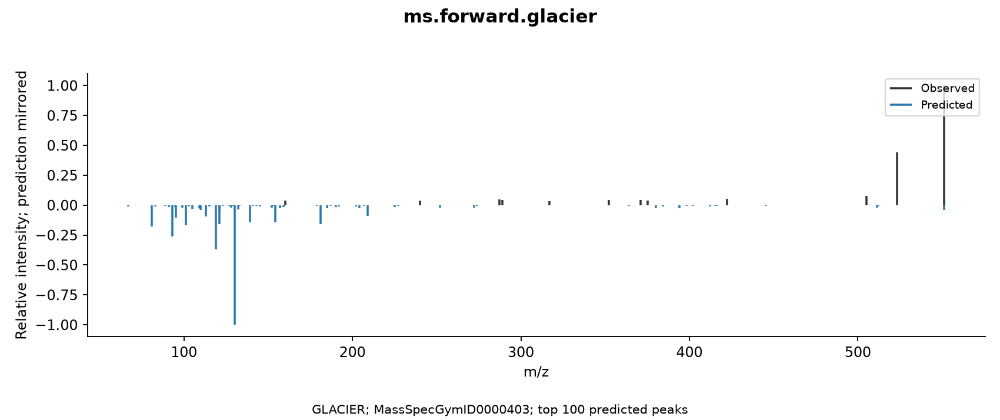

# 分子 → MS/MS（GLACIER）

给定分子结构、加合物、碰撞能和仪器，预测 MS/MS 的 m/z–强度峰列表。

## 当前结论

采用作者接口并显式提供采集条件，方法适配合理；31 条评分不足以证明广泛精度。先核查协议与训练重叠，再决定微调。

## 输入是什么

| Field | Meaning |
| --- | --- |
| `smiles / adduct` | 分子结构与记录中的离子/加合物类型，例如 [M+H]+ 或 [M+Na]+。 |
| `collision_energy / instrument` | 发布模型支持的实际碰撞能与仪器条件；不能补造缺失值。 |
| `precursor_mz` | 记录中的前体 m/z；按作者接口解释输入条件。 |

## 输出是什么

| Field | Meaning |
| --- | --- |
| `predicted_peaks` | m/z 与相对强度对；图中显示预测强度最高的 100 个峰。 |
| `similarity` | 与全部实测参考峰比较的余弦/熵相似度，同时统计跳过记录。 |

## 真实运行案例

下面展示记录中的第一例，不按结果好坏筛选。长数组预览会标明完整长度；完整数值可下载证据 JSON。参考标签与模型输入分开保留。

```json
{
  "input": {
    "smiles": "C/C1=C\\[C@@H](C)C/C=C/[C@H]2[C@@H]3O[C@]3(C)[C@@H](C)[C@H]3[C@H](Cc4c[nH]c5ccccc45)NC(=O)[C@]32C(=O)/C=C/C(=O)[C@@H]1O",
    "adduct": "[M+Na]+",
    "collision_energy": "35.0",
    "instrument": "Orbitrap",
    "precursor_mz": 551.2511
  },
  "sample_id": "MassSpecGymID0000403",
  "output": {
    "predicted_peaks_top100": {
      "length": 100,
      "first_values": [
        [
          67.0542266590246,
          0.011822191998362541
        ],
        [
          81.06987672302459,
          0.16171321272850037
        ],
        [
          83.0491412790246,
          0.008260359987616539
        ],
        [
          83.0855267569754,
          0.0016736892284825444
        ]
      ]
    }
  },
  "reference": {
    "observed_peaks": {
      "length": 12,
      "first_values": [
        [
          160.0366,
          0.03803803803803804
        ],
        [
          240.0992,
          0.03803803803803804
        ],
        [
          287.1152,
          0.04704704704704705
        ],
        [
          289.0945,
          0.042042042042042045
        ]
      ]
    }
  },
  "metrics": {
    "cosine_similarity": 0.029863639020685673,
    "entropy_similarity": 0.03731316551570296,
    "predicted_nonzero_bins": 100,
    "reference_nonzero_bins": 12
  }
}
```



[SVG](../assets/gallery/ms-forward-glacier.svg) · [PNG](../assets/gallery/ms-forward-glacier.png) · [Full input/output JSON](../assets/examples/ms-forward-glacier.json)

## 实际评测结果

| Dataset / scope | Model / variant | Metric | Value |
| --- | --- | --- | ---: |
| recorded evaluation | recorded model | cosine_similarity | 0.485717 |
| recorded evaluation | recorded model | entropy_similarity | 0.41328 |

样本量和候选池随每次运行记录。图可能展示单个分子，表格是来源实验的实际汇总，不能混为同一统计范围。

## 模型与方法

直接加载作者发布的冻结 checkpoint，调用 predict_mol。用我们测试 CSV 中的实测谱评分，并按谱图 ID、规范分子结构和加合物核对采集元数据。默认每个分子只取一条谱，避免多碰撞能重复分子主导平均值。

m/z 单位为 Da。用 0–1500 Da、150000 个 bin，bin 内 max pooling，保留预测强度最高的 100 个 bin，计算与全部实测峰的余弦相似度和熵相似度。缺少碰撞能或仪器时不补造条件，明确跳过。

## 复现方式

[Notebook with executed figures](../notebooks/ms-forward-glacier.ipynb) · [Quick Start](../quickstart.md)

```bash
python -m openmolspec_bench run --workspace /path/to/OpenMolSpec \
  --tasks ms.forward.glacier --limit 8 --output results/ms-forward-glacier-new.json
```

## 边界与来源

该口径保留全部实测峰，不等同于只保留可指认峰的 benchmark。预训练使用 MassSpecGym，当前自建划分与权重训练集重叠尚未独立核验；旧权重的仪器/加合物训练覆盖元数据也不完整。

- [ms_glacier_32_molecules_20261116.json](https://github.com/jiaqingxie/openmolspec-studio-frontend/blob/release/openmolspec-v1/results/ms_glacier_32_molecules_20261116.json) — SHA-256 `a4d084c72c7df758f49500942cdfcea91047cb3da3616b9adb93b5bc6e8470c6`

[Original model / 原模型](https://github.com/coleygroup/ms-pred) · [Model review / 模型检查](../model-audit.md)
