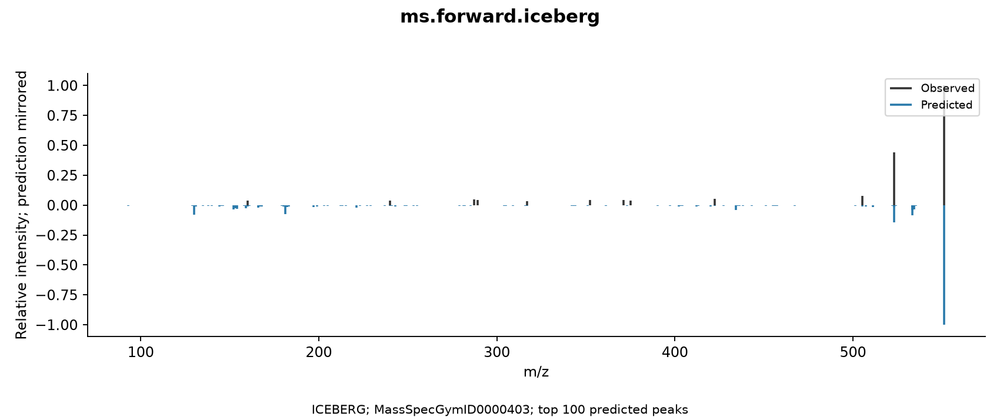
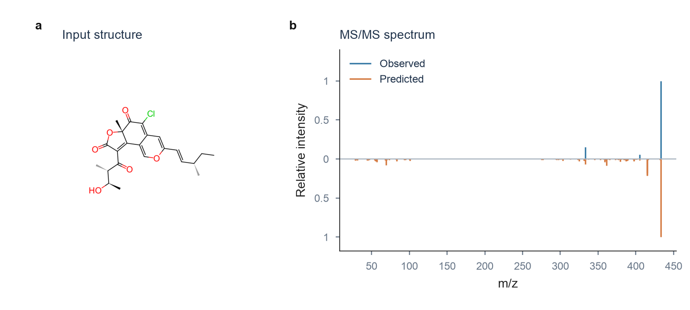
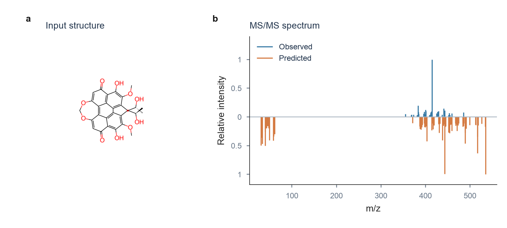

# MS/MS prediction with ICEBERG

Predict the fragment masses and intensities of a molecule under specified acquisition conditions.

## Independent confirmation

Settings were fixed by five-fold validation on 280 scored structures. All 384 original test structures were excluded from the confirmation sample. On the same 875 scored molecules out of 1,024 additional MassSpecGym structures, mean cosine was 0.5118 before calibration and 0.5175 after calibration. The paired 95% interval for the change was [+0.0018, +0.0096]. The 149 remaining structures were skipped. The released predictor applies the selected calibration for the tested acquisition conditions and structures with up to 40 heavy atoms. Use one CPU thread for confirmation and set `author_baseline=True` in the SDK to reproduce the original output. [Paired comparison](https://github.com/jiaqingxie/openmolspec-studio-frontend/blob/release/openmolspec-v1/results/forward_confirmation_iceberg.json)

## Validation and held-out comparison

ICEBERG was evaluated with 189 combinations of intensity scaling, precursor weighting and retained peak count. Of 384 sampled structures per MassSpecGym split, 280 validation and 327 test structures produced a scored prediction. On those same 327 test structures, mean cosine was 0.5050 for the default and 0.5112 for the validation-selected setting. The paired 95% interval for the difference was [-0.0004, 0.0127]. The original model was retained after this first comparison.

## What goes in

| Field | Meaning |
| --- | --- |
| `smiles / adduct` | Molecular structure and ion/adduct, e.g. the actual [M+H]+ or [M+Na]+ in the record. |
| `collision_energy / instrument` | Collision energy and instrument settings supported by the model. |
| `precursor_mz` | Recorded precursor m/z; input conventions follow the author interface. |

## What comes out

| Field | Meaning |
| --- | --- |
| `predicted_peaks` | Pairs of m/z and relative intensity; figures retain the top 100 predicted peaks. |
| `similarity` | Cosine/entropy similarity to all observed reference peaks, with skipped records counted. |

## A real recorded example

Inspect the input, prediction and reference for the example below. Download the JSON for the complete numerical arrays and additional examples.



[SVG](../assets/gallery/ms-forward-iceberg.svg) · [PNG](../assets/gallery/ms-forward-iceberg.png) · [Full input/output JSON](../assets/examples/ms-forward-iceberg.json)

### Example 2



### Example 3



<details><summary>Inspect the actual input and output fields</summary>

```json
{
  "input": {
    "smiles": "C/C1=C\\[C@@H](C)C/C=C/[C@H]2[C@@H]3O[C@]3(C)[C@@H](C)[C@H]3[C@H](Cc4c[nH]c5ccccc45)NC(=O)[C@]32C(=O)/C=C/C(=O)[C@@H]1O",
    "adduct": "[M+Na]+",
    "collision_energy": "35.0",
    "instrument": "Orbitrap",
    "precursor_mz": 551.2511
  },
  "sample_id": "MassSpecGymID0000403",
  "output": {
    "predicted_peaks_top100": {
      "length": 100,
      "first_values": [
        [
          93.06987621515076,
          0.0043686628341674805
        ],
        [
          129.0573002311496,
          0.004620126914232969
        ],
        [
          130.065125248125,
          0.07967650890350342
        ],
        [
          131.07295026510042,
          0.011109611950814724
        ]
      ]
    }
  },
  "reference": {
    "observed_peaks": {
      "length": 12,
      "first_values": [
        [
          160.0366,
          0.03803803803803804
        ],
        [
          240.0992,
          0.03803803803803804
        ],
        [
          287.1152,
          0.04704704704704705
        ],
        [
          289.0945,
          0.042042042042042045
        ]
      ]
    }
  },
  "metrics": {
    "cosine_similarity": 0.9412847417548776,
    "entropy_similarity": 0.6221104979157452,
    "predicted_nonzero_bins": 100,
    "reference_nonzero_bins": 12
  }
}
```

</details>

## Actual evaluation results

| Dataset / scope | Model / variant | Metric | Value |
| --- | --- | --- | ---: |
| recorded evaluation | recorded model | cosine_similarity | 0.4625 |
| recorded evaluation | recorded model | entropy_similarity | 0.369847 |

## Model and method

ICEBERG takes the molecular structure, adduct, collision energy and instrument. Its fragment and intensity components produce a numerical MS/MS peak list.

Compare the predicted and measured spectra using cosine and entropy similarity.

## Reproduce

[Notebook with executed figures](../notebooks/ms-forward-iceberg.ipynb) · [Quick Start](../quickstart.md)

```bash
python -m openmolspec_bench run --workspace /path/to/OpenMolSpec \
  --tasks ms.forward.iceberg --limit 8 --output results/ms-forward-iceberg-new.json
```

## Call and adapt this model

```python
from openmolspec.model import MSPredictor
model = MSPredictor(model='iceberg', source='/path/to/ms-pred',
    weights='/path/to/weights', python='/path/to/ms-env/bin/python')
result = model.predict(smiles=smiles, adduct='[M+H]+',
    collision_energy=20., instrument='Orbitrap')
```

Fine-tune using the [author training modules](https://github.com/coleygroup/ms-pred). Build molecule-disjoint splits with structures, acquisition conditions, measured peak intensities and the fragment targets required by the chosen architecture. ICEBERG exposes `ms_pred.iceberg.train_gen` and `ms_pred.iceberg.train_inten`; GLACIER exposes `ms_pred.glacier.train_joint` and contrastive joint training. Inspect each entry’s `--help` and the released configuration before launching. ICEBERG fragment generation uses binary cross-entropy over valid atom decisions; its intensity module supports cosine or entropy objectives. GLACIER joint/contrastive losses depend on its configuration; preserve the selected variant when reporting fine-tuning.

$$L_{\rm cosine}=1-\frac{\hat s\cdot s}{\|\hat s\|\|s\|}.$$

<details><summary>Source reports and SHA-256 fingerprints</summary>

- [ms_iceberg_32_molecules_20261116.json](https://github.com/jiaqingxie/openmolspec-studio-frontend/blob/release/openmolspec-v1/results/ms_iceberg_32_molecules_20261116.json) — SHA-256 `7b403aa40d8478ff3ff8ee93ed6bec4151493d88eb0d2521f037542889c443ee`

</details>


[Model implementation / 模型实现](https://github.com/coleygroup/ms-pred) · [Model review / 模型检查](../model-audit.md)

## References

- Wang, R., Manjrekar, M., Mahjour, B., Avila-Pacheco, J., et al. Neural Spectral Prediction for Structure Elucidation with Tandem Mass Spectrometry. bioRxiv (2025). doi:10.1101/2025.05.28.656653. [Source](https://doi.org/10.1101/2025.05.28.656653)
- Bushuiev, R., Bushuiev, A., de Jonge, N. F., Young, A., et al. MassSpecGym: A benchmark for the discovery and identification of molecules. Advances in Neural Information Processing Systems 37, Datasets and Benchmarks Track (2024). arXiv:2410.23326. [Source](https://arxiv.org/abs/2410.23326)
