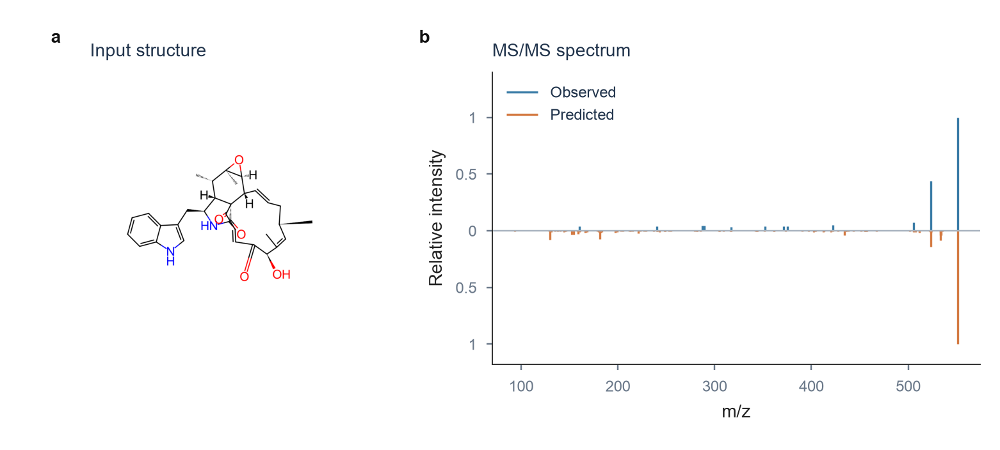
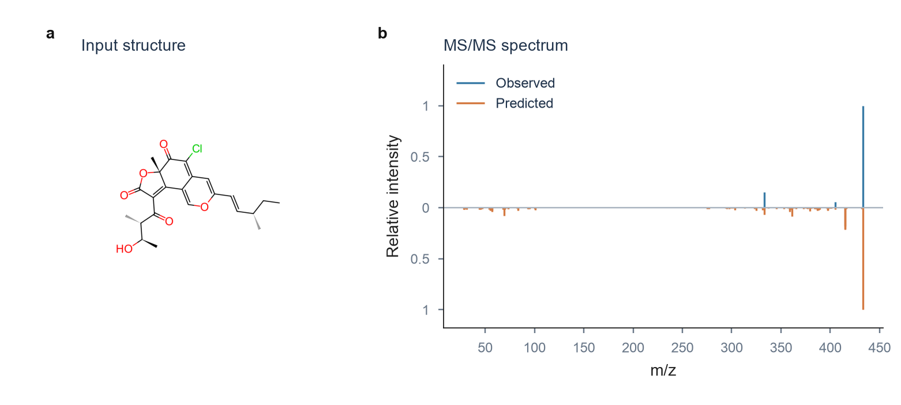
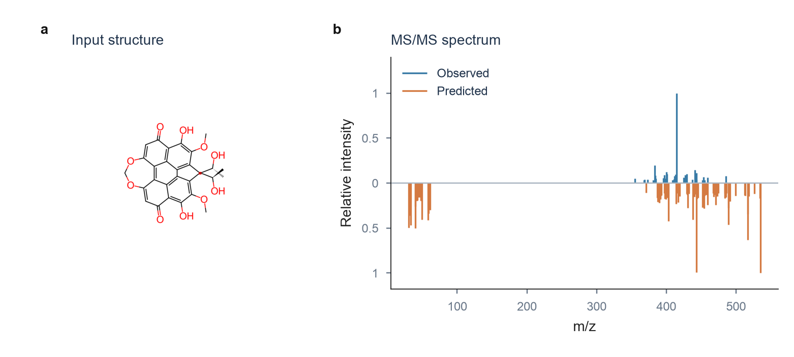

# 使用 ICEBERG 预测 MS/MS

在指定采集条件下预测分子的碎片质量和强度。

## 输入是什么

| Field | Meaning |
| --- | --- |
| `smiles / adduct` | 分子结构与记录中的离子/加合物类型，例如 [M+H]+ 或 [M+Na]+。 |
| `collision_energy / instrument` | 模型支持的碰撞能与仪器条件。 |
| `precursor_mz` | 记录中的前体 m/z；按作者接口解释输入条件。 |

## 输出是什么

| Field | Meaning |
| --- | --- |
| `predicted_peaks` | m/z 与相对强度对；图中显示预测强度最高的 100 个峰。 |
| `similarity` | 与全部实测参考峰比较的余弦/熵相似度，同时统计跳过记录。 |

## 真实运行案例

下面展示示例的输入、预测与参考。下载 JSON 可获取完整数值数组及更多示例。



[SVG](../assets/gallery/ms-forward-iceberg.svg) · [PNG](../assets/gallery/ms-forward-iceberg.png) · [Full input/output JSON](../assets/examples/ms-forward-iceberg.json)

### 示例 2



### 示例 3



<details><summary>展开查看实际输入与输出字段</summary>

```json
{
  "input": {
    "smiles": "C/C1=C\\[C@@H](C)C/C=C/[C@H]2[C@@H]3O[C@]3(C)[C@@H](C)[C@H]3[C@H](Cc4c[nH]c5ccccc45)NC(=O)[C@]32C(=O)/C=C/C(=O)[C@@H]1O",
    "adduct": "[M+Na]+",
    "collision_energy": "35.0",
    "instrument": "Orbitrap",
    "precursor_mz": 551.2511
  },
  "sample_id": "MassSpecGymID0000403",
  "output": {
    "predicted_peaks_top100": {
      "length": 100,
      "first_values": [
        [
          93.06987621515076,
          0.0043686628341674805
        ],
        [
          129.0573002311496,
          0.004620126914232969
        ],
        [
          130.065125248125,
          0.07967650890350342
        ],
        [
          131.07295026510042,
          0.011109611950814724
        ]
      ]
    }
  },
  "reference": {
    "observed_peaks": {
      "length": 12,
      "first_values": [
        [
          160.0366,
          0.03803803803803804
        ],
        [
          240.0992,
          0.03803803803803804
        ],
        [
          287.1152,
          0.04704704704704705
        ],
        [
          289.0945,
          0.042042042042042045
        ]
      ]
    }
  },
  "metrics": {
    "cosine_similarity": 0.9412847417548776,
    "entropy_similarity": 0.6221104979157452,
    "predicted_nonzero_bins": 100,
    "reference_nonzero_bins": 12
  }
}
```

</details>

## 实际评测结果

| Dataset / scope | Model / variant | Metric | Value |
| --- | --- | --- | ---: |
| recorded evaluation | recorded model | cosine_similarity | 0.4625 |
| recorded evaluation | recorded model | entropy_similarity | 0.369847 |

## 模型与方法

ICEBERG 接收分子结构、加合物、碰撞能和仪器类型，通过碎片与强度预测模块生成 MS/MS 峰表。

使用余弦相似度与熵相似度比较预测谱和实测谱。

## 复现方式

[Notebook with executed figures](../notebooks/ms-forward-iceberg.ipynb) · [Quick Start](../quickstart.md)

```bash
python -m openmolspec_bench run --workspace /path/to/OpenMolSpec \
  --tasks ms.forward.iceberg --limit 8 --output results/ms-forward-iceberg-new.json
```

## 调用模型与微调

```python
from openmolspec.model import MSPredictor
model = MSPredictor(model='iceberg', source='/path/to/ms-pred',
    weights='/path/to/weights', python='/path/to/ms-env/bin/python')
result = model.predict(smiles=smiles, adduct='[M+H]+',
    collision_energy=20., instrument='Orbitrap')
```

微调使用 [作者训练模块](https://github.com/coleygroup/ms-pred)。准备分子独立的 train/val，包含结构、采集条件、实测峰强度及所选架构需要的碎片目标。ICEBERG 对应 `ms_pred.iceberg.train_gen`、`ms_pred.iceberg.train_inten`；GLACIER 提供 `ms_pred.glacier.train_joint` 及联合对比训练。启动前对照发布配置和各模块的 `--help`。 ICEBERG 碎片生成对有效原子决策使用二元交叉熵，强度模块支持余弦或熵目标。GLACIER 联合／对比损失随配置变化，报告微调时须注明具体变体。

$$L_{\rm cosine}=1-\frac{\hat s\cdot s}{\|\hat s\|\|s\|}.$$

<details><summary>来源报告与 SHA-256 指纹</summary>

- [ms_iceberg_32_molecules_20261116.json](https://github.com/jiaqingxie/openmolspec-studio-frontend/blob/release/openmolspec-v1/results/ms_iceberg_32_molecules_20261116.json) — SHA-256 `7b403aa40d8478ff3ff8ee93ed6bec4151493d88eb0d2521f037542889c443ee`

</details>


[Model implementation / 模型实现](https://github.com/coleygroup/ms-pred) · [Model review / 模型检查](../model-audit.md)

## 参考文献

- Wang, R., Manjrekar, M., Mahjour, B., Avila-Pacheco, J., et al. Neural Spectral Prediction for Structure Elucidation with Tandem Mass Spectrometry. bioRxiv (2025). doi:10.1101/2025.05.28.656653. [Source](https://doi.org/10.1101/2025.05.28.656653)
- Bushuiev, R., Bushuiev, A., de Jonge, N. F., Young, A., et al. MassSpecGym: A benchmark for the discovery and identification of molecules. Advances in Neural Information Processing Systems 37, Datasets and Benchmarks Track (2024). arXiv:2410.23326. [Source](https://arxiv.org/abs/2410.23326)
