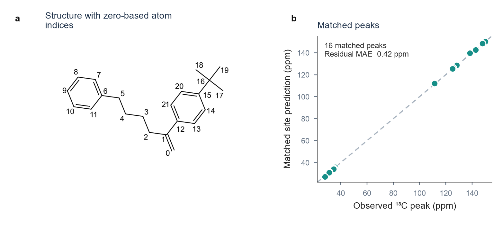

# Peak-to-atom assignment

Assign measured NMR peaks to atoms in a known molecular structure.

## What goes in

| Field | Meaning |
| --- | --- |
| `smiles` | Known molecular structure. |
| `nucleus / peaks_ppm` | 1H or 13C and the measured 1D peak positions in ppm. |
| `tolerance_ppm` | Maximum allowed peak/site residual: default H 0.5, C 5 ppm. |

## What comes out

| Field | Meaning |
| --- | --- |
| `assignments` | Peak index → candidate atom indices, predicted ppm, residual and alternatives. |
| `unmatched` | Indices of unmatched peaks and predicted sites. |

## A real recorded example

Inspect the input, prediction and reference for the example below. Download the JSON for the complete numerical arrays and additional examples.



[SVG](../assets/gallery/nmr-assignment.svg) · [PNG](../assets/gallery/nmr-assignment.png) · [Full input/output JSON](../assets/examples/nmr-assignment.json)

<details><summary>Inspect the actual input and output fields</summary>

```json
{
  "input": {
    "smiles": "C=C(CCCCc1ccccc1)c1ccc(C(C)(C)C)cc1",
    "nucleus": "13C",
    "peaks_ppm": {
      "length": 16,
      "first_values": [
        150.22,
        148.03,
        142.68,
        138.28
      ]
    },
    "note": "Assigned observed peaks; unmatched indices retained in output"
  },
  "output": {
    "smiles": "C=C(CCCCc1ccccc1)c1ccc(C(C)(C)C)cc1",
    "symbol": "C",
    "mapped_smiles": "[C:1](=[C:2]([C:3]([C:4]([C:5]([C:6]([c:7]1[c:8]([H:33])[c:9]([H:34])[c:10]([H:35])[c:11]([H:36])[c:12]1[H:37])([H:31])[H:32])([H:29])[H:30])([H:27])[H:28])([H:25])[H:26])[c:13]1[c:14]([H:38])[c:15]([H:39])[c:16]([C:17]([C:18]([H:40])([H:41])[H:42])([C:19]([H:43])([H:44])[H:45])[C:20]([H:46])([H:47])[H:48])[c:21]([H:49])[c:22]1[H:50])([H:23])[H:24]",
    "atom_index_basis": "zero-based RDKit AddHs(input_smiles); atom-map numbers = index + 1",
    "equivalence": "topological symmetry including chirality; not proof of magnetic equivalence",
    "assignments": {
      "length": 16,
      "first_values": [
        {
          "peak_index": 0,
          "observed_ppm": 150.22,
          "atom_indices": [
            15
          ],
          "predicted_ppm": 150.09881591796875,
          "absolute_error_ppm": 0.12118408203124886,
          "other_sites_within_tolerance": [
            1
          ]
        },
        {
          "peak_index": 1,
          "observed_ppm": 148.03,
          "atom_indices": [
            1
          ],
          "predicted_ppm": 148.56301879882812,
          "absolute_error_ppm": 0.5330187988281239,
          "other_sites_within_tolerance": [
            13
          ]
        },
        {
          "peak_index": 2,
          "observed_ppm": 142.68,
          "atom_indices": [
            6
          ],
          "predicted_ppm": 142.5129852294922,
          "absolute_error_ppm": 0.16701477050781932,
          "other_sites_within_tolerance": [
            10
          ]
        },
        {
          "peak_index": 3,
          "observed_ppm": 138.28,
          "atom_indices": [
            12
          ],
          "predicted_ppm": 139.7798614501953,
          "absolute_error_ppm": 1.4998614501953114,
          "other_sites_within_tolerance": [
            6
          ]
        }
      ]
    },
    "unmatched_peak_indices": [],
    "unmatched_sites": [],
    "sites": {
      "length": 16,
      "first_values": [
        {
          "atom_indices": [
            0
          ],
          "predicted_ppm": 111.92984008789062
        },
        {
          "atom_indices": [
            1
          ],
          "predicted_ppm": 148.56301879882812
        },
        {
          "atom_indices": [
            2
          ],
          "predicted_ppm": 34.59314727783203
        },
        {
          "atom_indices": [
            3
          ],
          "predicted_ppm": 27.1068172454834
        }
      ]
    },
    "tolerance_ppm": 5.0,
    "matched_fraction": 1.0,
    "assignment_accuracy": null,
    "accuracy_note": "Predicted assignments; experimental atom labels are not supplied."
  }
}
```

</details>

## Actual evaluation results

| Dataset / scope | Model / variant | Metric | Value |
| --- | --- | --- | ---: |
| recorded evaluation | recorded model | molecules | 32 |
| recorded evaluation | recorded model | matched_peaks | 488 |
| recorded evaluation | recorded model | matched_peak_fraction_macro | 0.939238 |
| recorded evaluation | recorded model | matched_residual_mae_ppm | 0.899131 |
| recorded evaluation | recorded model | assignment_accuracy | not measured |

## Model and method

NMRNet first predicts atomwise shifts. Symmetry-related sites are grouped, then a minimum-cost matching step pairs the measured peaks with the predicted sites. The output includes atom indices, predicted shifts, residuals and alternative assignments.

Peak coverage and matched-peak MAE summarize the assignment.

## Reproduce

[Notebook with executed figures](../notebooks/nmr-assignment.ipynb) · [Quick Start](../quickstart.md)

```bash
python -m openmolspec_bench run --workspace /path/to/OpenMolSpec \
  --tasks nmr.assignment --limit 8 --output results/nmr-assignment-new.json
```

## Call and adapt this model

```python
from openmolspec.model import NMRNet
model = NMRNet.from_pretrained('/path/to/models', nucleus='13C',
    python='/path/to/nmr-env/bin/python')
result = model.assign(smiles, measured_peaks_ppm)
```

For fine-tuning, use the [NMRNet author training implementation](https://github.com/Colin-Jay/NMRNet), preparing atom-labelled structures/coordinates, target masks and train/validation LMDBs for the selected nucleus. Its `atom_regloss_mae` and `atom_regloss_mse` criteria operate on supervised target atoms. Retain the scaler/reference convention and select the checkpoint on validation data. This author training route is separate from the SDK inference facade. Peak matching then minimizes a separate assignment cost under the stated tolerances; it does not create atom-labelled training truth.

$$L_{\rm MAE}=\frac{1}{N_{\rm labelled}}\sum_{i\in\mathcal M}|\hat\delta_i-\delta_i|,\qquad L_{\rm MSE}=\frac{1}{N_{\rm labelled}}\sum_{i\in\mathcal M}(\hat\delta_i-\delta_i)^2.$$

<details><summary>Source reports and SHA-256 fingerprints</summary>

- [assignment_carbon32_20261116.json](https://github.com/jiaqingxie/openmolspec-studio-frontend/blob/release/openmolspec-v1/results/assignment_carbon32_20261116.json) — SHA-256 `c3d25150e5811b8987060e147f43d9add4f729e340da420b94425766e1e76540`

</details>


[Model implementation / 模型实现](https://github.com/Colin-Jay/NMRNet) · [Model review / 模型检查](../model-audit.md)

## References

- Xu, F., Guo, W., Wang, F., Yao, L., Wang, H., Tang, F., Gao, Z., Zhang, L., E, W., Tian, Z.-Q., et al. Toward a unified benchmark and framework for deep learning-based prediction of nuclear magnetic resonance chemical shifts. Nature Computational Science 5, 292–300 (2025). doi:10.1038/s43588-025-00783-z. [Source](https://doi.org/10.1038/s43588-025-00783-z)
- OpenDataLab. WanJuan MolSpectra, version 1.0.3. Experimental molecular spectroscopy dataset. [Source](https://opendatalab.com/)
