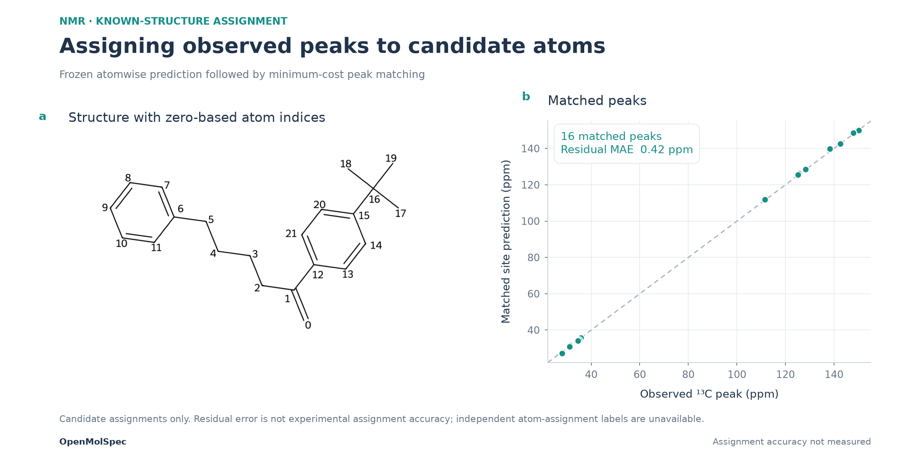

# H/C 峰 → 原子指认

给定结构和实测 H/C 峰，预测逐原子位移并输出候选指认。

## 当前结论

作为已知结构的候选指认流程合理，但尚无实验指认准确率。先验证原子标签和对称性，再决定微调。

## 输入是什么

| Field | Meaning |
| --- | --- |
| `smiles` | 已知分子结构；本任务不负责猜测未知分子。 |
| `nucleus / peaks_ppm` | 1H 或 13C，以及实测一维峰位置（ppm）。 |
| `tolerance_ppm` | 峰与预测位点的最大允许残差，默认 H 0.5、C 5 ppm。 |

## 输出是什么

| Field | Meaning |
| --- | --- |
| `assignments` | 峰编号 → 候选原子编号、预测位移、残差与备选位点。 |
| `unmatched` | 保留未匹配峰和位点。当前没有实验指认准确率。 |

## 真实运行案例

下面展示记录中的第一例，不按结果好坏筛选。长数组预览会标明完整长度；完整数值可下载证据 JSON。参考标签与模型输入分开保留。



[SVG](../assets/gallery/nmr-assignment.svg) · [PNG](../assets/gallery/nmr-assignment.png) · [Full input/output JSON](../assets/examples/nmr-assignment.json)

<details><summary>展开查看实际输入与输出字段</summary>

```json
{
  "input": {
    "smiles": "C=C(CCCCc1ccccc1)c1ccc(C(C)(C)C)cc1",
    "nucleus": "13C",
    "peaks_ppm": {
      "length": 16,
      "first_values": [
        150.22,
        148.03,
        142.68,
        138.28
      ]
    },
    "note": "Assigned observed peaks; unmatched indices retained in output"
  },
  "output": {
    "smiles": "C=C(CCCCc1ccccc1)c1ccc(C(C)(C)C)cc1",
    "symbol": "C",
    "mapped_smiles": "[C:1](=[C:2]([C:3]([C:4]([C:5]([C:6]([c:7]1[c:8]([H:33])[c:9]([H:34])[c:10]([H:35])[c:11]([H:36])[c:12]1[H:37])([H:31])[H:32])([H:29])[H:30])([H:27])[H:28])([H:25])[H:26])[c:13]1[c:14]([H:38])[c:15]([H:39])[c:16]([C:17]([C:18]([H:40])([H:41])[H:42])([C:19]([H:43])([H:44])[H:45])[C:20]([H:46])([H:47])[H:48])[c:21]([H:49])[c:22]1[H:50])([H:23])[H:24]",
    "atom_index_basis": "zero-based RDKit AddHs(input_smiles); atom-map numbers = index + 1",
    "equivalence": "topological symmetry including chirality; not proof of magnetic equivalence",
    "assignments": {
      "length": 16,
      "first_values": [
        {
          "peak_index": 0,
          "observed_ppm": 150.22,
          "atom_indices": [
            15
          ],
          "predicted_ppm": 150.09881591796875,
          "absolute_error_ppm": 0.12118408203124886,
          "other_sites_within_tolerance": [
            1
          ]
        },
        {
          "peak_index": 1,
          "observed_ppm": 148.03,
          "atom_indices": [
            1
          ],
          "predicted_ppm": 148.56301879882812,
          "absolute_error_ppm": 0.5330187988281239,
          "other_sites_within_tolerance": [
            13
          ]
        },
        {
          "peak_index": 2,
          "observed_ppm": 142.68,
          "atom_indices": [
            6
          ],
          "predicted_ppm": 142.5129852294922,
          "absolute_error_ppm": 0.16701477050781932,
          "other_sites_within_tolerance": [
            10
          ]
        },
        {
          "peak_index": 3,
          "observed_ppm": 138.28,
          "atom_indices": [
            12
          ],
          "predicted_ppm": 139.7798614501953,
          "absolute_error_ppm": 1.4998614501953114,
          "other_sites_within_tolerance": [
            6
          ]
        }
      ]
    },
    "unmatched_peak_indices": [],
    "unmatched_sites": [],
    "sites": {
      "length": 16,
      "first_values": [
        {
          "atom_indices": [
            0
          ],
          "predicted_ppm": 111.92984008789062
        },
        {
          "atom_indices": [
            1
          ],
          "predicted_ppm": 148.56301879882812
        },
        {
          "atom_indices": [
            2
          ],
          "predicted_ppm": 34.59314727783203
        },
        {
          "atom_indices": [
            3
          ],
          "predicted_ppm": 27.1068172454834
        }
      ]
    },
    "tolerance_ppm": 5.0,
    "matched_fraction": 1.0,
    "assignment_accuracy": null,
    "accuracy_note": "Predicted assignments; experimental atom labels are not supplied."
  }
}
```

</details>

## 实际评测结果

| Dataset / scope | Model / variant | Metric | Value |
| --- | --- | --- | ---: |
| recorded evaluation | recorded model | molecules | 32 |
| recorded evaluation | recorded model | matched_peak_fraction_macro | 0.939238 |
| recorded evaluation | recorded model | matched_residual_mae_ppm | 0.899131 |
| recorded evaluation | recorded model | assignment_accuracy | not measured |

样本量和候选池随每次运行记录。图可能展示单个分子，表格是来源实验的实际汇总，不能混为同一统计范围。

## 模型与方法

直接加载液相 NMRNet H/C fold-0 权重，固定种子生成构象；完整恢复权重，保存 RDKit AddHs(input SMILES) 的 0 起始原子编号。按拓扑对称性合并位点，再做带未匹配项的最小代价匹配。H/C 默认容差分别为 0.5/5 ppm。

32 个碳谱分子已完成，匹配 488 个峰；另有真实在线氢谱请求。报告覆盖率、残差、原子编号及歧义候选；缺少独立实验指认答案时 assignment_accuracy 为 null。

## 复现方式

[Notebook with executed figures](../notebooks/nmr-assignment.ipynb) · [Quick Start](../quickstart.md)

```bash
python -m openmolspec_bench run --workspace /path/to/OpenMolSpec \
  --tasks nmr.assignment --limit 8 --output results/nmr-assignment-new.json
```

## 边界与来源

匹配残差不等于指认准确率；拓扑对称不保证磁等价。模型不输入溶剂，未做构象系综平均，目前仅覆盖 H/C。

<details><summary>来源报告与 SHA-256 指纹</summary>

- [assignment_carbon32_20261116.json](https://github.com/jiaqingxie/openmolspec-studio-frontend/blob/release/openmolspec-v1/results/assignment_carbon32_20261116.json) — SHA-256 `c3d25150e5811b8987060e147f43d9add4f729e340da420b94425766e1e76540`

</details>


[Original model / 原模型](https://github.com/Colin-Jay/NMRNet) · [Model review / 模型检查](../model-audit.md)
