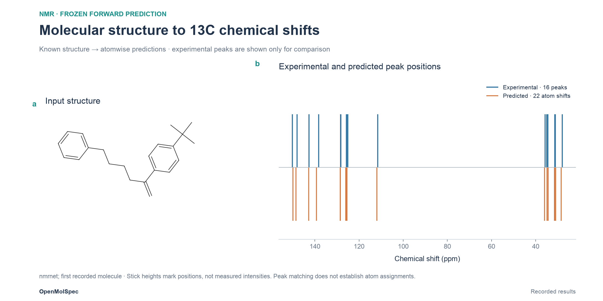

# 13C chemical shift prediction

Predict the 13C chemical shifts of a molecule from its structure. Use the atom indices to display predictions on the molecular graph or compare them with measured peaks.

## Released solution carbon model

The predictor averages the atomic shifts from five NMRNet++ checkpoints and reports one peak per symmetry-equivalent carbon group in the input SMILES. Distinct carbon environments retain separate peaks even if their predicted shifts are close. A validation set of 108 patent structures selected this setting from 60 combinations of fold count, experimental-model weight and peak grouping.

| Independent evaluation | Unique structures | Five folds, one peak per carbon atom | Five folds, one peak per symmetry group |
| --- | ---: | ---: | ---: |
| NMRSpec | 1,000 | 2.31 | 1.22 |
| NMRExp | 748 | 2.45 | 1.14 |
| NMRGym | 980 | 3.20 | 2.77 |

Values are molecule-averaged peak-list errors in ppm. Minimum-cost matching caps paired errors at 20 ppm and charges 10 ppm for each extra or missing peak. Averaging across the three held-out sets, the paired 95% interval for the change was −0.95 to −0.87 ppm. Molecular connectivities are disjoint across development and evaluation sets. Overlap with upstream NMRNet++ pretraining is unverified.

[Use the carbon predictor](https://jiaqingxie.github.io/openmolspec.github.io/#tool-13c) · [Fold comparisons](https://github.com/jiaqingxie/openmolspec-studio-frontend/blob/release/openmolspec-v1/results/forward_carbon_folds.json) · [Author checkpoints](https://zenodo.org/records/18232165) · [Download the carbon SDK and model profile](https://github.com/jiaqingxie/openmolspec-studio-frontend/releases/download/peak-nmr-v2/openmolspec-13C.zip)

Run the selected predictor with the NMRNet++ source and five author checkpoints installed under the model root.

```python
from openmolspec.harness import SpectraHarness

prediction = SpectraHarness().run(
    "nmr.forward.13C", {"smiles": "CC(C)O"},
    {"root": "models", "backend": "nmrnetpp", "python": "/path/to/nmr-env/bin/python"},
)
print(prediction["result"]["records"][0]["peaks"])
```

## What goes in

| Field | Meaning |
| --- | --- |
| `smiles / geometry` | A valid molecular graph and a compatible 3D conformer; atom order must be preserved. |
| `nucleus` | 13C; the checkpoint must cover this nucleus. |
| `reference peaks` | Optional measured ppm values for evaluation; not an inference input. |

## What comes out

| Field | Meaning |
| --- | --- |
| `prediction_ppm` | Per-atom chemical shifts in ppm, with atom indices or a peak list. |
| `error / coverage` | Reference-matched errors and peak coverage. |

## Recorded atomwise baseline example

Inspect the input, prediction and reference for the example below. Download the JSON for the complete numerical arrays and additional examples.



[SVG](../assets/gallery/nmr-forward-13C.svg) · [PNG](../assets/gallery/nmr-forward-13C.png) · [Full input/output JSON](../assets/examples/nmr-forward-13C.json)

<details><summary>Inspect the actual input and output fields</summary>

```json
{
  "input": {
    "smiles": "C=C(CCCCc1ccccc1)c1ccc(C(C)(C)C)cc1"
  },
  "output": {
    "prediction_ppm": {
      "length": 22,
      "first_values": [
        111.90728759765625,
        148.55685424804688,
        34.887306213378906,
        28.467559814453125
      ]
    },
    "model": "nmrnet"
  },
  "reference": {
    "peaks_ppm": {
      "length": 16,
      "first_values": [
        150.22,
        148.03,
        142.68,
        138.28
      ]
    }
  }
}
```

</details>

## Earlier atomwise benchmark results

| Dataset / scope | Model / variant | Metric | Value |
| --- | --- | --- | ---: |
| nmrspec_test | nmrnet | matched_peak_mae_ppm | 1.16684 |
| nmrspec_test | nmrnet | matched_peak_rmse_ppm | 2.38985 |
| nmrspec_test | nmrnet | peak_count_mae | 2.65625 |
| nmrspec_test | nmrnet | matched_fraction | 0.868315 |
| nmrspec_test | nmrnet | examples | 32 |
| nmrspec_test | nmrnet | scored_examples | 32 |
| nmrspec_test | nmrnet | aggregation | equal_weight_per_molecule |
| nmrspec_test | nmrnet | assignment | minimum_absolute_error_without_atom_labels |
| nmrspec_test | nmrnetpp | matched_peak_mae_ppm | 0.816381 |
| nmrspec_test | nmrnetpp | matched_peak_rmse_ppm | 2.01372 |
| nmrspec_test | nmrnetpp | peak_count_mae | 2.65625 |
| nmrspec_test | nmrnetpp | matched_fraction | 0.868315 |
| nmrspec_test | nmrnetpp | examples | 32 |
| nmrspec_test | nmrnetpp | scored_examples | 32 |
| nmrspec_test | nmrnetpp | aggregation | equal_weight_per_molecule |
| nmrspec_test | nmrnetpp | assignment | minimum_absolute_error_without_atom_labels |
| patent_test_10k | nmrnet | matched_peak_mae_ppm | 8.04192 |
| patent_test_10k | nmrnet | matched_peak_rmse_ppm | 24.2975 |
| patent_test_10k | nmrnet | peak_count_mae | 18.1935 |
| patent_test_10k | nmrnet | matched_fraction | 0.433151 |
| patent_test_10k | nmrnet | examples | 31 |
| patent_test_10k | nmrnet | scored_examples | 31 |
| patent_test_10k | nmrnet | aggregation | equal_weight_per_molecule |
| patent_test_10k | nmrnet | assignment | minimum_absolute_error_without_atom_labels |
| patent_test_10k | nmrnetpp | matched_peak_mae_ppm | 7.56152 |
| patent_test_10k | nmrnetpp | matched_peak_rmse_ppm | 22.9178 |
| patent_test_10k | nmrnetpp | peak_count_mae | 18.1935 |
| patent_test_10k | nmrnetpp | matched_fraction | 0.433151 |
| patent_test_10k | nmrnetpp | examples | 31 |
| patent_test_10k | nmrnetpp | scored_examples | 31 |
| patent_test_10k | nmrnetpp | aggregation | equal_weight_per_molecule |
| patent_test_10k | nmrnetpp | assignment | minimum_absolute_error_without_atom_labels |
| nmrexp_exp_10k | nmrnet | matched_peak_mae_ppm | 1.30638 |
| nmrexp_exp_10k | nmrnet | matched_peak_rmse_ppm | 7.49856 |
| nmrexp_exp_10k | nmrnet | peak_count_mae | 3.90625 |
| nmrexp_exp_10k | nmrnet | matched_fraction | 0.753554 |
| nmrexp_exp_10k | nmrnet | examples | 32 |
| nmrexp_exp_10k | nmrnet | scored_examples | 32 |
| nmrexp_exp_10k | nmrnet | aggregation | equal_weight_per_molecule |
| nmrexp_exp_10k | nmrnet | assignment | minimum_absolute_error_without_atom_labels |
| nmrexp_exp_10k | nmrnetpp | matched_peak_mae_ppm | 1.29252 |
| nmrexp_exp_10k | nmrnetpp | matched_peak_rmse_ppm | 8.09745 |
| nmrexp_exp_10k | nmrnetpp | peak_count_mae | 3.90625 |
| nmrexp_exp_10k | nmrnetpp | matched_fraction | 0.753554 |
| nmrexp_exp_10k | nmrnetpp | examples | 32 |
| nmrexp_exp_10k | nmrnetpp | scored_examples | 32 |
| nmrexp_exp_10k | nmrnetpp | aggregation | equal_weight_per_molecule |
| nmrexp_exp_10k | nmrnetpp | assignment | minimum_absolute_error_without_atom_labels |
| nmrgym_test | nmrnet | matched_peak_mae_ppm | 2.27653 |
| nmrgym_test | nmrnet | matched_peak_rmse_ppm | 3.99254 |
| nmrgym_test | nmrnet | peak_count_mae | 2.625 |
| nmrgym_test | nmrnet | matched_fraction | 0.908013 |
| nmrgym_test | nmrnet | examples | 32 |
| nmrgym_test | nmrnet | scored_examples | 32 |
| nmrgym_test | nmrnet | aggregation | equal_weight_per_molecule |
| nmrgym_test | nmrnet | assignment | minimum_absolute_error_without_atom_labels |
| nmrgym_test | nmrnetpp | matched_peak_mae_ppm | 2.45342 |
| nmrgym_test | nmrnetpp | matched_peak_rmse_ppm | 4.1577 |
| nmrgym_test | nmrnetpp | peak_count_mae | 2.625 |
| nmrgym_test | nmrnetpp | matched_fraction | 0.908013 |
| nmrgym_test | nmrnetpp | examples | 32 |
| nmrgym_test | nmrnetpp | scored_examples | 32 |
| nmrgym_test | nmrnetpp | aggregation | equal_weight_per_molecule |
| nmrgym_test | nmrnetpp | assignment | minimum_absolute_error_without_atom_labels |

## Model and method

NMRNet encodes the molecular geometry and predicts chemical shifts at the selected atoms. The adapter prepares a conformer, loads the nucleus-specific weights and applies the checkpoint scaler.

MAE and RMSE are reported in ppm.

## Reproduce

[Notebook with executed figures](../notebooks/nmr-forward-13C.ipynb) · [Quick Start](../quickstart.md)

```bash
python -m openmolspec_bench run --workspace /path/to/OpenMolSpec \
  --tasks nmr.forward.13C --limit 8 --output results/nmr-forward-13C-new.json
```

## Call and adapt this model

```python
from openmolspec.model import NMRNet
model = NMRNet.from_pretrained('/path/to/models', nucleus='13C',
    python='/path/to/nmr-env/bin/python')
result = model.predict(smiles)
```

For fine-tuning, use the [NMRNet author training implementation](https://github.com/Colin-Jay/NMRNet), preparing atom-labelled structures/coordinates, target masks and train/validation LMDBs for the selected nucleus. Its `atom_regloss_mae` and `atom_regloss_mse` criteria operate on supervised target atoms. Retain the scaler/reference convention and select the checkpoint on validation data. This author training route is separate from the SDK inference facade.

$$L_{\rm MAE}=\frac{1}{N_{\rm labelled}}\sum_{i\in\mathcal M}|\hat\delta_i-\delta_i|,\qquad L_{\rm MSE}=\frac{1}{N_{\rm labelled}}\sum_{i\in\mathcal M}(\hat\delta_i-\delta_i)^2.$$


| Model setting | Value |
| --- | --- |
| Checkpoint | NMRNet 13C fold 0 |
| Training domain | liquid |
| Shift unit | ppm |

<details><summary>Source reports and SHA-256 fingerprints</summary>

- [nmr_documented_examples_20261117_v2.json](https://github.com/jiaqingxie/openmolspec-studio-frontend/blob/release/openmolspec-v1/results/nmr_documented_examples_20261117_v2.json) — SHA-256 `669413d6fc0939bdb6826782d41fc13cf12926a672418ecb46303f0b8ba05b99`

</details>


[Model implementation / 模型实现](https://github.com/Colin-Jay/NMRNet) · [Model review / 模型检查](../model-audit.md)

## References

- Xu, F., Guo, W., Wang, F., Yao, L., Wang, H., Tang, F., Gao, Z., Zhang, L., E, W., Tian, Z.-Q., et al. Toward a unified benchmark and framework for deep learning-based prediction of nuclear magnetic resonance chemical shifts. Nature Computational Science 5, 292–300 (2025). doi:10.1038/s43588-025-00783-z. [Source](https://doi.org/10.1038/s43588-025-00783-z)
- OpenDataLab. WanJuan MolSpectra, version 1.0.3. Experimental molecular spectroscopy dataset. [Source](https://opendatalab.com/)
