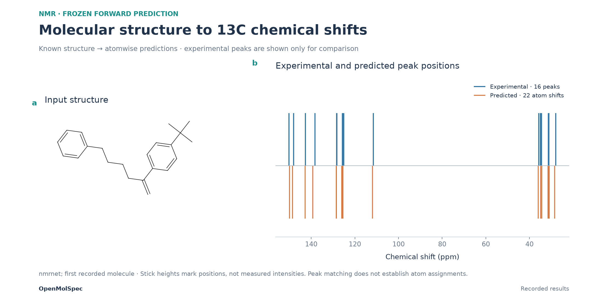

# 结构 → 13C 峰列表

由分子结构预测 13C 化学位移，已有兼容权重时进行冻结推理或已有预测评分。

## 当前结论

可作为 H/C 冻结模型基线；误差来自峰匹配，不代表实验原子指认。仍要检查训练重叠和溶剂覆盖。

## 输入是什么

| Field | Meaning |
| --- | --- |
| `smiles / geometry` | 有效分子结构及相容的三维构象，必须保留原子顺序。 |
| `nucleus` | 13C，权重必须覆盖该核种。 |
| `reference peaks` | 评测时提供实测 ppm 标签；标签不作为模型推理输入。 |

## 输出是什么

| Field | Meaning |
| --- | --- |
| `prediction_ppm` | 逐原子化学位移（ppm）及原子编号，或整理后的峰列表。 |
| `error / coverage` | 与参考谱匹配后的误差及覆盖率；峰匹配不等于实验原子指认。 |

## 真实运行案例

下面展示记录中的第一例，不按结果好坏筛选。长数组预览会标明完整长度；完整数值可下载证据 JSON。参考标签与模型输入分开保留。



[SVG](../assets/gallery/nmr-forward-13C.svg) · [PNG](../assets/gallery/nmr-forward-13C.png) · [Full input/output JSON](../assets/examples/nmr-forward-13C.json)

<details><summary>展开查看实际输入与输出字段</summary>

```json
{
  "input": {
    "smiles": "C=C(CCCCc1ccccc1)c1ccc(C(C)(C)C)cc1"
  },
  "output": {
    "prediction_ppm": {
      "length": 22,
      "first_values": [
        111.90728759765625,
        148.55685424804688,
        34.887306213378906,
        28.467559814453125
      ]
    },
    "model": "nmrnet"
  },
  "reference": {
    "peaks_ppm": {
      "length": 16,
      "first_values": [
        150.22,
        148.03,
        142.68,
        138.28
      ]
    }
  }
}
```

</details>

## 实际评测结果

| Dataset / scope | Model / variant | Metric | Value |
| --- | --- | --- | ---: |
| nmrspec_test | nmrnet | matched_peak_mae_ppm | 1.16684 |
| nmrspec_test | nmrnet | matched_fraction | 0.868315 |
| nmrspec_test | nmrnet | examples | 32 |
| nmrspec_test | nmrnet | scored_examples | 32 |
| nmrspec_test | nmrnetpp | matched_peak_mae_ppm | 0.816381 |
| nmrspec_test | nmrnetpp | matched_fraction | 0.868315 |
| nmrspec_test | nmrnetpp | examples | 32 |
| nmrspec_test | nmrnetpp | scored_examples | 32 |
| patent_test_10k | nmrnet | matched_peak_mae_ppm | 8.04192 |
| patent_test_10k | nmrnet | matched_fraction | 0.433151 |
| patent_test_10k | nmrnet | examples | 31 |
| patent_test_10k | nmrnet | scored_examples | 31 |
| patent_test_10k | nmrnetpp | matched_peak_mae_ppm | 7.56152 |
| patent_test_10k | nmrnetpp | matched_fraction | 0.433151 |
| patent_test_10k | nmrnetpp | examples | 31 |
| patent_test_10k | nmrnetpp | scored_examples | 31 |
| nmrexp_exp_10k | nmrnet | matched_peak_mae_ppm | 1.30638 |
| nmrexp_exp_10k | nmrnet | matched_fraction | 0.753554 |
| nmrexp_exp_10k | nmrnet | examples | 32 |
| nmrexp_exp_10k | nmrnet | scored_examples | 32 |
| nmrexp_exp_10k | nmrnetpp | matched_peak_mae_ppm | 1.29252 |
| nmrexp_exp_10k | nmrnetpp | matched_fraction | 0.753554 |
| nmrexp_exp_10k | nmrnetpp | examples | 32 |
| nmrexp_exp_10k | nmrnetpp | scored_examples | 32 |
| nmrgym_test | nmrnet | matched_peak_mae_ppm | 2.27653 |
| nmrgym_test | nmrnet | matched_fraction | 0.908013 |
| nmrgym_test | nmrnet | examples | 32 |
| nmrgym_test | nmrnet | scored_examples | 32 |
| nmrgym_test | nmrnetpp | matched_peak_mae_ppm | 2.45342 |
| nmrgym_test | nmrnetpp | matched_fraction | 0.908013 |
| nmrgym_test | nmrnetpp | examples | 32 |
| nmrgym_test | nmrnetpp | scored_examples | 32 |

样本量和候选池随每次运行记录。图可能展示单个分子，表格是来源实验的实际汇总，不能混为同一统计范围。

## 模型与方法

H/C 读取 NMRNet、NMRNet++ 的预测及对应元数据；未指认实验峰用最小绝对误差匹配，并保留峰数和覆盖率诊断。

位移和误差单位均为 ppm。按分子等权计算匹配峰 MAE/RMSE，必须同时报告匹配比例与峰数误差，因为匹配误差本身不惩罚全部缺失峰或额外峰。

## 复现方式

[Notebook with executed figures](../notebooks/nmr-forward-13C.ipynb) · [Quick Start](../quickstart.md)

```bash
python -m openmolspec_bench run --workspace /path/to/OpenMolSpec \
  --tasks nmr.forward.13C --limit 8 --output results/nmr-forward-13C-new.json
```

## 边界与来源

峰匹配误差不是逐原子指认准确率。这里对 H/C 保存的预测评分，不据此外推其他核种的适用性。

<details><summary>来源报告与 SHA-256 指纹</summary>

- [nmr_documented_examples_20261117_v2.json](https://github.com/jiaqingxie/openmolspec-studio-frontend/blob/release/openmolspec-v1/results/nmr_documented_examples_20261117_v2.json) — SHA-256 `669413d6fc0939bdb6826782d41fc13cf12926a672418ecb46303f0b8ba05b99`

</details>


[Original model / 原模型](https://github.com/Colin-Jay/NMRNet) · [Model review / 模型检查](../model-audit.md)
