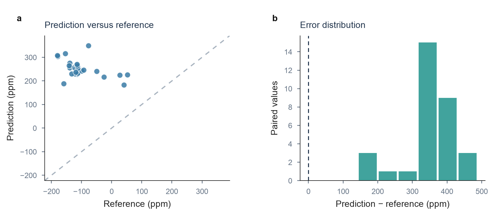

# 19F 化学位移预测

根据分子结构预测 19F 化学位移。利用返回的原子编号，可以把预测值标到分子结构上，也可以与实测峰比较。

## 输入是什么

| Field | Meaning |
| --- | --- |
| `smiles / geometry` | 有效分子结构及相容的三维构象，必须保留原子顺序。 |
| `nucleus` | 19F，权重必须覆盖该核种。 |
| `reference peaks` | 评测时提供实测 ppm 标签；标签不作为模型推理输入。 |

## 输出是什么

| Field | Meaning |
| --- | --- |
| `prediction_ppm` | 逐原子化学位移（ppm）及原子编号，或整理后的峰列表。 |
| `error / coverage` | 与参考谱匹配后的误差及峰覆盖率。 |

## 真实运行案例

下面展示示例的输入、预测与参考。下载 JSON 可获取完整数值数组及更多示例。



[SVG](../assets/gallery/nmr-forward-19F.svg) · [PNG](../assets/gallery/nmr-forward-19F.png) · [Full input/output JSON](../assets/examples/nmr-forward-19F.json)

<details><summary>展开查看实际输入与输出字段</summary>

```json
{
  "input": {
    "smiles": "CCC(C)NC(=O)/C(F)=C(\\c1ccccc1)C(C)C(=O)OCC",
    "nucleus": "F",
    "atom_indices": [
      8
    ]
  },
  "output": {
    "prediction_ppm": 262.4828796386719
  },
  "reference": {
    "ppm": -121.01998138427734
  }
}
```

</details>

## 实际评测结果

| Dataset / scope | Model / variant | Metric | Value |
| --- | --- | --- | ---: |
| recorded evaluation | recorded model | mae_ppm | 356.345 |
| recorded evaluation | recorded model | rmse_ppm | 364.396 |
| recorded evaluation | recorded model | examples | 32 |

## 模型与方法

使用固态 NMRNet 权重，为准备好的分子构象生成逐原子 F/P 预测。基准将保存的预测与严格配对的 LMDB 标签计分；调用时指定冻结推理目录，并选择跨数据域比较选项。

MAE 和 RMSE 的单位均为 ppm。

## 复现方式

[Notebook with executed figures](../notebooks/nmr-forward-19F.ipynb) · [Quick Start](../quickstart.md)

```bash
python -m openmolspec_bench run --workspace /path/to/OpenMolSpec \
  --tasks nmr.forward.19F --fp-inference-root /path/to/frozen-fp --allow-cross-domain-diagnostic --limit 8 --output results/nmr-forward-19F-new.json
```

## 调用模型与微调

```python
from openmolspec.benchmark import Benchmark
benchmark = Benchmark(workspace='/path/to/workspace',
    python='/path/to/sdk-env/bin/python',
    models_root='/path/to/models',
    nmr_python='/path/to/nmr-env/bin/python',
    fp_inference_root='/path/to/frozen-fp')
result = benchmark.run('nmr.forward.19F', output='19F-results.json', limit=32, allow_cross_domain_diagnostic=True)
```

微调使用 [NMRNet 作者训练实现](https://github.com/Colin-Jay/NMRNet)：准备对应核种的逐原子标签、结构／坐标、目标掩码及 train/val LMDB。实现提供 `atom_regloss_mae` 与 `atom_regloss_mse`，在有标签的原子上计算目标。保留 scaler 和参考标准，在验证集选择 checkpoint。该训练流程通过作者实现运行。

$$L_{\rm MAE}=\frac{1}{N_{\rm labelled}}\sum_{i\in\mathcal M}|\hat\delta_i-\delta_i|,\qquad L_{\rm MSE}=\frac{1}{N_{\rm labelled}}\sum_{i\in\mathcal M}(\hat\delta_i-\delta_i)^2.$$


| 模型设置 | 值 |
| --- | --- |
| Checkpoint | NMRNet 19F checkpoint |
| Training domain | solid-state |
| Shift unit | ppm |

<details><summary>来源报告与 SHA-256 指纹</summary>

- [fp_frozen_fresh_diagnostic_20261115.json](https://github.com/jiaqingxie/openmolspec-studio-frontend/blob/release/openmolspec-v1/results/fp_frozen_fresh_diagnostic_20261115.json) — SHA-256 `7a44203bd5826e778a9006edd92dee0ec71e47930c2a980f6082313974c68475`

</details>


[Model implementation / 模型实现](https://github.com/Colin-Jay/NMRNet) · [Model review / 模型检查](../model-audit.md)

## 参考文献

- Xu, F., Guo, W., Wang, F., Yao, L., Wang, H., Tang, F., Gao, Z., Zhang, L., E, W., Tian, Z.-Q., et al. Toward a unified benchmark and framework for deep learning-based prediction of nuclear magnetic resonance chemical shifts. Nature Computational Science 5, 292–300 (2025). doi:10.1038/s43588-025-00783-z. [Source](https://doi.org/10.1038/s43588-025-00783-z)
- OpenDataLab. WanJuan MolSpectra, version 1.0.3. Experimental molecular spectroscopy dataset. [Source](https://opendatalab.com/)
