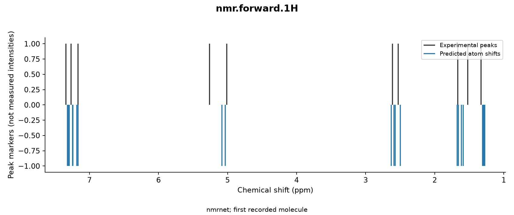

# Structure to 1H NMR

Predict chemical shifts for the selected nucleus from a molecular structure, using existing frozen weights where available.

## Current evidence

Reasonable H/C frozen-model baseline; reported errors use peak matching, not experimental atom assignments. Verify data overlap and solvent coverage.

## What goes in

| Field | Meaning |
| --- | --- |
| `smiles / geometry` | A valid molecular graph and a compatible 3D conformer; atom order must be preserved. |
| `nucleus` | 1H; the checkpoint must cover this nucleus. |
| `reference peaks` | Optional measured ppm values for evaluation; not an inference input. |

## What comes out

| Field | Meaning |
| --- | --- |
| `prediction_ppm` | Per-atom chemical shifts in ppm, with atom indices or a peak list. |
| `error / coverage` | Reference-matched errors and coverage; matching does not establish atom assignments. |

## A real recorded example

The first recorded example is shown below, regardless of whether it succeeds. Array previews explicitly state their lengths; download the evidence JSON for complete values. Reference labels are kept separate from model inputs.

```json
{
  "input": {
    "smiles": "C=C(CCCCc1ccccc1)c1ccc(C(C)(C)C)cc1"
  },
  "output": {
    "prediction_ppm": {
      "length": 28,
      "first_values": [
        5.080643653869629,
        5.033477783203125,
        2.49700927734375,
        2.570378065109253
      ]
    },
    "model": "nmrnet"
  },
  "reference": {
    "peaks_ppm": {
      "length": 10,
      "first_values": [
        7.34,
        7.265,
        7.165,
        5.26
      ]
    }
  }
}
```



[SVG](../assets/gallery/nmr-forward-1H.svg) · [PNG](../assets/gallery/nmr-forward-1H.png) · [Full input/output JSON](../assets/examples/nmr-forward-1H.json)

## Actual evaluation results

| Dataset / scope | Model / variant | Metric | Value |
| --- | --- | --- | ---: |
| nmrspec_test | nmrnet | matched_peak_mae_ppm | 0.134143 |
| nmrspec_test | nmrnet | matched_fraction | 0.519243 |
| nmrspec_test | nmrnet | examples | 32 |
| nmrspec_test | nmrnet | scored_examples | 32 |
| nmrspec_test | nmrnetpp | matched_peak_mae_ppm | 0.0769934 |
| nmrspec_test | nmrnetpp | matched_fraction | 0.519243 |
| nmrspec_test | nmrnetpp | examples | 32 |
| nmrspec_test | nmrnetpp | scored_examples | 32 |
| patent_test_10k | nmrnet | matched_peak_mae_ppm | 0.26912 |
| patent_test_10k | nmrnet | matched_fraction | 0.294737 |
| patent_test_10k | nmrnet | examples | 29 |
| patent_test_10k | nmrnet | scored_examples | 29 |
| patent_test_10k | nmrnetpp | matched_peak_mae_ppm | 0.227842 |
| patent_test_10k | nmrnetpp | matched_fraction | 0.294737 |
| patent_test_10k | nmrnetpp | examples | 29 |
| patent_test_10k | nmrnetpp | scored_examples | 29 |
| nmrexp_exp_10k | nmrnet | matched_peak_mae_ppm | 0.0485825 |
| nmrexp_exp_10k | nmrnet | matched_fraction | 0.530831 |
| nmrexp_exp_10k | nmrnet | examples | 32 |
| nmrexp_exp_10k | nmrnet | scored_examples | 32 |
| nmrexp_exp_10k | nmrnetpp | matched_peak_mae_ppm | 0.030637 |
| nmrexp_exp_10k | nmrnetpp | matched_fraction | 0.530831 |
| nmrexp_exp_10k | nmrnetpp | examples | 32 |
| nmrexp_exp_10k | nmrnetpp | scored_examples | 32 |
| nmrgym_test | nmrnet | matched_peak_mae_ppm | 0.196824 |
| nmrgym_test | nmrnet | matched_fraction | 0.529103 |
| nmrgym_test | nmrnet | examples | 32 |
| nmrgym_test | nmrnet | scored_examples | 32 |
| nmrgym_test | nmrnetpp | matched_peak_mae_ppm | 0.198216 |
| nmrgym_test | nmrnetpp | matched_fraction | 0.529103 |
| nmrgym_test | nmrnetpp | examples | 32 |
| nmrgym_test | nmrnetpp | scored_examples | 32 |

Sample sizes and candidate pools belong to each run. The figure may show one molecule; the table reports the cited run, not a new benchmark on that molecule.

## Model and method

For H/C, score existing NMRNet and NMRNet++ predictions with their exact metadata. Unassigned experimental peak sets use minimum-error matching and retain peak-count and coverage diagnostics.

Shifts and errors are in ppm. Molecule-macro matched-peak MAE/RMSE alone do not penalize every missing/extra peak; publish matched fraction and peak-count error alongside them.

## Reproduce

[Notebook with executed figures](../notebooks/nmr-forward-1H.ipynb) · [Quick Start](../quickstart.md)

```bash
python -m openmolspec_bench run --workspace /path/to/OpenMolSpec \
  --tasks nmr.forward.1H --limit 8 --output results/nmr-forward-1H-new.json
```

## Limits and provenance

A peak-matching score is not atom-assignment accuracy. These H/C results score saved predictions; they do not establish validity for other nuclei.

- [nmr_documented_examples_20261117_v2.json](https://github.com/jiaqingxie/openmolspec-studio-frontend/blob/release/openmolspec-v1/results/nmr_documented_examples_20261117_v2.json) — SHA-256 `669413d6fc0939bdb6826782d41fc13cf12926a672418ecb46303f0b8ba05b99`

[Original model / 原模型](https://github.com/Colin-Jay/NMRNet) · [Model review / 模型检查](../model-audit.md)
