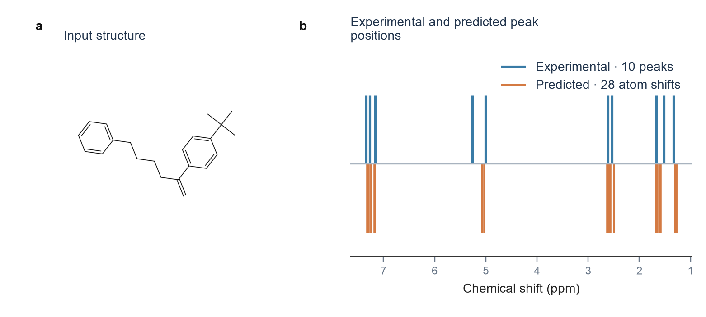

# 1H 化学位移预测

根据分子结构预测 1H 化学位移。利用返回的原子编号，可以把预测值标到分子结构上，也可以与实测峰比较。

## 输入是什么

| Field | Meaning |
| --- | --- |
| `smiles / geometry` | 有效分子结构及相容的三维构象，必须保留原子顺序。 |
| `nucleus` | 1H，权重必须覆盖该核种。 |
| `reference peaks` | 评测时提供实测 ppm 标签；标签不作为模型推理输入。 |

## 输出是什么

| Field | Meaning |
| --- | --- |
| `prediction_ppm` | 逐原子化学位移（ppm）及原子编号，或整理后的峰列表。 |
| `error / coverage` | 与参考谱匹配后的误差及峰覆盖率。 |

## 真实运行案例

下面展示示例的输入、预测与参考。下载 JSON 可获取完整数值数组及更多示例。



[SVG](../assets/gallery/nmr-forward-1H.svg) · [PNG](../assets/gallery/nmr-forward-1H.png) · [Full input/output JSON](../assets/examples/nmr-forward-1H.json)

<details><summary>展开查看实际输入与输出字段</summary>

```json
{
  "input": {
    "smiles": "C=C(CCCCc1ccccc1)c1ccc(C(C)(C)C)cc1"
  },
  "output": {
    "prediction_ppm": {
      "length": 28,
      "first_values": [
        5.080643653869629,
        5.033477783203125,
        2.49700927734375,
        2.570378065109253
      ]
    },
    "model": "nmrnet"
  },
  "reference": {
    "peaks_ppm": {
      "length": 10,
      "first_values": [
        7.34,
        7.265,
        7.165,
        5.26
      ]
    }
  }
}
```

</details>

## 实际评测结果

| Dataset / scope | Model / variant | Metric | Value |
| --- | --- | --- | ---: |
| nmrspec_test | nmrnet | matched_peak_mae_ppm | 0.134143 |
| nmrspec_test | nmrnet | matched_peak_rmse_ppm | 0.236816 |
| nmrspec_test | nmrnet | peak_count_mae | 10.2188 |
| nmrspec_test | nmrnet | matched_fraction | 0.519243 |
| nmrspec_test | nmrnet | examples | 32 |
| nmrspec_test | nmrnet | scored_examples | 32 |
| nmrspec_test | nmrnet | aggregation | equal_weight_per_molecule |
| nmrspec_test | nmrnet | assignment | minimum_absolute_error_without_atom_labels |
| nmrspec_test | nmrnetpp | matched_peak_mae_ppm | 0.0769934 |
| nmrspec_test | nmrnetpp | matched_peak_rmse_ppm | 0.163875 |
| nmrspec_test | nmrnetpp | peak_count_mae | 10.2188 |
| nmrspec_test | nmrnetpp | matched_fraction | 0.519243 |
| nmrspec_test | nmrnetpp | examples | 32 |
| nmrspec_test | nmrnetpp | scored_examples | 32 |
| nmrspec_test | nmrnetpp | aggregation | equal_weight_per_molecule |
| nmrspec_test | nmrnetpp | assignment | minimum_absolute_error_without_atom_labels |
| patent_test_10k | nmrnet | matched_peak_mae_ppm | 0.26912 |
| patent_test_10k | nmrnet | matched_peak_rmse_ppm | 0.530869 |
| patent_test_10k | nmrnet | peak_count_mae | 24.7586 |
| patent_test_10k | nmrnet | matched_fraction | 0.294737 |
| patent_test_10k | nmrnet | examples | 29 |
| patent_test_10k | nmrnet | scored_examples | 29 |
| patent_test_10k | nmrnet | aggregation | equal_weight_per_molecule |
| patent_test_10k | nmrnet | assignment | minimum_absolute_error_without_atom_labels |
| patent_test_10k | nmrnetpp | matched_peak_mae_ppm | 0.227842 |
| patent_test_10k | nmrnetpp | matched_peak_rmse_ppm | 0.484549 |
| patent_test_10k | nmrnetpp | peak_count_mae | 24.7586 |
| patent_test_10k | nmrnetpp | matched_fraction | 0.294737 |
| patent_test_10k | nmrnetpp | examples | 29 |
| patent_test_10k | nmrnetpp | scored_examples | 29 |
| patent_test_10k | nmrnetpp | aggregation | equal_weight_per_molecule |
| patent_test_10k | nmrnetpp | assignment | minimum_absolute_error_without_atom_labels |
| nmrexp_exp_10k | nmrnet | matched_peak_mae_ppm | 0.0485825 |
| nmrexp_exp_10k | nmrnet | matched_peak_rmse_ppm | 0.0797388 |
| nmrexp_exp_10k | nmrnet | peak_count_mae | 8.09375 |
| nmrexp_exp_10k | nmrnet | matched_fraction | 0.530831 |
| nmrexp_exp_10k | nmrnet | examples | 32 |
| nmrexp_exp_10k | nmrnet | scored_examples | 32 |
| nmrexp_exp_10k | nmrnet | aggregation | equal_weight_per_molecule |
| nmrexp_exp_10k | nmrnet | assignment | minimum_absolute_error_without_atom_labels |
| nmrexp_exp_10k | nmrnetpp | matched_peak_mae_ppm | 0.030637 |
| nmrexp_exp_10k | nmrnetpp | matched_peak_rmse_ppm | 0.0626249 |
| nmrexp_exp_10k | nmrnetpp | peak_count_mae | 8.09375 |
| nmrexp_exp_10k | nmrnetpp | matched_fraction | 0.530831 |
| nmrexp_exp_10k | nmrnetpp | examples | 32 |
| nmrexp_exp_10k | nmrnetpp | scored_examples | 32 |
| nmrexp_exp_10k | nmrnetpp | aggregation | equal_weight_per_molecule |
| nmrexp_exp_10k | nmrnetpp | assignment | minimum_absolute_error_without_atom_labels |
| nmrgym_test | nmrnet | matched_peak_mae_ppm | 0.196824 |
| nmrgym_test | nmrnet | matched_peak_rmse_ppm | 0.393488 |
| nmrgym_test | nmrnet | peak_count_mae | 15.8438 |
| nmrgym_test | nmrnet | matched_fraction | 0.529103 |
| nmrgym_test | nmrnet | examples | 32 |
| nmrgym_test | nmrnet | scored_examples | 32 |
| nmrgym_test | nmrnet | aggregation | equal_weight_per_molecule |
| nmrgym_test | nmrnet | assignment | minimum_absolute_error_without_atom_labels |
| nmrgym_test | nmrnetpp | matched_peak_mae_ppm | 0.198216 |
| nmrgym_test | nmrnetpp | matched_peak_rmse_ppm | 0.406316 |
| nmrgym_test | nmrnetpp | peak_count_mae | 15.8438 |
| nmrgym_test | nmrnetpp | matched_fraction | 0.529103 |
| nmrgym_test | nmrnetpp | examples | 32 |
| nmrgym_test | nmrnetpp | scored_examples | 32 |
| nmrgym_test | nmrnetpp | aggregation | equal_weight_per_molecule |
| nmrgym_test | nmrnetpp | assignment | minimum_absolute_error_without_atom_labels |

## 模型与方法

NMRNet 编码分子构象，并预测所选原子的化学位移。接口负责准备构象、加载相应核种的权重，并应用模型的位移缩放参数。

MAE 和 RMSE 的单位均为 ppm。

## 复现方式

[Notebook with executed figures](../notebooks/nmr-forward-1H.ipynb) · [Quick Start](../quickstart.md)

```bash
python -m openmolspec_bench run --workspace /path/to/OpenMolSpec \
  --tasks nmr.forward.1H --limit 8 --output results/nmr-forward-1H-new.json
```

## 调用模型与微调

```python
from openmolspec.model import NMRNet
model = NMRNet.from_pretrained('/path/to/models', nucleus='1H',
    python='/path/to/nmr-env/bin/python')
result = model.predict(smiles)
```

微调使用 [NMRNet 作者训练实现](https://github.com/Colin-Jay/NMRNet)：准备对应核种的逐原子标签、结构／坐标、目标掩码及 train/val LMDB。实现提供 `atom_regloss_mae` 与 `atom_regloss_mse`，在有标签的原子上计算目标。保留 scaler 和参考标准，在验证集选择 checkpoint。该训练流程通过作者实现运行。

$$L_{\rm MAE}=\frac{1}{N_{\rm labelled}}\sum_{i\in\mathcal M}|\hat\delta_i-\delta_i|,\qquad L_{\rm MSE}=\frac{1}{N_{\rm labelled}}\sum_{i\in\mathcal M}(\hat\delta_i-\delta_i)^2.$$


| 模型设置 | 值 |
| --- | --- |
| Checkpoint | NMRNet 1H fold 0 |
| Training domain | liquid |
| Shift unit | ppm |

<details><summary>来源报告与 SHA-256 指纹</summary>

- [nmr_documented_examples_20261117_v2.json](https://github.com/jiaqingxie/openmolspec-studio-frontend/blob/release/openmolspec-v1/results/nmr_documented_examples_20261117_v2.json) — SHA-256 `669413d6fc0939bdb6826782d41fc13cf12926a672418ecb46303f0b8ba05b99`

</details>


[Model implementation / 模型实现](https://github.com/Colin-Jay/NMRNet) · [Model review / 模型检查](../model-audit.md)

## 参考文献

- Xu, F., Guo, W., Wang, F., Yao, L., Wang, H., Tang, F., Gao, Z., Zhang, L., E, W., Tian, Z.-Q., et al. Toward a unified benchmark and framework for deep learning-based prediction of nuclear magnetic resonance chemical shifts. Nature Computational Science 5, 292–300 (2025). doi:10.1038/s43588-025-00783-z. [Source](https://doi.org/10.1038/s43588-025-00783-z)
- OpenDataLab. WanJuan MolSpectra, version 1.0.3. Experimental molecular spectroscopy dataset. [Source](https://opendatalab.com/)
