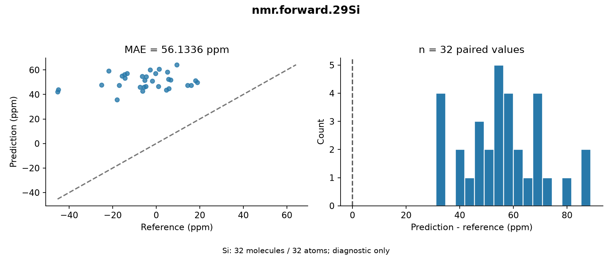

# Structure to 29Si NMR: frozen diagnostic

Run the released liquid All-nucleus NMRNet checkpoint on existing atom-indexed validation records.

## Current evidence

Unsuitable as an accurate solution predictor: 56.13 ppm MAE, all 32 predictions biased high. Clean data and obtain compatible weights before considering fine-tuning.

## What goes in

| Field | Meaning |
| --- | --- |
| `smiles / geometry` | A valid molecular graph and a compatible 3D conformer; atom order must be preserved. |
| `nucleus` | 29Si; the checkpoint must cover this nucleus. |
| `reference peaks` | Optional measured ppm values for evaluation; not an inference input. |

## What comes out

| Field | Meaning |
| --- | --- |
| `prediction_ppm` | Per-atom chemical shifts in ppm, with atom indices or a peak list. |
| `error / coverage` | Reference-matched errors and coverage; matching does not establish atom assignments. |

## A real recorded example

The first recorded example is shown below, regardless of whether it succeeds. Array previews explicitly state their lengths; download the evidence JSON for complete values. Reference labels are kept separate from model inputs.

```json
{
  "input": {
    "smiles": "CCCCCC/C(=C(/C=O)N1CCOC1=O)[Si](C)(C)c1cc(OC)cc(OC)c1",
    "atom_indices": [
      16
    ]
  },
  "output": {
    "prediction_ppm": [
      54.781612396240234
    ]
  },
  "reference": {
    "ppm": [
      -6.480000019073486
    ]
  }
}
```



[SVG](../assets/gallery/nmr-forward-29Si.svg) · [PNG](../assets/gallery/nmr-forward-29Si.png) · [Full input/output JSON](../assets/examples/nmr-forward-29Si.json)

## Actual evaluation results

| Dataset / scope | Model / variant | Metric | Value |
| --- | --- | --- | ---: |
| recorded evaluation | recorded model | mae_ppm | 56.1336 |
| recorded evaluation | recorded model | rmse_ppm | 58.1058 |
| recorded evaluation | recorded model | molecules | 32 |
| recorded evaluation | recorded model | atoms | 32 |

Sample sizes and candidate pools belong to each run. The figure may show one molecule; the table reports the cited run, not a new benchmark on that molecule.

## Model and method

Completed 32 distinct molecules per nucleus using the saved scaler and full checkpoint restoration. Sample IDs and atom labels were checked against the exact inference inputs. See results/bsi_frozen_diagnostic_20261116.json and scripts/run_frozen_bsi_diagnostic.py.

Diagnostic atom-level MAE/RMSE in ppm; these are not peak-matching scores or validated held-out benchmark results.

## Reproduce

[Notebook with executed figures](../notebooks/nmr-forward-29Si.ipynb) · [Quick Start](../quickstart.md)

```bash
python -m openmolspec_bench run --workspace /path/to/OpenMolSpec \
  --tasks nmr.forward.29Si --limit 8 --output results/nmr-forward-29Si-new.json
```

## Limits and provenance

Nucleus-specific training coverage, training overlap and experimental assignment provenance are unverified. The model has no solvent input. Primary scoring remains disabled; NMRNet++ B/Si-specific weights are still being sought. No fitting was performed.

- [bsi_frozen_diagnostic_20261116.json](https://github.com/jiaqingxie/openmolspec-studio-frontend/blob/release/openmolspec-v1/results/bsi_frozen_diagnostic_20261116.json) — SHA-256 `0f7c1f6c9eae12e644753581f785d76b1824f8311d5fccc7ae4afb98d19c65e6`

[Original model / 原模型](https://github.com/Colin-Jay/NMRNet) · [Model review / 模型检查](../model-audit.md)
