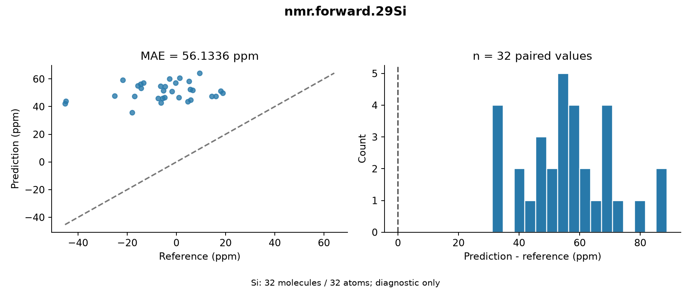

# 结构 → 29Si 峰列表

用已训练的液相 All-nucleus NMRNet 对 29Si 验证数据做冻结推理。

## 当前结论

当前不适合精确溶液位移预测：MAE 56.13 ppm，32 个预测全部偏高。先清理数据并确认相容权重，再考虑微调。

## 输入是什么

| Field | Meaning |
| --- | --- |
| `smiles / geometry` | 有效分子结构及相容的三维构象，必须保留原子顺序。 |
| `nucleus` | 29Si，权重必须覆盖该核种。 |
| `reference peaks` | 评测时提供实测 ppm 标签；标签不作为模型推理输入。 |

## 输出是什么

| Field | Meaning |
| --- | --- |
| `prediction_ppm` | 逐原子化学位移（ppm）及原子编号，或整理后的峰列表。 |
| `error / coverage` | 与参考谱匹配后的误差及覆盖率；峰匹配不等于实验原子指认。 |

## 真实运行案例

下面展示记录中的第一例，不按结果好坏筛选。长数组预览会标明完整长度；完整数值可下载证据 JSON。参考标签与模型输入分开保留。

```json
{
  "input": {
    "smiles": "CCCCCC/C(=C(/C=O)N1CCOC1=O)[Si](C)(C)c1cc(OC)cc(OC)c1",
    "atom_indices": [
      16
    ]
  },
  "output": {
    "prediction_ppm": [
      54.781612396240234
    ]
  },
  "reference": {
    "ppm": [
      -6.480000019073486
    ]
  }
}
```



[SVG](../assets/gallery/nmr-forward-29Si.svg) · [PNG](../assets/gallery/nmr-forward-29Si.png) · [Full input/output JSON](../assets/examples/nmr-forward-29Si.json)

## 实际评测结果

| Dataset / scope | Model / variant | Metric | Value |
| --- | --- | --- | ---: |
| recorded evaluation | recorded model | mae_ppm | 56.1336 |
| recorded evaluation | recorded model | rmse_ppm | 58.1058 |
| recorded evaluation | recorded model | molecules | 32 |
| recorded evaluation | recorded model | atoms | 32 |

样本量和候选池随每次运行记录。图可能展示单个分子，表格是来源实验的实际汇总，不能混为同一统计范围。

## 模型与方法

B、Si 各完成 32 个不同分子，复用保存的 scaler，检查完整加载全部权重，并通过样本 ID 核对原子标签。证据为 results/bsi_frozen_diagnostic_20261116.json；复现脚本为 scripts/run_frozen_bsi_diagnostic.py。

报告逐原子 MAE/RMSE，单位 ppm；这是诊断值，不是峰匹配分数或已验证的独立测试成绩。

## 复现方式

[Notebook with executed figures](../notebooks/nmr-forward-29Si.ipynb) · [Quick Start](../quickstart.md)

```bash
python -m openmolspec_bench run --workspace /path/to/OpenMolSpec \
  --tasks nmr.forward.29Si --limit 8 --output results/nmr-forward-29Si-new.json
```

## 边界与来源

各核训练覆盖、训练重叠及实验原子指认来源尚未核实，且该模型不输入溶剂。正式评分仍停用；继续核查 NMRNet++ 的 B/Si 专用权重，不拟合任何校正。

- [bsi_frozen_diagnostic_20261116.json](https://github.com/jiaqingxie/openmolspec-studio-frontend/blob/release/openmolspec-v1/results/bsi_frozen_diagnostic_20261116.json) — SHA-256 `0f7c1f6c9eae12e644753581f785d76b1824f8311d5fccc7ae4afb98d19c65e6`

[Original model / 原模型](https://github.com/Colin-Jay/NMRNet) · [Model review / 模型检查](../model-audit.md)
