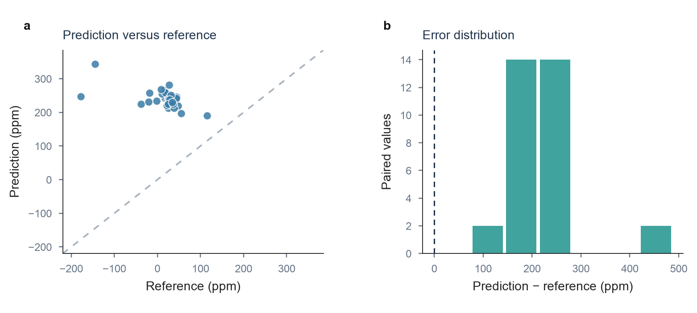

# 31P chemical shift prediction

Predict the 31P chemical shifts of a molecule from its structure. Use the atom indices to display predictions on the molecular graph or compare them with measured peaks.

## What goes in

| Field | Meaning |
| --- | --- |
| `smiles / geometry` | A valid molecular graph and a compatible 3D conformer; atom order must be preserved. |
| `nucleus` | 31P; the checkpoint must cover this nucleus. |
| `reference peaks` | Optional measured ppm values for evaluation; not an inference input. |

## What comes out

| Field | Meaning |
| --- | --- |
| `prediction_ppm` | Per-atom chemical shifts in ppm, with atom indices or a peak list. |
| `error / coverage` | Reference-matched errors and peak coverage. |

## A real recorded example

Inspect the input, prediction and reference for the example below. Download the JSON for the complete numerical arrays and additional examples.



[SVG](../assets/gallery/nmr-forward-31P.svg) · [PNG](../assets/gallery/nmr-forward-31P.png) · [Full input/output JSON](../assets/examples/nmr-forward-31P.json)

<details><summary>Inspect the actual input and output fields</summary>

```json
{
  "input": {
    "smiles": "COc1ccc(P(=O)(CCCc2ccccc2)OCC)cc1",
    "nucleus": "P",
    "atom_indices": [
      6
    ]
  },
  "output": {
    "prediction_ppm": 246.23046875
  },
  "reference": {
    "ppm": 44.90999984741211
  }
}
```

</details>

## Actual evaluation results

| Dataset / scope | Model / variant | Metric | Value |
| --- | --- | --- | ---: |
| recorded evaluation | recorded model | mae_ppm | 226.449 |
| recorded evaluation | recorded model | rmse_ppm | 237.252 |
| recorded evaluation | recorded model | examples | 32 |

## Model and method

Use the solid-state NMRNet checkpoint to generate atomwise F/P predictions for the prepared molecular geometries. The benchmark scores the saved predictions against the exact paired LMDB references. Supply the frozen-inference directory and select the cross-domain comparison option.

MAE and RMSE are reported in ppm.

## Reproduce

[Notebook with executed figures](../notebooks/nmr-forward-31P.ipynb) · [Quick Start](../quickstart.md)

```bash
python -m openmolspec_bench run --workspace /path/to/OpenMolSpec \
  --tasks nmr.forward.31P --fp-inference-root /path/to/frozen-fp --allow-cross-domain-diagnostic --limit 8 --output results/nmr-forward-31P-new.json
```

## Call and adapt this model

```python
from openmolspec.benchmark import Benchmark
benchmark = Benchmark(workspace='/path/to/workspace',
    python='/path/to/sdk-env/bin/python',
    models_root='/path/to/models',
    nmr_python='/path/to/nmr-env/bin/python',
    fp_inference_root='/path/to/frozen-fp')
result = benchmark.run('nmr.forward.31P', output='31P-results.json', limit=32, allow_cross_domain_diagnostic=True)
```

For fine-tuning, use the [NMRNet author training implementation](https://github.com/Colin-Jay/NMRNet), preparing atom-labelled structures/coordinates, target masks and train/validation LMDBs for the selected nucleus. Its `atom_regloss_mae` and `atom_regloss_mse` criteria operate on supervised target atoms. Retain the scaler/reference convention and select the checkpoint on validation data. This author training route is separate from the SDK inference facade.

$$L_{\rm MAE}=\frac{1}{N_{\rm labelled}}\sum_{i\in\mathcal M}|\hat\delta_i-\delta_i|,\qquad L_{\rm MSE}=\frac{1}{N_{\rm labelled}}\sum_{i\in\mathcal M}(\hat\delta_i-\delta_i)^2.$$


| Model setting | Value |
| --- | --- |
| Checkpoint | NMRNet 31P checkpoint |
| Training domain | solid-state |
| Shift unit | ppm |

<details><summary>Source reports and SHA-256 fingerprints</summary>

- [fp_frozen_fresh_diagnostic_20261115.json](https://github.com/jiaqingxie/openmolspec-studio-frontend/blob/release/openmolspec-v1/results/fp_frozen_fresh_diagnostic_20261115.json) — SHA-256 `7a44203bd5826e778a9006edd92dee0ec71e47930c2a980f6082313974c68475`

</details>


[Model implementation / 模型实现](https://github.com/Colin-Jay/NMRNet) · [Model review / 模型检查](../model-audit.md)

## References

- Xu, F., Guo, W., Wang, F., Yao, L., Wang, H., Tang, F., Gao, Z., Zhang, L., E, W., Tian, Z.-Q., et al. Toward a unified benchmark and framework for deep learning-based prediction of nuclear magnetic resonance chemical shifts. Nature Computational Science 5, 292–300 (2025). doi:10.1038/s43588-025-00783-z. [Source](https://doi.org/10.1038/s43588-025-00783-z)
- OpenDataLab. WanJuan MolSpectra, version 1.0.3. Experimental molecular spectroscopy dataset. [Source](https://opendatalab.com/)
