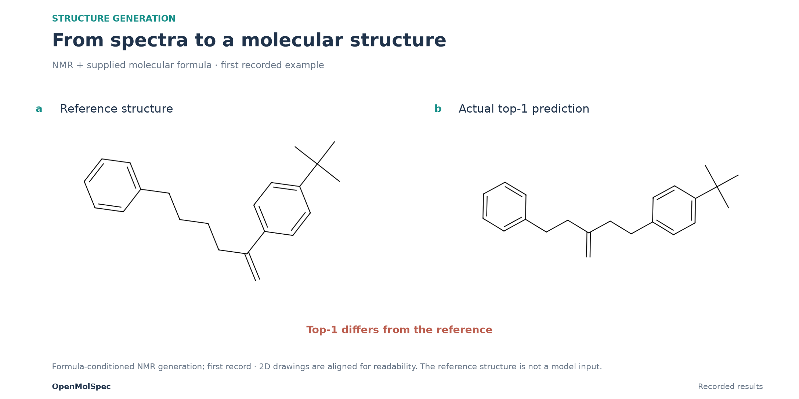

# 谱图 → SMILES · C

用已有生成模型从实验 H/C NMR 预测 SMILES 候选。

**评测限制：**多个 NMR 视图已确认与 checkpoint 记录的训练数据存在分子重叠，最终生成模型还存在训练文件哈希不一致。现有运行不能证明独立泛化能力。 [Training-history audit / 训练历史审计](../training-overlap.md)

## 当前结论

存在明显数据域差异：专利和 NMRGym 的 32 样本检查均为零精确匹配。先检查独立测试、解析及词表覆盖，再考虑领域微调。

## 输入是什么

| Field | Meaning |
| --- | --- |
| `h_nmr / c_nmr` | C 谱记录：位移（ppm）及原记录中的多重性、积分、J 值；按模态掩码选择输入。 |
| `formula` | 此 checkpoint 必须显式提供已知分子式。 |
| `beam_size` | 解码候选数；本页实验使用 5。 |

## 输出是什么

| Field | Meaning |
| --- | --- |
| `candidates` | 生成 SMILES、规范结构、有效性、分子式一致性及模型分数。 |
| `exact_match` | 将选中候选与参考结构比较；SMILES 有效并不代表结构正确。 |

## 真实运行案例

下面展示记录中的第一例，不按结果好坏筛选。长数组预览会标明完整长度；完整数值可下载证据 JSON。参考标签与模型输入分开保留。

```json
{
  "input": {
    "formula": "C22H28",
    "h_nmr": [],
    "c_nmr": [
      {
        "type": "13C NMR",
        "chemical_shift": "150.22, 148.03, 142.68, 138.28, 128.36, 128.22, 125.68, 125.58, 125.12, 111.51, 35.72, 35.03, 34.46, 31.32, 31.11, 27.93"
      }
    ],
    "modality_mask": [
      0,
      1
    ]
  },
  "reference_smiles": "C=C(CCCCc1ccccc1)c1ccc(C(C)(C)C)cc1",
  "candidates": {
    "length": 5,
    "first_values": [
      {
        "smiles": "C=C(CCc1ccc(C(C)(C)C)cc1)CCc1ccccc1",
        "canonical_smiles": "C=C(CCc1ccccc1)CCc1ccc(C(C)(C)C)cc1",
        "score": -2.8281531435108036,
        "valid": true,
        "formula_match": true
      },
      {
        "smiles": "C=C(c1ccc(C(C)(C)C)cc1)c1ccc(C(C)(C)C)cc1",
        "canonical_smiles": "C=C(c1ccc(C(C)(C)C)cc1)c1ccc(C(C)(C)C)cc1",
        "score": -3.3919860787640914,
        "valid": true,
        "formula_match": true
      },
      {
        "smiles": "C=C(CCc1ccccc1)c1ccc(C(C)(C)C)cc1CC",
        "canonical_smiles": "C=C(CCc1ccccc1)c1ccc(C(C)(C)C)cc1CC",
        "score": -3.731960778021964,
        "valid": true,
        "formula_match": true
      },
      {
        "smiles": "C=C(CCCc1ccccc1)c1ccc(C(C)(C)C)cc1",
        "canonical_smiles": "C=C(CCCc1ccccc1)c1ccc(C(C)(C)C)cc1",
        "score": -3.0991712021525473,
        "valid": true,
        "formula_match": false
      }
    ]
  },
  "exact_match": false
}
```



[SVG](../assets/gallery/nmr-generation-c.svg) · [PNG](../assets/gallery/nmr-generation-c.png) · [Full input/output JSON](../assets/examples/nmr-generation-c.json)

## 实际评测结果

| Dataset / scope | Model / variant | Metric | Value |
| --- | --- | --- | ---: |
| nmrspec_test | recorded model | examples | 32 |
| nmrspec_test | recorded model | valid_rate | 0.96875 |
| nmrspec_test | recorded model | formula_match_rate | 0.71875 |
| nmrspec_test | recorded model | exact_rate | 0.09375 |
| patent_test_10k | recorded model | examples | 32 |
| patent_test_10k | recorded model | valid_rate | 0.875 |
| patent_test_10k | recorded model | formula_match_rate | 0.09375 |
| patent_test_10k | recorded model | exact_rate | 0 |
| nmrexp_exp_10k | recorded model | examples | 32 |
| nmrexp_exp_10k | recorded model | valid_rate | 1 |
| nmrexp_exp_10k | recorded model | formula_match_rate | 0.9375 |
| nmrexp_exp_10k | recorded model | exact_rate | 0.59375 |
| nmrgym_test | recorded model | examples | 32 |
| nmrgym_test | recorded model | valid_rate | 0.9375 |
| nmrgym_test | recorded model | formula_match_rate | 0.5 |
| nmrgym_test | recorded model | exact_rate | 0 |

样本量和候选池随每次运行记录。图可能展示单个分子，表格是来源实验的实际汇总，不能混为同一统计范围。

## 模型与方法

该模型需要显式给定分子式。按原推理代码的有效性、分子式一致性和模型分数排序 beam，取 top-1 评分。不会从目标 SMILES 偷偷推导缺失的输入分子式。

报告有效 SMILES 比率、规范异构 SMILES exact match、分子式一致率，同时保存 beam size、模态 mask 和样本。JSONL 的 smiles 仅是评测答案，不是生成输入。

## 复现方式

[Notebook with executed figures](../notebooks/nmr-generation-c.ipynb) · [Quick Start](../quickstart.md)

```bash
python -m openmolspec_bench run --workspace /path/to/OpenMolSpec \
  --tasks nmr.generation.c --limit 8 --output results/nmr-generation-c-new.json
```

## 边界与来源

给定分子式的结构生成与分子式预测、无分子式生成是不同任务。跨数据集 exact match 低或为零时保留真实结果，不替换成缓存答案。

- [nmr_documented_examples_20261117_v2.json](https://github.com/jiaqingxie/openmolspec-studio-frontend/blob/release/openmolspec-v1/results/nmr_documented_examples_20261117_v2.json) — SHA-256 `669413d6fc0939bdb6826782d41fc13cf12926a672418ecb46303f0b8ba05b99`

[Original model / 原模型](https://github.com/jiaqingxie/openmolspec-studio-frontend) · [Model review / 模型检查](../model-audit.md)
