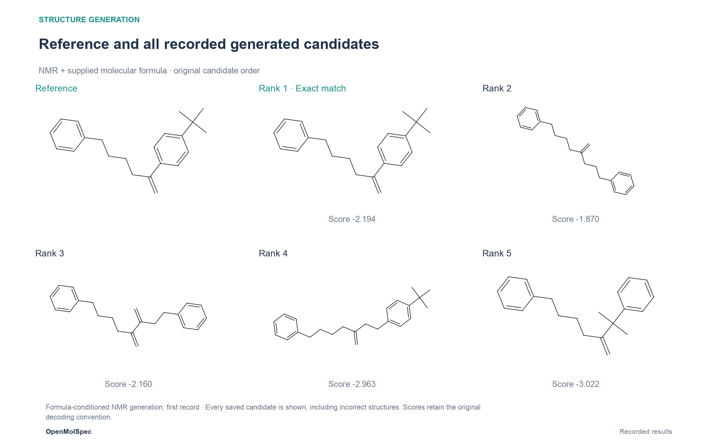

# NMR-to-SMILES generation: H

Generate candidate molecular structures from experimental H/C NMR with the existing generation checkpoint.

## Example and evaluation

Strong dataset dependence: zero exact matches on the 32-example patent and NMRGym checks. Prioritize a clean external test and parsing/token coverage audit; then consider domain fine-tuning.

## What goes in

| Field | Meaning |
| --- | --- |
| `h_nmr / c_nmr` | H records: shift positions (ppm), multiplicity/integration/J where recorded; obey the modality mask. |
| `formula` | A known molecular formula is required by this checkpoint. |
| `beam_size` | Number of decoded candidates; 5 in the documented experiment. |

## What comes out

| Field | Meaning |
| --- | --- |
| `candidates` | Generated SMILES, canonical structures, validity, formula match and model score. |
| `exact_match` | Compare the selected candidate with a held reference structure; valid SMILES alone is not success. |

## A real recorded example

The first recorded example is shown below, regardless of whether it succeeds. Array previews explicitly state their lengths; download the evidence JSON for complete values. Reference labels are kept separate from model inputs.



[SVG](../assets/gallery/nmr-generation-h.svg) · [PNG](../assets/gallery/nmr-generation-h.png) · [Full input/output JSON](../assets/examples/nmr-generation-h.json)

<details><summary>Inspect the actual input and output fields</summary>

```json
{
  "input": {
    "formula": "C22H28",
    "h_nmr": [
      {
        "type": "1H NMR",
        "chemical_shift": "7.34 (s, 4H), 7.265 (m, 2H), 7.165 (m, 3H), 5.26 (d, J=1.6 Hz, 1H), 5.01 (t, J=1.4 Hz, 1H), 2.61 (t, J=7.8 Hz, 2H), 2.53 (t, J=7.6 Hz, 2H), 1.665 (m, 2H), 1.52 (d, J=7.7 Hz, 2H), 1.33 (s, 9H)"
      }
    ],
    "c_nmr": [],
    "modality_mask": [
      1,
      0
    ]
  },
  "reference_smiles": "C=C(CCCCc1ccccc1)c1ccc(C(C)(C)C)cc1",
  "candidates": {
    "length": 5,
    "first_values": [
      {
        "smiles": "C=C(CCCCc1ccccc1)c1ccc(C(C)(C)C)cc1",
        "canonical_smiles": "C=C(CCCCc1ccccc1)c1ccc(C(C)(C)C)cc1",
        "score": -2.1940921595343212,
        "valid": true,
        "formula_match": true
      },
      {
        "smiles": "C=C(CCCCc1ccccc1)CCCc1ccccc1",
        "canonical_smiles": "C=C(CCCCc1ccccc1)CCCc1ccccc1",
        "score": -1.869783622449546,
        "valid": true,
        "formula_match": false
      },
      {
        "smiles": "C=C(CCCCc1ccccc1)C(=C)CCc1ccccc1",
        "canonical_smiles": "C=C(CCCCc1ccccc1)C(=C)CCc1ccccc1",
        "score": -2.15992978554236,
        "valid": true,
        "formula_match": false
      },
      {
        "smiles": "C=C(CCCCc1ccccc1)CCc1ccc(C(C)(C)C)cc1",
        "canonical_smiles": "C=C(CCCCc1ccccc1)CCc1ccc(C(C)(C)C)cc1",
        "score": -2.962536625102061,
        "valid": true,
        "formula_match": false
      }
    ]
  },
  "exact_match": true
}
```

</details>

## Actual evaluation results

| Dataset / scope | Model / variant | Metric | Value |
| --- | --- | --- | ---: |
| nmrspec_test | recorded model | examples | 32 |
| nmrspec_test | recorded model | valid_rate | 1 |
| nmrspec_test | recorded model | formula_match_rate | 0.84375 |
| nmrspec_test | recorded model | exact_rate | 0.09375 |
| patent_test_10k | recorded model | examples | 32 |
| patent_test_10k | recorded model | valid_rate | 0.71875 |
| patent_test_10k | recorded model | formula_match_rate | 0.15625 |
| patent_test_10k | recorded model | exact_rate | 0 |
| nmrexp_exp_10k | recorded model | examples | 32 |
| nmrexp_exp_10k | recorded model | valid_rate | 1 |
| nmrexp_exp_10k | recorded model | formula_match_rate | 0.84375 |
| nmrexp_exp_10k | recorded model | exact_rate | 0.46875 |
| nmrgym_test | recorded model | examples | 32 |
| nmrgym_test | recorded model | valid_rate | 0.9375 |
| nmrgym_test | recorded model | formula_match_rate | 0.46875 |
| nmrgym_test | recorded model | exact_rate | 0 |

Sample sizes and candidate pools belong to each run. The figure may show one molecule; the table reports the cited run, not a new benchmark on that molecule.

## Model and method

The existing model requires an explicitly supplied molecular formula. Beam candidates are ranked by validity, formula agreement and model score, following the checkpoint's inference code. No formula is derived secretly from the target structure.

Report valid SMILES rate, canonical exact-match rate and formula-match rate, with the beam size, modality mask and selected records.

## Reproduce

[Notebook with executed figures](../notebooks/nmr-generation-h.ipynb) · [Quick Start](../quickstart.md)

```bash
python -m openmolspec_bench run --workspace /path/to/OpenMolSpec \
  --tasks nmr.generation.h --limit 8 --output results/nmr-generation-h-new.json
```

## Call and adapt this model

```python
from openmolspec.model import NMRTransformer
model = NMRTransformer.from_pretrained(
    '/path/to/checkpoint.pt', stage='generate',
    python='/path/to/nmr-env/bin/python')
result = model.predict(query, beam_size=5)
plan = model.training_plan(
    'prepared-nmr', run_dir='runs/my-model', epochs=10, batch_size=32,
    alignment_checkpoint='/path/to/alignment.pt')
print(plan.validate())
# trained = model.fit(plan)
```

Prepare disjoint train/validation records with `prepare_nmr_training`; supply an alignment checkpoint for the generator. Use H/C masks to define available inputs and choose model selection criteria on validation data. Pretrained initialization restores model weights. [Data preparation](../api.md) provides the complete workflow.

### Training objective

$$L_{\rm LM}=-\frac{1}{N_{\rm token}}\sum_t\log p_\theta(y_t\mid y_{<t},x,F).$$

Generation uses token cross-entropy; an optional joint alignment term follows its configured weight. Alignment uses normalized spectral/molecular representations with symmetric contrastive cross-entropy; ITM configuration adds positive/negative matching. The actual checkpoint/training configuration determines the objective.

## Data requirements and references

Formula-conditioned generation must be distinguished from formula prediction and from generation without a supplied formula. Low or zero cross-dataset exact match is retained, not replaced by cached answers.

<details><summary>Source reports and SHA-256 fingerprints</summary>

- [nmr_documented_examples_20261117_v2.json](https://github.com/jiaqingxie/openmolspec-studio-frontend/blob/release/openmolspec-v1/results/nmr_documented_examples_20261117_v2.json) — SHA-256 `669413d6fc0939bdb6826782d41fc13cf12926a672418ecb46303f0b8ba05b99`

</details>


[Original model / 原模型](https://github.com/jiaqingxie/openmolspec-studio-frontend) · [Model review / 模型检查](../model-audit.md)
