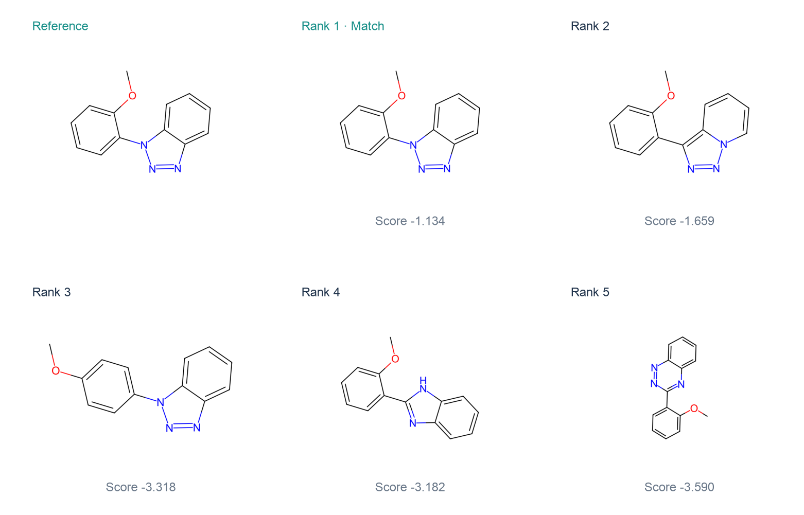
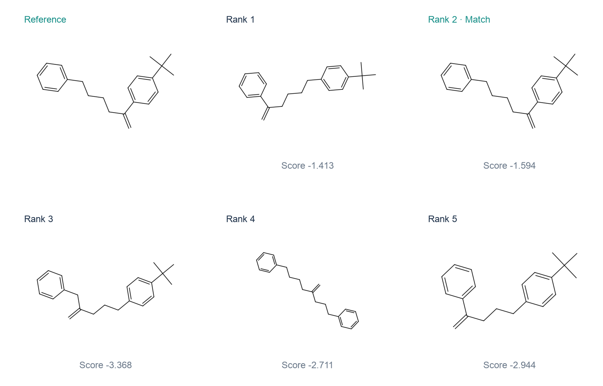

# Structure elucidation from ¹H + ¹³C NMR

Generate candidate molecular structures from NMR peak lists and a molecular formula.

## What goes in

| Field | Meaning |
| --- | --- |
| `h_nmr / c_nmr` | HC records: shift positions (ppm), multiplicity/integration/J where recorded; obey the modality mask. |
| `formula` | A known molecular formula is required by this checkpoint. |
| `beam_size` | Number of decoded candidates; 5 in the documented experiment. |

## What comes out

| Field | Meaning |
| --- | --- |
| `candidates` | Generated SMILES, canonical structures, validity, formula match and model score. |
| `exact_match` | Canonical structural agreement with the reference molecule. |

## A real recorded example

Inspect the input, prediction and reference for the example below. Download the JSON for the complete numerical arrays and additional examples.



[SVG](../assets/gallery/nmr-generation-hc.svg) · [PNG](../assets/gallery/nmr-generation-hc.png) · [Full input/output JSON](../assets/examples/nmr-generation-hc.json)

### Example 2



### Example 3


<details><summary>Inspect the actual input and output fields</summary>

```json
{
  "input": {
    "formula": "C13H11N3O",
    "h_nmr": [
      {
        "type": "1H NMR",
        "chemical_shift": "8.13 (d, J=8.2 Hz, 1H), 7.52 (m, 1H), 7.47 (m, 1H), 7.395 (m, 2H), 7.16 (m, 2H), 3.8 (s, 3H)"
      }
    ],
    "c_nmr": [
      {
        "type": "13C NMR",
        "chemical_shift": "153.75, 145.7, 134.13, 131.02, 128.17, 127.52, 125.38, 123.83, 121.12, 119.88, 112.43, 111.17, 55.85"
      }
    ],
    "modality_mask": [
      1,
      1
    ]
  },
  "reference_smiles": "COc1ccccc1-n1nnc2ccccc21",
  "candidates": {
    "length": 5,
    "first_values": [
      {
        "smiles": "COc1ccccc1-n1nnc2ccccc21",
        "canonical_smiles": "COc1ccccc1-n1nnc2ccccc21",
        "score": -1.1338406825806828,
        "valid": true,
        "formula_match": true
      },
      {
        "smiles": "COc1ccccc1-c1nnn2ccccc12",
        "canonical_smiles": "COc1ccccc1-c1nnn2ccccc12",
        "score": -1.6589541644720214,
        "valid": true,
        "formula_match": true
      },
      {
        "smiles": "COc1ccc(-n2nnc3ccccc32)cc1",
        "canonical_smiles": "COc1ccc(-n2nnc3ccccc32)cc1",
        "score": -3.3182191402798367,
        "valid": true,
        "formula_match": true
      },
      {
        "smiles": "COc1ccccc1-c1nc2ccccc2[nH]1",
        "canonical_smiles": "COc1ccccc1-c1nc2ccccc2[nH]1",
        "score": -3.1824993170265827,
        "valid": true,
        "formula_match": false
      }
    ]
  },
  "exact_match": true
}
```

</details>

## Actual evaluation results

| Dataset / scope | Model / variant | Metric | Value |
| --- | --- | --- | ---: |
| nmrspec_test | recorded model | modality | available |
| nmrspec_test | recorded model | examples | 32 |
| nmrspec_test | recorded model | skipped_missing_modality | 0 |
| nmrspec_test | recorded model | valid | 32 |
| nmrspec_test | recorded model | formula_match | 29 |
| nmrspec_test | recorded model | exact | 4 |
| nmrspec_test | recorded model | valid_rate | 1 |
| nmrspec_test | recorded model | formula_match_rate | 0.90625 |
| nmrspec_test | recorded model | exact_rate | 0.125 |
| patent_test_10k | recorded model | modality | available |
| patent_test_10k | recorded model | examples | 32 |
| patent_test_10k | recorded model | skipped_missing_modality | 0 |
| patent_test_10k | recorded model | valid | 24 |
| patent_test_10k | recorded model | formula_match | 1 |
| patent_test_10k | recorded model | exact | 0 |
| patent_test_10k | recorded model | valid_rate | 0.75 |
| patent_test_10k | recorded model | formula_match_rate | 0.03125 |
| patent_test_10k | recorded model | exact_rate | 0 |
| nmrexp_exp_10k | recorded model | modality | available |
| nmrexp_exp_10k | recorded model | examples | 32 |
| nmrexp_exp_10k | recorded model | skipped_missing_modality | 0 |
| nmrexp_exp_10k | recorded model | valid | 32 |
| nmrexp_exp_10k | recorded model | formula_match | 29 |
| nmrexp_exp_10k | recorded model | exact | 22 |
| nmrexp_exp_10k | recorded model | valid_rate | 1 |
| nmrexp_exp_10k | recorded model | formula_match_rate | 0.90625 |
| nmrexp_exp_10k | recorded model | exact_rate | 0.6875 |
| nmrgym_test | recorded model | modality | available |
| nmrgym_test | recorded model | examples | 32 |
| nmrgym_test | recorded model | skipped_missing_modality | 0 |
| nmrgym_test | recorded model | valid | 25 |
| nmrgym_test | recorded model | formula_match | 15 |
| nmrgym_test | recorded model | exact | 0 |
| nmrgym_test | recorded model | valid_rate | 0.78125 |
| nmrgym_test | recorded model | formula_match_rate | 0.46875 |
| nmrgym_test | recorded model | exact_rate | 0 |

## Model and method

The NMRTransformer spectral encoder represents the peak lists, and the molecular decoder generates SMILES with beam search. Candidates include their molecular formula agreement and decoding scores.

Canonical top-k accuracy and valid-SMILES rate summarize generation.

## Reproduce

[Notebook with executed figures](../notebooks/nmr-generation-hc.ipynb) · [Quick Start](../quickstart.md)

```bash
python -m openmolspec_bench run --workspace /path/to/OpenMolSpec \
  --tasks nmr.generation.hc --limit 8 --output results/nmr-generation-hc-new.json
```

## Call and adapt this model

```python
from openmolspec.model import NMRTransformer
model = NMRTransformer.from_pretrained(
    '/path/to/checkpoint.pt', stage='generate',
    python='/path/to/nmr-env/bin/python')
result = model.predict(query, beam_size=5)
plan = model.training_plan(
    'prepared-nmr', run_dir='runs/my-model', epochs=10, batch_size=32,
    alignment_checkpoint='/path/to/alignment.pt')
print(plan.validate())
# trained = model.fit(plan)
```

Prepare disjoint train/validation records with `prepare_nmr_training`; supply an alignment checkpoint for the generator. Use H/C masks to define available inputs and choose model selection criteria on validation data. Pretrained initialization restores model weights. [Data preparation](../api.md) provides the complete workflow.

### Training objective

$$L_{\rm LM}=-\frac{1}{N_{\rm token}}\sum_t\log p_\theta(y_t\mid y_{<t},x,F).$$

Generation uses token cross-entropy; an optional joint alignment term follows its configured weight. Alignment uses normalized spectral/molecular representations with symmetric contrastive cross-entropy; ITM configuration adds positive/negative matching. The actual checkpoint/training configuration determines the objective.

<details><summary>Source reports and SHA-256 fingerprints</summary>

- [nmr_documented_examples_20261117_v2.json](https://github.com/jiaqingxie/openmolspec-studio-frontend/blob/release/openmolspec-v1/results/nmr_documented_examples_20261117_v2.json) — SHA-256 `669413d6fc0939bdb6826782d41fc13cf12926a672418ecb46303f0b8ba05b99`

</details>


[Model implementation / 模型实现](https://github.com/jiaqingxie/openmolspec-studio-frontend) · [Model review / 模型检查](../model-audit.md)

## References

- Yang, L., Yang, Z., Xie, J., Wang, Y., Gao, B., Fu, T., Wei, X., Sun, J., Wu, J., He, C., Li, Y. & Gu, Q. NMRTrans: Structure Elucidation from Experimental NMR Spectra via Set Transformers. arXiv:2602.10158 (2026). [Source](https://arxiv.org/abs/2602.10158)
- Fang, Z., Yang, C., Yu, H., Luo, H., He, H., Xie, J., Yang, Z. & Xia, J. NMRGym: A Comprehensive Benchmark for Nuclear Magnetic Resonance Based Molecular Structure Elucidation. arXiv:2601.15763 (2026). [Source](https://arxiv.org/abs/2601.15763)
- OpenDataLab. WanJuan MolSpectra, version 1.0.3. Experimental molecular spectroscopy dataset. [Source](https://opendatalab.com/)
