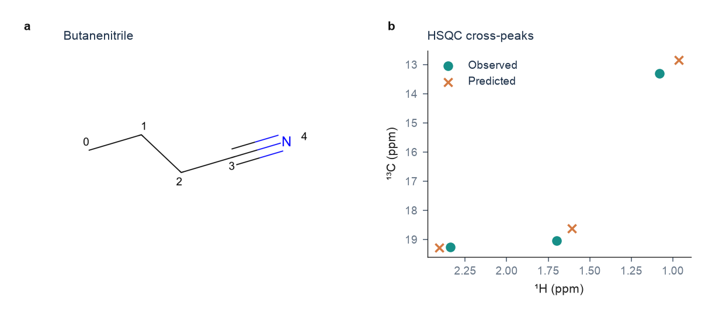

# HSQC cross-peak prediction

Predict C–H cross-peaks from a known structure and solvent.

## What goes in

| Field | Meaning |
| --- | --- |
| `smiles` | Original atom order of the known structure. |
| `solvent` | One of the nine author solvent classes. |

## What comes out

| Field | Meaning |
| --- | --- |
| `carbon_atom_index` | Zero-based protonated carbon indices. |
| `carbon_ppm / proton_ppm` | Per-carbon shifts and two proton head outputs in ppm. |

## A real recorded example

Inspect the input, prediction and reference for the example below. Download the JSON for the complete numerical arrays and additional examples.



[SVG](../assets/gallery/nmr-hsqc-transpeaknet.svg) · [PNG](../assets/gallery/nmr-hsqc-transpeaknet.png) · [Full input/output JSON](../assets/examples/nmr-hsqc-transpeaknet.json)

<details><summary>Inspect the actual input and output fields</summary>

```json
{
  "sample_id": "32869.csv",
  "input": {
    "smiles": "CCCC#N",
    "solvent": "CDCl3"
  },
  "output": {
    "peaks_c_h_ppm": [
      [
        12.845844268798828,
        0.962708592414856
      ],
      [
        18.62872314453125,
        1.6068708896636963
      ],
      [
        19.271541595458984,
        2.4061617851257324
      ]
    ],
    "carbon_atom_index": [
      0,
      1,
      2
    ]
  },
  "reference": {
    "peaks_c_h_ppm": [
      [
        13.3,
        1.081
      ],
      [
        19.04,
        1.699
      ],
      [
        19.26,
        2.339
      ]
    ]
  }
}
```

</details>

## Actual evaluation results

| Dataset / scope | Model / variant | Metric | Value |
| --- | --- | --- | ---: |
| 479 expert spectra | recorded model | carbon_mae_ppm | 2.02753 |
| 479 expert spectra | recorded model | proton_mae_ppm | 0.165891 |
| Author notebook (511 solvent rows) | recorded model | carbon_mae_ppm | 2.02487 |
| Author notebook (511 solvent rows) | recorded model | proton_mae_ppm | 0.165062 |

## Model and method

Load the released TransPeakNet weights and encode the original SMILES with explicit hydrogens. The benchmark pairs each predicted carbon and its two ordered proton outputs with the expert row for the same carbon index.

The full ZIP gives one vote to each of 479 spectra. The author notebook gives one vote to each of 511 metadata rows covering 472 spectra. The full-ZIP run uses the unknown class for 38 conflicting and seven missing solvent labels.

## Reproduce

[Notebook with executed figures](../notebooks/nmr-hsqc-transpeaknet.ipynb) · [Quick Start](../quickstart.md)

```bash
python -m openmolspec_bench run --workspace /path/to/OpenMolSpec \
  --tasks nmr.hsqc.transpeaknet --transpeaknet-source /path/to/2dNMR --limit 8 --output results/nmr-hsqc-transpeaknet-new.json
```

## Call and adapt this model

From the OpenMolSpec source checkout, install the HSQC dependencies and get the frozen author release.

```bash
python -m pip install -e '.[hsqc]'
git clone https://github.com/siriusxiao62/2dNMR.git
git -C 2dNMR checkout 2e93db82a9d627ac01109474e9b6e594065e3d56
python -m openmolspec_bench run --tasks nmr.hsqc.transpeaknet --transpeaknet-source 2dNMR --limit 479 --output results/hsqc-local.json
```

<details><summary>Source reports and SHA-256 fingerprints</summary>

- [transpeaknet_hsqc_479.json](https://github.com/jiaqingxie/openmolspec-studio-frontend/blob/release/openmolspec-v1/results/transpeaknet_hsqc_479.json) — SHA-256 `e65c1fe4a0966a72e446c4a8d2e656848d8262170676fe7b9d3449bdff8b1844`

</details>


[Model implementation / 模型实现](https://github.com/siriusxiao62/2dNMR/tree/2e93db82a9d627ac01109474e9b6e594065e3d56) · [Model review / 模型检查](../model-audit.md)

## References

- Li, Y., Xu, H., et al. TransPeakNet for solvent-aware 2D NMR prediction via multi-task pre-training and unsupervised learning. Communications Chemistry (2025). [Source](https://doi.org/10.1038/s42004-025-01455-9)
