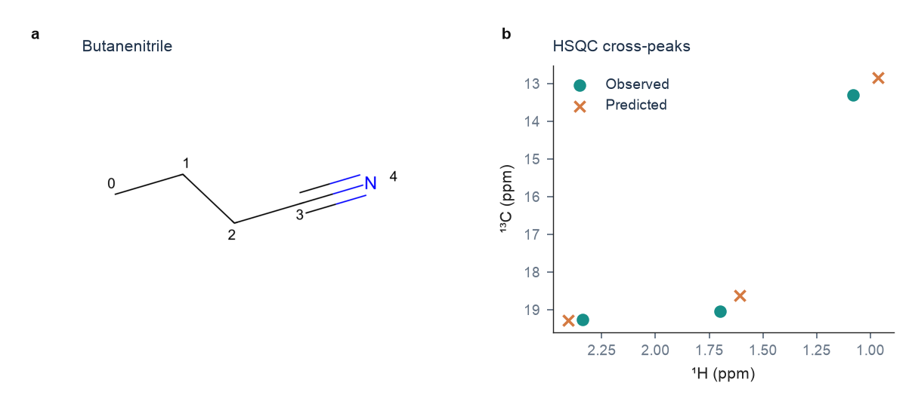

# HSQC 交叉峰预测

根据已知分子结构与溶剂预测碳氢交叉峰。

## 输入是什么

| Field | Meaning |
| --- | --- |
| `smiles` | 保留原子顺序的已知结构。 |
| `solvent` | 作者定义的九种溶剂类别之一。 |

## 输出是什么

| Field | Meaning |
| --- | --- |
| `carbon_atom_index` | 带氢碳原子的编号，从零开始。 |
| `carbon_ppm / proton_ppm` | 各碳位点的碳位移及两个氢位移输出，单位为 ppm。 |

## 真实运行案例

下面展示示例的输入、预测与参考。下载 JSON 可获取完整数值数组及更多示例。



[SVG](../assets/gallery/nmr-hsqc-transpeaknet.svg) · [PNG](../assets/gallery/nmr-hsqc-transpeaknet.png) · [Full input/output JSON](../assets/examples/nmr-hsqc-transpeaknet.json)

<details><summary>展开查看实际输入与输出字段</summary>

```json
{
  "sample_id": "32869.csv",
  "input": {
    "smiles": "CCCC#N",
    "solvent": "CDCl3"
  },
  "output": {
    "peaks_c_h_ppm": [
      [
        12.845844268798828,
        0.962708592414856
      ],
      [
        18.62872314453125,
        1.6068708896636963
      ],
      [
        19.271541595458984,
        2.4061617851257324
      ]
    ],
    "carbon_atom_index": [
      0,
      1,
      2
    ]
  },
  "reference": {
    "peaks_c_h_ppm": [
      [
        13.3,
        1.081
      ],
      [
        19.04,
        1.699
      ],
      [
        19.26,
        2.339
      ]
    ]
  }
}
```

</details>

## 实际评测结果

| Dataset / scope | Model / variant | Metric | Value |
| --- | --- | --- | ---: |
| 479 expert spectra | recorded model | carbon_mae_ppm | 2.02753 |
| 479 expert spectra | recorded model | proton_mae_ppm | 0.165891 |
| Author notebook (511 solvent rows) | recorded model | carbon_mae_ppm | 2.02487 |
| Author notebook (511 solvent rows) | recorded model | proton_mae_ppm | 0.165062 |

## 模型与方法

加载 TransPeakNet 作者权重，按输入 SMILES 的顺序补氢建图。对每个碳位点，按原子编号将模型的碳输出和两个有序氢输出与专家标注配对。

全量评测对 479 张谱等权平均。作者笔记本对溶剂表中的 511 行等权平均，覆盖 472 张谱。全量评测将 38 张有多种溶剂类别和 7 张缺溶剂记录的谱设为 unknown。

## 复现方式

[Notebook with executed figures](../notebooks/nmr-hsqc-transpeaknet.ipynb) · [Quick Start](../quickstart.md)

```bash
python -m openmolspec_bench run --workspace /path/to/OpenMolSpec \
  --tasks nmr.hsqc.transpeaknet --transpeaknet-source /path/to/2dNMR --limit 8 --output results/nmr-hsqc-transpeaknet-new.json
```

## 调用模型与微调

在 OpenMolSpec 源码目录中安装 HSQC 依赖，并下载作者发布的代码、权重和测试集。

```bash
python -m pip install -e '.[hsqc]'
git clone https://github.com/siriusxiao62/2dNMR.git
git -C 2dNMR checkout 2e93db82a9d627ac01109474e9b6e594065e3d56
python -m openmolspec_bench run --tasks nmr.hsqc.transpeaknet --transpeaknet-source 2dNMR --limit 479 --output results/hsqc-local.json
```

<details><summary>来源报告与 SHA-256 指纹</summary>

- [transpeaknet_hsqc_479.json](https://github.com/jiaqingxie/openmolspec-studio-frontend/blob/release/openmolspec-v1/results/transpeaknet_hsqc_479.json) — SHA-256 `e65c1fe4a0966a72e446c4a8d2e656848d8262170676fe7b9d3449bdff8b1844`

</details>


[Model implementation / 模型实现](https://github.com/siriusxiao62/2dNMR/tree/2e93db82a9d627ac01109474e9b6e594065e3d56) · [Model review / 模型检查](../model-audit.md)

## 参考文献

- Li, Y., Xu, H., et al. TransPeakNet for solvent-aware 2D NMR prediction via multi-task pre-training and unsupervised learning. Communications Chemistry (2025). [Source](https://doi.org/10.1038/s42004-025-01455-9)
