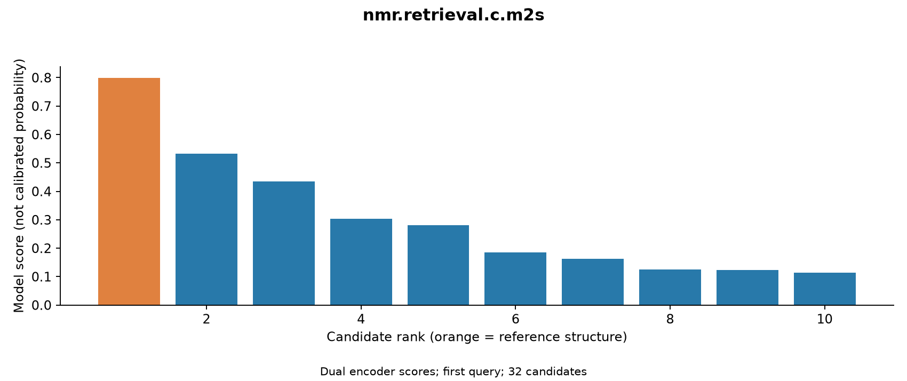

# NMR retrieval: C, m2s

Rank candidate structures from NMR spectra, or rank candidate spectra from a molecular structure, with the existing dual encoder.

**Evaluation limitation:** molecular overlap with checkpoint-recorded training data is confirmed for several NMR views. The final generator also has a training-file fingerprint discrepancy. These runs do not establish independent generalization.  [Training-history audit / 训练历史审计](../training-overlap.md)

## Current evidence

Input/output pairing is appropriate; the 32-candidate smoke pool is small. Validate a larger independent library before judging generalization or fine-tuning.

## What goes in

| Field | Meaning |
| --- | --- |
| `query` | C peak records for s2m; molecular structure for m2s. Direction here: m2s. |
| `candidate_pool` | Explicit candidate structures or spectra; ranking is restricted to this pool. |
| `formula` | Not supplied to the spectral encoder. |

## What comes out

| Field | Meaning |
| --- | --- |
| `ranked_candidates` | Candidate identity, rank and embedding similarity score. |
| `recall / MRR` | Report candidate-pool size with every metric; 32-way retrieval is not full-library retrieval. |

## A real recorded example

The first recorded example is shown below, regardless of whether it succeeds. Array previews explicitly state their lengths; download the evidence JSON for complete values. Reference labels are kept separate from model inputs.

```json
{
  "input": {
    "smiles": "C=C(CCCCc1ccccc1)c1ccc(C(C)(C)C)cc1"
  },
  "reference_smiles": "C=C(CCCCc1ccccc1)c1ccc(C(C)(C)C)cc1",
  "output": {
    "length": 10,
    "first_values": [
      {
        "smiles": "C=C(CCCCc1ccccc1)c1ccc(C(C)(C)C)cc1",
        "score": 0.7985133528709412,
        "reference_match": true
      },
      {
        "smiles": "Cc1cnn(C2CCc3ccccc32)c1",
        "score": 0.5333701372146606,
        "reference_match": false
      },
      {
        "smiles": "CC(C)(C)C1=CC(=Cc2ccc(Cl)cc2)C=C(C(C)(C)C)C1=O",
        "score": 0.4344002604484558,
        "reference_match": false
      },
      {
        "smiles": "CC(C)(C)OC(=O)N[C@H](CCC(=O)c1ccccc1)c1c[nH]c2cc(Cl)ccc12",
        "score": 0.30310308933258057,
        "reference_match": false
      }
    ]
  }
}
```



[SVG](../assets/gallery/nmr-retrieval-c-m2s.svg) · [PNG](../assets/gallery/nmr-retrieval-c-m2s.png) · [Full input/output JSON](../assets/examples/nmr-retrieval-c-m2s.json)

## Actual evaluation results

| Dataset / scope | Model / variant | Metric | Value |
| --- | --- | --- | ---: |
| nmrspec_test | recorded model | recall_at_1 | 0.9375 |
| nmrspec_test | recorded model | mrr | 0.950321 |
| nmrspec_test | recorded model | queries | 32 |
| nmrspec_test | recorded model | candidate_pool | 32 |
| patent_test_10k | recorded model | recall_at_1 | 0.5625 |
| patent_test_10k | recorded model | mrr | 0.694401 |
| patent_test_10k | recorded model | queries | 32 |
| patent_test_10k | recorded model | candidate_pool | 32 |
| nmrexp_exp_10k | recorded model | recall_at_1 | 0.65625 |
| nmrexp_exp_10k | recorded model | mrr | 0.774595 |
| nmrexp_exp_10k | recorded model | queries | 32 |
| nmrexp_exp_10k | recorded model | candidate_pool | 32 |
| nmrgym_test | recorded model | recall_at_1 | 0.78125 |
| nmrgym_test | recorded model | mrr | 0.861111 |
| nmrgym_test | recorded model | queries | 32 |
| nmrgym_test | recorded model | candidate_pool | 32 |

Sample sizes and candidate pools belong to each run. The figure may show one molecule; the table reports the cited run, not a new benchmark on that molecule.

## Model and method

H-only, C-only and H+C are explicit visibility masks. The spectral encoder does not receive the molecular formula. Canonical isomeric identities define positive matches; the selected dataset supplies the candidate pool.

Report Recall@1/5/10 and MRR with candidate counts. Byte-encoded candidate SMILES that exceed checkpoint capacity are excluded and counted rather than silently truncated.

## Reproduce

[Notebook with executed figures](../notebooks/nmr-retrieval-c-m2s.ipynb) · [Quick Start](../quickstart.md)

```bash
python -m openmolspec_bench run --workspace /path/to/OpenMolSpec \
  --tasks nmr.retrieval.c.m2s --limit 8 --output results/nmr-retrieval-c-m2s-new.json
```

## Limits and provenance

Scores from 16, 32 and full-dataset candidate pools are not directly comparable. Existing dataset provenance and train/test overlap still require independent audit before an accuracy claim.

- [nmr_documented_examples_20261117_v2.json](https://github.com/jiaqingxie/openmolspec-studio-frontend/blob/release/openmolspec-v1/results/nmr_documented_examples_20261117_v2.json) — SHA-256 `669413d6fc0939bdb6826782d41fc13cf12926a672418ecb46303f0b8ba05b99`

[Original model / 原模型](https://github.com/jiaqingxie/openmolspec-studio-frontend) · [Model review / 模型检查](../model-audit.md)
