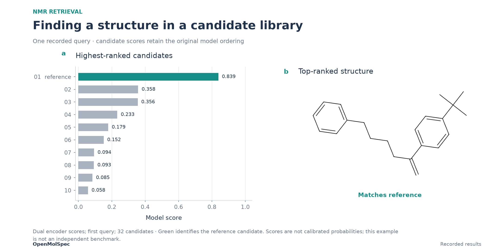

# 谱图 → 结构检索 · H

用已有双编码器，从 NMR 谱检索候选分子，或由分子检索候选谱。

**评测限制：**多个 NMR 视图已确认与 checkpoint 记录的训练数据存在分子重叠，最终生成模型还存在训练文件哈希不一致。现有运行不能证明独立泛化能力。 [Training-history audit / 训练历史审计](../training-overlap.md)

## 当前结论

输入输出对应合理，但目前主要是 32 候选的小池检查。先评更大的独立候选库，再判断泛化和微调需求。

## 输入是什么

| Field | Meaning |
| --- | --- |
| `query` | s2m 使用 H 峰记录查询结构；m2s 使用结构查询谱。当前方向：s2m。 |
| `candidate_pool` | 明确提供候选结构或谱库；结果仅在这个候选池内排序。 |
| `formula` | 谱编码器不接收分子式。 |

## 输出是什么

| Field | Meaning |
| --- | --- |
| `ranked_candidates` | 候选 ID、排名与嵌入相似度分数。 |
| `recall / MRR` | 每个指标都应同时给出候选池大小；32 候选检索不代表全库检索。 |

## 真实运行案例

下面展示记录中的第一例，不按结果好坏筛选。长数组预览会标明完整长度；完整数值可下载证据 JSON。参考标签与模型输入分开保留。



[SVG](../assets/gallery/nmr-retrieval-h-s2m.svg) · [PNG](../assets/gallery/nmr-retrieval-h-s2m.png) · [Full input/output JSON](../assets/examples/nmr-retrieval-h-s2m.json)

<details><summary>展开查看实际输入与输出字段</summary>

```json
{
  "input": {
    "h_nmr": [
      {
        "type": "1H NMR",
        "chemical_shift": "7.34 (s, 4H), 7.265 (m, 2H), 7.165 (m, 3H), 5.26 (d, J=1.6 Hz, 1H), 5.01 (t, J=1.4 Hz, 1H), 2.61 (t, J=7.8 Hz, 2H), 2.53 (t, J=7.6 Hz, 2H), 1.665 (m, 2H), 1.52 (d, J=7.7 Hz, 2H), 1.33 (s, 9H)"
      }
    ],
    "c_nmr": [
      {
        "type": "13C NMR",
        "chemical_shift": "150.22, 148.03, 142.68, 138.28, 128.36, 128.22, 125.68, 125.58, 125.12, 111.51, 35.72, 35.03, 34.46, 31.32, 31.11, 27.93"
      }
    ],
    "modality_mask": [
      1,
      0
    ]
  },
  "reference_smiles": "C=C(CCCCc1ccccc1)c1ccc(C(C)(C)C)cc1",
  "output": {
    "length": 10,
    "first_values": [
      {
        "smiles": "C=C(CCCCc1ccccc1)c1ccc(C(C)(C)C)cc1",
        "score": 0.8390898108482361,
        "reference_match": true
      },
      {
        "smiles": "Cc1ccc(/C=C/C(O)(CCCCCO)c2ccccc2)cc1",
        "score": 0.35815000534057617,
        "reference_match": false
      },
      {
        "smiles": "CC(C)(C)OC(=O)N[C@H](CCC(=O)c1ccccc1)c1c[nH]c2cc(Cl)ccc12",
        "score": 0.3557360768318176,
        "reference_match": false
      },
      {
        "smiles": "CC1=C2CCCCCCCCCCC2OC1=O",
        "score": 0.2330881506204605,
        "reference_match": false
      }
    ]
  }
}
```

</details>

## 实际评测结果

| Dataset / scope | Model / variant | Metric | Value |
| --- | --- | --- | ---: |
| nmrspec_test | recorded model | recall_at_1 | 1 |
| nmrspec_test | recorded model | mrr | 1 |
| nmrspec_test | recorded model | queries | 32 |
| nmrspec_test | recorded model | candidate_pool | 32 |
| patent_test_10k | recorded model | recall_at_1 | 0.6875 |
| patent_test_10k | recorded model | mrr | 0.819568 |
| patent_test_10k | recorded model | queries | 32 |
| patent_test_10k | recorded model | candidate_pool | 32 |
| nmrexp_exp_10k | recorded model | recall_at_1 | 0.875 |
| nmrexp_exp_10k | recorded model | mrr | 0.917708 |
| nmrexp_exp_10k | recorded model | queries | 32 |
| nmrexp_exp_10k | recorded model | candidate_pool | 32 |
| nmrgym_test | recorded model | recall_at_1 | 0.6875 |
| nmrgym_test | recorded model | mrr | 0.76864 |
| nmrgym_test | recorded model | queries | 32 |
| nmrgym_test | recorded model | candidate_pool | 32 |

样本量和候选池随每次运行记录。图可能展示单个分子，表格是来源实验的实际汇总，不能混为同一统计范围。

## 模型与方法

H-only、C-only、H+C 使用明确的可见性 mask，谱编码器不接收分子式。规范异构 SMILES 用于判定对应关系，所选测试分子构成本次候选池。

报告 Recall@1/5/10、MRR、查询数和候选数。byte 分子编码器遇到超长 SMILES 时排除并计数，补取后续合格记录，不截断分子结构。

## 复现方式

[Notebook with executed figures](../notebooks/nmr-retrieval-h-s2m.ipynb) · [Quick Start](../quickstart.md)

```bash
python -m openmolspec_bench run --workspace /path/to/OpenMolSpec \
  --tasks nmr.retrieval.h.s2m --limit 8 --output results/nmr-retrieval-h-s2m-new.json
```

## 边界与来源

16、32 和全库候选的成绩不能直接比较。数据来源和训练/测试重叠仍需单独审计。JSONL 中的 smiles 是评测目标或候选身份，不作为谱编码器的输入。

<details><summary>来源报告与 SHA-256 指纹</summary>

- [nmr_documented_examples_20261117_v2.json](https://github.com/jiaqingxie/openmolspec-studio-frontend/blob/release/openmolspec-v1/results/nmr_documented_examples_20261117_v2.json) — SHA-256 `669413d6fc0939bdb6826782d41fc13cf12926a672418ecb46303f0b8ba05b99`

</details>


[Original model / 原模型](https://github.com/jiaqingxie/openmolspec-studio-frontend) · [Model review / 模型检查](../model-audit.md)
