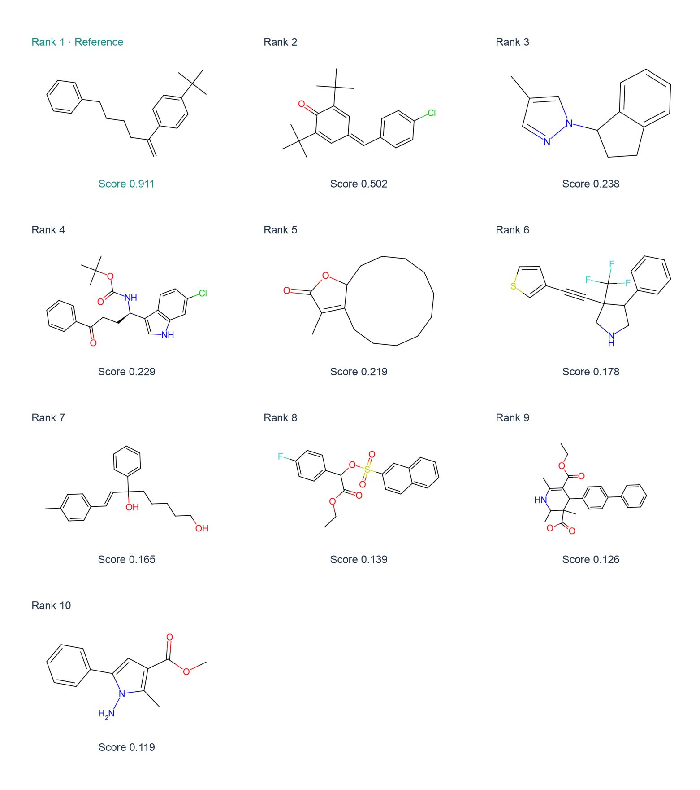

# Structure-to-spectrum retrieval: ¹H + ¹³C

Rank the candidates that best match the query molecule or spectrum.

## What goes in

| Field | Meaning |
| --- | --- |
| `query` | HC peak records for s2m; molecular structure for m2s. Direction here: m2s. |
| `candidate_pool` | Explicit candidate structures or spectra; ranking is restricted to this pool. |
| `formula` | Not supplied to the spectral encoder. |

## What comes out

| Field | Meaning |
| --- | --- |
| `ranked_candidates` | Candidate identity, rank and embedding similarity score. |
| `recall / MRR` | Recall@1/5/10 and MRR, with the candidate-pool size. |

## A real recorded example

Inspect the input, prediction and reference for the example below. Download the JSON for the complete numerical arrays and additional examples.



[SVG](../assets/gallery/nmr-retrieval-hc-m2s.svg) · [PNG](../assets/gallery/nmr-retrieval-hc-m2s.png) · [Full input/output JSON](../assets/examples/nmr-retrieval-hc-m2s.json)

<details><summary>Inspect the actual input and output fields</summary>

```json
{
  "input": {
    "smiles": "C=C(CCCCc1ccccc1)c1ccc(C(C)(C)C)cc1"
  },
  "reference_smiles": "C=C(CCCCc1ccccc1)c1ccc(C(C)(C)C)cc1",
  "output": {
    "length": 10,
    "first_values": [
      {
        "smiles": "C=C(CCCCc1ccccc1)c1ccc(C(C)(C)C)cc1",
        "score": 0.9107388854026794,
        "reference_match": true
      },
      {
        "smiles": "CC(C)(C)C1=CC(=Cc2ccc(Cl)cc2)C=C(C(C)(C)C)C1=O",
        "score": 0.5020971298217773,
        "reference_match": false
      },
      {
        "smiles": "Cc1cnn(C2CCc3ccccc32)c1",
        "score": 0.23823510110378265,
        "reference_match": false
      },
      {
        "smiles": "CC(C)(C)OC(=O)N[C@H](CCC(=O)c1ccccc1)c1c[nH]c2cc(Cl)ccc12",
        "score": 0.22899200022220612,
        "reference_match": false
      }
    ]
  }
}
```

</details>

## Actual evaluation results

| Dataset / scope | Model / variant | Metric | Value |
| --- | --- | --- | ---: |
| nmrspec_test | recorded model | recall_at_1 | 1 |
| nmrspec_test | recorded model | recall_at_5 | 1 |
| nmrspec_test | recorded model | recall_at_10 | 1 |
| nmrspec_test | recorded model | mrr | 1 |
| nmrspec_test | recorded model | queries | 32 |
| nmrspec_test | recorded model | candidate_pool | 32 |
| nmrspec_test | recorded model | unique_candidates | 32 |
| nmrspec_test | recorded model | tie_policy | stable_candidate_order |
| patent_test_10k | recorded model | recall_at_1 | 0.625 |
| patent_test_10k | recorded model | recall_at_5 | 0.90625 |
| patent_test_10k | recorded model | recall_at_10 | 0.90625 |
| patent_test_10k | recorded model | mrr | 0.738817 |
| patent_test_10k | recorded model | queries | 32 |
| patent_test_10k | recorded model | candidate_pool | 32 |
| patent_test_10k | recorded model | unique_candidates | 32 |
| patent_test_10k | recorded model | tie_policy | stable_candidate_order |
| nmrexp_exp_10k | recorded model | recall_at_1 | 0.875 |
| nmrexp_exp_10k | recorded model | recall_at_5 | 1 |
| nmrexp_exp_10k | recorded model | recall_at_10 | 1 |
| nmrexp_exp_10k | recorded model | mrr | 0.924479 |
| nmrexp_exp_10k | recorded model | queries | 32 |
| nmrexp_exp_10k | recorded model | candidate_pool | 32 |
| nmrexp_exp_10k | recorded model | unique_candidates | 32 |
| nmrexp_exp_10k | recorded model | tie_policy | stable_candidate_order |
| nmrgym_test | recorded model | recall_at_1 | 0.84375 |
| nmrgym_test | recorded model | recall_at_5 | 0.96875 |
| nmrgym_test | recorded model | recall_at_10 | 0.96875 |
| nmrgym_test | recorded model | mrr | 0.897254 |
| nmrgym_test | recorded model | queries | 32 |
| nmrgym_test | recorded model | candidate_pool | 32 |
| nmrgym_test | recorded model | unique_candidates | 32 |
| nmrgym_test | recorded model | tie_policy | stable_candidate_order |

## Model and method

The dual encoder maps molecular structures and NMR peak lists into a shared embedding space. Candidates are ranked by embedding similarity.

Report Recall@1/5/10 and mean reciprocal rank together with the candidate count.

## Reproduce

[Notebook with executed figures](../notebooks/nmr-retrieval-hc-m2s.ipynb) · [Quick Start](../quickstart.md)

```bash
python -m openmolspec_bench run --workspace /path/to/OpenMolSpec \
  --tasks nmr.retrieval.hc.m2s --limit 8 --output results/nmr-retrieval-hc-m2s-new.json
```

## Call and adapt this model

```python
from openmolspec.model import NMRTransformer
model = NMRTransformer.from_pretrained(
    '/path/to/checkpoint.pt', stage='align',
    python='/path/to/nmr-env/bin/python')
from openmolspec.benchmark import Benchmark
benchmark = Benchmark(workspace='/path/to/workspace',
    python='/path/to/sdk-env/bin/python',
    alignment_checkpoint='/path/to/checkpoint.pt',
    nmr_python='/path/to/nmr-env/bin/python')
result = benchmark.run('nmr.retrieval.hc.m2s', output='m2s-results.json', limit=32)
plan = model.training_plan(
    'prepared-nmr', run_dir='runs/my-model', epochs=10, batch_size=32)
print(plan.validate())
# trained = model.fit(plan)
```

Prepare disjoint train/validation records with `prepare_nmr_training`; supply an alignment checkpoint for the generator. Use H/C masks to define available inputs and choose model selection criteria on validation data. Pretrained initialization restores model weights. [Data preparation](../api.md) provides the complete workflow.

### Training objective

$$L_{\rm align}=\tfrac12[\mathrm{CE}(SM^\top/\tau,I)+\mathrm{CE}(MS^\top/\tau,I)]+\lambda_{\rm ITM}L_{\rm match}.$$

Generation uses token cross-entropy; an optional joint alignment term follows its configured weight. Alignment uses normalized spectral/molecular representations with symmetric contrastive cross-entropy; ITM configuration adds positive/negative matching. The actual checkpoint/training configuration determines the objective.

<details><summary>Source reports and SHA-256 fingerprints</summary>

- [nmr_documented_examples_20261117_v2.json](https://github.com/jiaqingxie/openmolspec-studio-frontend/blob/release/openmolspec-v1/results/nmr_documented_examples_20261117_v2.json) — SHA-256 `669413d6fc0939bdb6826782d41fc13cf12926a672418ecb46303f0b8ba05b99`

</details>


[Model implementation / 模型实现](https://github.com/jiaqingxie/openmolspec-studio-frontend) · [Model review / 模型检查](../model-audit.md)

## References

- Yang, L., Yang, Z., Xie, J., Wang, Y., Gao, B., Fu, T., Wei, X., Sun, J., Wu, J., He, C., Li, Y. & Gu, Q. NMRTrans: Structure Elucidation from Experimental NMR Spectra via Set Transformers. arXiv:2602.10158 (2026). [Source](https://arxiv.org/abs/2602.10158)
- Fang, Z., Yang, C., Yu, H., Luo, H., He, H., Xie, J., Yang, Z. & Xia, J. NMRGym: A Comprehensive Benchmark for Nuclear Magnetic Resonance Based Molecular Structure Elucidation. arXiv:2601.15763 (2026). [Source](https://arxiv.org/abs/2601.15763)
- OpenDataLab. WanJuan MolSpectra, version 1.0.3. Experimental molecular spectroscopy dataset. [Source](https://opendatalab.com/)
