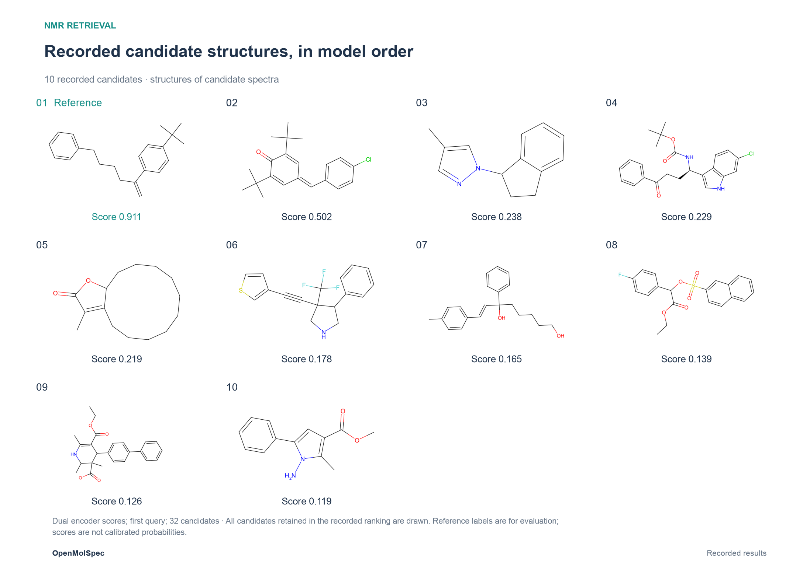

# 结构 → 谱图检索 · HC

用已有双编码器，从 NMR 谱检索候选分子，或由分子检索候选谱。

## 示例与评测

输入输出对应合理，但目前主要是 32 候选的小池检查。先评更大的独立候选库，再判断泛化和微调需求。

## 输入是什么

| Field | Meaning |
| --- | --- |
| `query` | s2m 使用 HC 峰记录查询结构；m2s 使用结构查询谱。当前方向：m2s。 |
| `candidate_pool` | 明确提供候选结构或谱库；结果仅在这个候选池内排序。 |
| `formula` | 谱编码器不接收分子式。 |

## 输出是什么

| Field | Meaning |
| --- | --- |
| `ranked_candidates` | 候选 ID、排名与嵌入相似度分数。 |
| `recall / MRR` | 每个指标都应同时给出候选池大小；32 候选检索不代表全库检索。 |

## 真实运行案例

下面展示记录中的第一例，不按结果好坏筛选。长数组预览会标明完整长度；完整数值可下载证据 JSON。参考标签与模型输入分开保留。



[SVG](../assets/gallery/nmr-retrieval-hc-m2s.svg) · [PNG](../assets/gallery/nmr-retrieval-hc-m2s.png) · [Full input/output JSON](../assets/examples/nmr-retrieval-hc-m2s.json)

<details><summary>展开查看实际输入与输出字段</summary>

```json
{
  "input": {
    "smiles": "C=C(CCCCc1ccccc1)c1ccc(C(C)(C)C)cc1"
  },
  "reference_smiles": "C=C(CCCCc1ccccc1)c1ccc(C(C)(C)C)cc1",
  "output": {
    "length": 10,
    "first_values": [
      {
        "smiles": "C=C(CCCCc1ccccc1)c1ccc(C(C)(C)C)cc1",
        "score": 0.9107388854026794,
        "reference_match": true
      },
      {
        "smiles": "CC(C)(C)C1=CC(=Cc2ccc(Cl)cc2)C=C(C(C)(C)C)C1=O",
        "score": 0.5020971298217773,
        "reference_match": false
      },
      {
        "smiles": "Cc1cnn(C2CCc3ccccc32)c1",
        "score": 0.23823510110378265,
        "reference_match": false
      },
      {
        "smiles": "CC(C)(C)OC(=O)N[C@H](CCC(=O)c1ccccc1)c1c[nH]c2cc(Cl)ccc12",
        "score": 0.22899200022220612,
        "reference_match": false
      }
    ]
  }
}
```

</details>

## 实际评测结果

| Dataset / scope | Model / variant | Metric | Value |
| --- | --- | --- | ---: |
| nmrspec_test | recorded model | recall_at_1 | 1 |
| nmrspec_test | recorded model | mrr | 1 |
| nmrspec_test | recorded model | queries | 32 |
| nmrspec_test | recorded model | candidate_pool | 32 |
| patent_test_10k | recorded model | recall_at_1 | 0.625 |
| patent_test_10k | recorded model | mrr | 0.738817 |
| patent_test_10k | recorded model | queries | 32 |
| patent_test_10k | recorded model | candidate_pool | 32 |
| nmrexp_exp_10k | recorded model | recall_at_1 | 0.875 |
| nmrexp_exp_10k | recorded model | mrr | 0.924479 |
| nmrexp_exp_10k | recorded model | queries | 32 |
| nmrexp_exp_10k | recorded model | candidate_pool | 32 |
| nmrgym_test | recorded model | recall_at_1 | 0.84375 |
| nmrgym_test | recorded model | mrr | 0.897254 |
| nmrgym_test | recorded model | queries | 32 |
| nmrgym_test | recorded model | candidate_pool | 32 |

样本量和候选池随每次运行记录。图可能展示单个分子，表格是来源实验的实际汇总，不能混为同一统计范围。

## 模型与方法

H-only、C-only、H+C 使用明确的可见性 mask，谱编码器不接收分子式。规范异构 SMILES 用于判定对应关系，所选测试分子构成本次候选池。

报告 Recall@1/5/10、MRR、查询数和候选数。byte 分子编码器遇到超长 SMILES 时排除并计数，补取后续合格记录，不截断分子结构。

## 复现方式

[Notebook with executed figures](../notebooks/nmr-retrieval-hc-m2s.ipynb) · [Quick Start](../quickstart.md)

```bash
python -m openmolspec_bench run --workspace /path/to/OpenMolSpec \
  --tasks nmr.retrieval.hc.m2s --limit 8 --output results/nmr-retrieval-hc-m2s-new.json
```

## 调用模型与微调

```python
from openmolspec.model import NMRTransformer
model = NMRTransformer.from_pretrained(
    '/path/to/checkpoint.pt', stage='align',
    python='/path/to/nmr-env/bin/python')
from openmolspec.benchmark import Benchmark
benchmark = Benchmark(workspace='/path/to/workspace',
    python='/path/to/sdk-env/bin/python',
    alignment_checkpoint='/path/to/checkpoint.pt',
    nmr_python='/path/to/nmr-env/bin/python')
result = benchmark.run('nmr.retrieval.hc.m2s', output='m2s-results.json', limit=32)
plan = model.training_plan(
    'prepared-nmr', run_dir='runs/my-model', epochs=10, batch_size=32)
print(plan.validate())
# trained = model.fit(plan)
```

先用 `prepare_nmr_training` 准备相互独立的 train/val；生成阶段需要对齐 checkpoint。用 H/C 掩码定义输入通道，在验证集选择模型。已有权重可用于初始化。[数据准备与训练指南](../api.md)给出完整流程。

### 训练目标

$$L_{\rm align}=\tfrac12[\mathrm{CE}(SM^\top/\tau,I)+\mathrm{CE}(MS^\top/\tau,I)]+\lambda_{\rm ITM}L_{\rm match}.$$

生成使用 token 交叉熵，可按配置加入联合对齐项。对齐使用归一化谱学／分子表征的双向对比交叉熵；ITM 配置增加正负配对分类项。具体目标与权重以训练配置为准。

## 数据要求与引用

16、32 和全库候选的成绩不能直接比较。数据来源和训练/测试重叠仍需单独审计。JSONL 中的 smiles 是评测目标或候选身份，不作为谱编码器的输入。

<details><summary>来源报告与 SHA-256 指纹</summary>

- [nmr_documented_examples_20261117_v2.json](https://github.com/jiaqingxie/openmolspec-studio-frontend/blob/release/openmolspec-v1/results/nmr_documented_examples_20261117_v2.json) — SHA-256 `669413d6fc0939bdb6826782d41fc13cf12926a672418ecb46303f0b8ba05b99`

</details>


[Original model / 原模型](https://github.com/jiaqingxie/openmolspec-studio-frontend) · [Model review / 模型检查](../model-audit.md)
