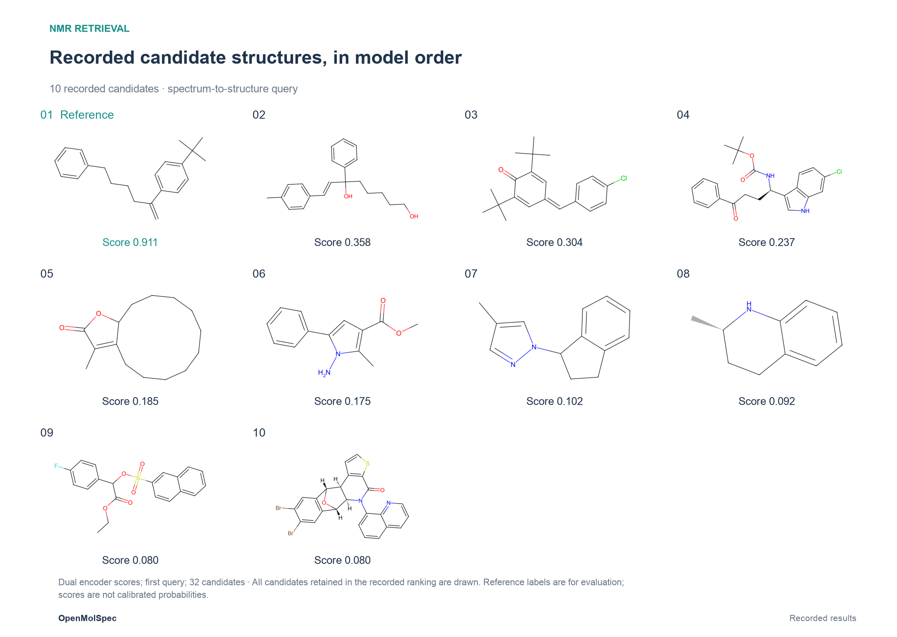

# NMR retrieval: HC, s2m

Rank candidate structures from NMR spectra, or rank candidate spectra from a molecular structure, with the existing dual encoder.

## Example and evaluation

Input/output pairing is appropriate; the 32-candidate smoke pool is small. Validate a larger independent library before judging generalization or fine-tuning.

## What goes in

| Field | Meaning |
| --- | --- |
| `query` | HC peak records for s2m; molecular structure for m2s. Direction here: s2m. |
| `candidate_pool` | Explicit candidate structures or spectra; ranking is restricted to this pool. |
| `formula` | Not supplied to the spectral encoder. |

## What comes out

| Field | Meaning |
| --- | --- |
| `ranked_candidates` | Candidate identity, rank and embedding similarity score. |
| `recall / MRR` | Report candidate-pool size with every metric; 32-way retrieval is not full-library retrieval. |

## A real recorded example

The first recorded example is shown below, regardless of whether it succeeds. Array previews explicitly state their lengths; download the evidence JSON for complete values. Reference labels are kept separate from model inputs.



[SVG](../assets/gallery/nmr-retrieval-hc-s2m.svg) · [PNG](../assets/gallery/nmr-retrieval-hc-s2m.png) · [Full input/output JSON](../assets/examples/nmr-retrieval-hc-s2m.json)

<details><summary>Inspect the actual input and output fields</summary>

```json
{
  "input": {
    "h_nmr": [
      {
        "type": "1H NMR",
        "chemical_shift": "7.34 (s, 4H), 7.265 (m, 2H), 7.165 (m, 3H), 5.26 (d, J=1.6 Hz, 1H), 5.01 (t, J=1.4 Hz, 1H), 2.61 (t, J=7.8 Hz, 2H), 2.53 (t, J=7.6 Hz, 2H), 1.665 (m, 2H), 1.52 (d, J=7.7 Hz, 2H), 1.33 (s, 9H)"
      }
    ],
    "c_nmr": [
      {
        "type": "13C NMR",
        "chemical_shift": "150.22, 148.03, 142.68, 138.28, 128.36, 128.22, 125.68, 125.58, 125.12, 111.51, 35.72, 35.03, 34.46, 31.32, 31.11, 27.93"
      }
    ],
    "modality_mask": [
      1,
      1
    ]
  },
  "reference_smiles": "C=C(CCCCc1ccccc1)c1ccc(C(C)(C)C)cc1",
  "output": {
    "length": 10,
    "first_values": [
      {
        "smiles": "C=C(CCCCc1ccccc1)c1ccc(C(C)(C)C)cc1",
        "score": 0.9107388854026794,
        "reference_match": true
      },
      {
        "smiles": "Cc1ccc(/C=C/C(O)(CCCCCO)c2ccccc2)cc1",
        "score": 0.3581679165363312,
        "reference_match": false
      },
      {
        "smiles": "CC(C)(C)C1=CC(=Cc2ccc(Cl)cc2)C=C(C(C)(C)C)C1=O",
        "score": 0.30377936363220215,
        "reference_match": false
      },
      {
        "smiles": "CC(C)(C)OC(=O)N[C@H](CCC(=O)c1ccccc1)c1c[nH]c2cc(Cl)ccc12",
        "score": 0.23662136495113373,
        "reference_match": false
      }
    ]
  }
}
```

</details>

## Actual evaluation results

| Dataset / scope | Model / variant | Metric | Value |
| --- | --- | --- | ---: |
| nmrspec_test | recorded model | recall_at_1 | 1 |
| nmrspec_test | recorded model | mrr | 1 |
| nmrspec_test | recorded model | queries | 32 |
| nmrspec_test | recorded model | candidate_pool | 32 |
| patent_test_10k | recorded model | recall_at_1 | 0.65625 |
| patent_test_10k | recorded model | mrr | 0.776217 |
| patent_test_10k | recorded model | queries | 32 |
| patent_test_10k | recorded model | candidate_pool | 32 |
| nmrexp_exp_10k | recorded model | recall_at_1 | 0.90625 |
| nmrexp_exp_10k | recorded model | mrr | 0.9375 |
| nmrexp_exp_10k | recorded model | queries | 32 |
| nmrexp_exp_10k | recorded model | candidate_pool | 32 |
| nmrgym_test | recorded model | recall_at_1 | 0.8125 |
| nmrgym_test | recorded model | mrr | 0.886979 |
| nmrgym_test | recorded model | queries | 32 |
| nmrgym_test | recorded model | candidate_pool | 32 |

Sample sizes and candidate pools belong to each run. The figure may show one molecule; the table reports the cited run, not a new benchmark on that molecule.

## Model and method

H-only, C-only and H+C are explicit visibility masks. The spectral encoder does not receive the molecular formula. Canonical isomeric identities define positive matches; the selected dataset supplies the candidate pool.

Report Recall@1/5/10 and MRR with candidate counts. Byte-encoded candidate SMILES that exceed checkpoint capacity are excluded and counted rather than silently truncated.

## Reproduce

[Notebook with executed figures](../notebooks/nmr-retrieval-hc-s2m.ipynb) · [Quick Start](../quickstart.md)

```bash
python -m openmolspec_bench run --workspace /path/to/OpenMolSpec \
  --tasks nmr.retrieval.hc.s2m --limit 8 --output results/nmr-retrieval-hc-s2m-new.json
```

## Call and adapt this model

```python
from openmolspec.model import NMRTransformer
model = NMRTransformer.from_pretrained(
    '/path/to/checkpoint.pt', stage='align',
    python='/path/to/nmr-env/bin/python')
result = model.retrieve(query, candidate_smiles, top_k=10)
plan = model.training_plan(
    'prepared-nmr', run_dir='runs/my-model', epochs=10, batch_size=32)
print(plan.validate())
# trained = model.fit(plan)
```

Prepare disjoint train/validation records with `prepare_nmr_training`; supply an alignment checkpoint for the generator. Use H/C masks to define available inputs and choose model selection criteria on validation data. Pretrained initialization restores model weights. [Data preparation](../api.md) provides the complete workflow.

### Training objective

$$L_{\rm align}=\tfrac12[\mathrm{CE}(SM^\top/\tau,I)+\mathrm{CE}(MS^\top/\tau,I)]+\lambda_{\rm ITM}L_{\rm match}.$$

Generation uses token cross-entropy; an optional joint alignment term follows its configured weight. Alignment uses normalized spectral/molecular representations with symmetric contrastive cross-entropy; ITM configuration adds positive/negative matching. The actual checkpoint/training configuration determines the objective.

## Data requirements and references

Scores from 16, 32 and full-dataset candidate pools are not directly comparable. Existing dataset provenance and train/test overlap still require independent audit before an accuracy claim.

<details><summary>Source reports and SHA-256 fingerprints</summary>

- [nmr_documented_examples_20261117_v2.json](https://github.com/jiaqingxie/openmolspec-studio-frontend/blob/release/openmolspec-v1/results/nmr_documented_examples_20261117_v2.json) — SHA-256 `669413d6fc0939bdb6826782d41fc13cf12926a672418ecb46303f0b8ba05b99`

</details>


[Original model / 原模型](https://github.com/jiaqingxie/openmolspec-studio-frontend) · [Model review / 模型检查](../model-audit.md)
