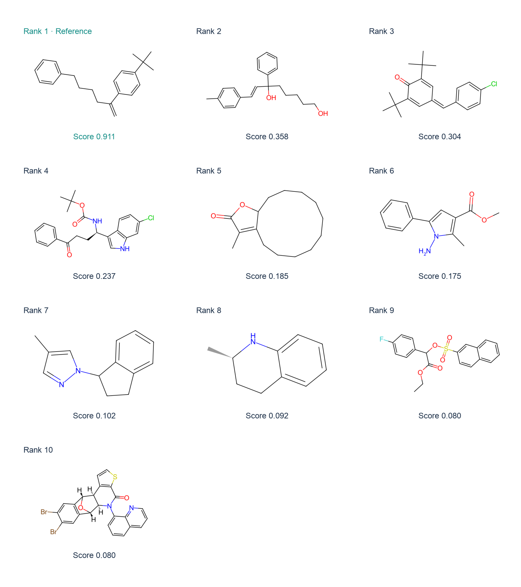

# 谱到结构检索：¹H + ¹³C

为查询分子或谱图寻找最匹配的候选。

## 输入是什么

| Field | Meaning |
| --- | --- |
| `query` | s2m 使用 HC 峰记录查询结构；m2s 使用结构查询谱。当前方向：s2m。 |
| `candidate_pool` | 明确提供候选结构或谱库；结果仅在这个候选池内排序。 |
| `formula` | 谱编码器不接收分子式。 |

## 输出是什么

| Field | Meaning |
| --- | --- |
| `ranked_candidates` | 候选 ID、排名与嵌入相似度分数。 |
| `recall / MRR` | Recall@1/5/10、MRR 及对应候选池大小。 |

## 真实运行案例

下面展示示例的输入、预测与参考。下载 JSON 可获取完整数值数组及更多示例。



[SVG](../assets/gallery/nmr-retrieval-hc-s2m.svg) · [PNG](../assets/gallery/nmr-retrieval-hc-s2m.png) · [Full input/output JSON](../assets/examples/nmr-retrieval-hc-s2m.json)

<details><summary>展开查看实际输入与输出字段</summary>

```json
{
  "input": {
    "h_nmr": [
      {
        "type": "1H NMR",
        "chemical_shift": "7.34 (s, 4H), 7.265 (m, 2H), 7.165 (m, 3H), 5.26 (d, J=1.6 Hz, 1H), 5.01 (t, J=1.4 Hz, 1H), 2.61 (t, J=7.8 Hz, 2H), 2.53 (t, J=7.6 Hz, 2H), 1.665 (m, 2H), 1.52 (d, J=7.7 Hz, 2H), 1.33 (s, 9H)"
      }
    ],
    "c_nmr": [
      {
        "type": "13C NMR",
        "chemical_shift": "150.22, 148.03, 142.68, 138.28, 128.36, 128.22, 125.68, 125.58, 125.12, 111.51, 35.72, 35.03, 34.46, 31.32, 31.11, 27.93"
      }
    ],
    "modality_mask": [
      1,
      1
    ]
  },
  "reference_smiles": "C=C(CCCCc1ccccc1)c1ccc(C(C)(C)C)cc1",
  "output": {
    "length": 10,
    "first_values": [
      {
        "smiles": "C=C(CCCCc1ccccc1)c1ccc(C(C)(C)C)cc1",
        "score": 0.9107388854026794,
        "reference_match": true
      },
      {
        "smiles": "Cc1ccc(/C=C/C(O)(CCCCCO)c2ccccc2)cc1",
        "score": 0.3581679165363312,
        "reference_match": false
      },
      {
        "smiles": "CC(C)(C)C1=CC(=Cc2ccc(Cl)cc2)C=C(C(C)(C)C)C1=O",
        "score": 0.30377936363220215,
        "reference_match": false
      },
      {
        "smiles": "CC(C)(C)OC(=O)N[C@H](CCC(=O)c1ccccc1)c1c[nH]c2cc(Cl)ccc12",
        "score": 0.23662136495113373,
        "reference_match": false
      }
    ]
  }
}
```

</details>

## 实际评测结果

| Dataset / scope | Model / variant | Metric | Value |
| --- | --- | --- | ---: |
| nmrspec_test | recorded model | recall_at_1 | 1 |
| nmrspec_test | recorded model | recall_at_5 | 1 |
| nmrspec_test | recorded model | recall_at_10 | 1 |
| nmrspec_test | recorded model | mrr | 1 |
| nmrspec_test | recorded model | queries | 32 |
| nmrspec_test | recorded model | candidate_pool | 32 |
| nmrspec_test | recorded model | unique_candidates | 32 |
| nmrspec_test | recorded model | tie_policy | stable_candidate_order |
| patent_test_10k | recorded model | recall_at_1 | 0.65625 |
| patent_test_10k | recorded model | recall_at_5 | 0.9375 |
| patent_test_10k | recorded model | recall_at_10 | 0.9375 |
| patent_test_10k | recorded model | mrr | 0.776217 |
| patent_test_10k | recorded model | queries | 32 |
| patent_test_10k | recorded model | candidate_pool | 32 |
| patent_test_10k | recorded model | unique_candidates | 32 |
| patent_test_10k | recorded model | tie_policy | stable_candidate_order |
| nmrexp_exp_10k | recorded model | recall_at_1 | 0.90625 |
| nmrexp_exp_10k | recorded model | recall_at_5 | 1 |
| nmrexp_exp_10k | recorded model | recall_at_10 | 1 |
| nmrexp_exp_10k | recorded model | mrr | 0.9375 |
| nmrexp_exp_10k | recorded model | queries | 32 |
| nmrexp_exp_10k | recorded model | candidate_pool | 32 |
| nmrexp_exp_10k | recorded model | unique_candidates | 32 |
| nmrexp_exp_10k | recorded model | tie_policy | stable_candidate_order |
| nmrgym_test | recorded model | recall_at_1 | 0.8125 |
| nmrgym_test | recorded model | recall_at_5 | 0.96875 |
| nmrgym_test | recorded model | recall_at_10 | 0.96875 |
| nmrgym_test | recorded model | mrr | 0.886979 |
| nmrgym_test | recorded model | queries | 32 |
| nmrgym_test | recorded model | candidate_pool | 32 |
| nmrgym_test | recorded model | unique_candidates | 32 |
| nmrgym_test | recorded model | tie_policy | stable_candidate_order |

## 模型与方法

双编码器将分子结构与 NMR 峰表映射到同一表征空间，并按嵌入相似度排序。

报告 Recall@1/5/10、平均倒数排名及候选数。

## 复现方式

[Notebook with executed figures](../notebooks/nmr-retrieval-hc-s2m.ipynb) · [Quick Start](../quickstart.md)

```bash
python -m openmolspec_bench run --workspace /path/to/OpenMolSpec \
  --tasks nmr.retrieval.hc.s2m --limit 8 --output results/nmr-retrieval-hc-s2m-new.json
```

## 调用模型与微调

```python
from openmolspec.model import NMRTransformer
model = NMRTransformer.from_pretrained(
    '/path/to/checkpoint.pt', stage='align',
    python='/path/to/nmr-env/bin/python')
result = model.retrieve(query, candidate_smiles, top_k=10)
plan = model.training_plan(
    'prepared-nmr', run_dir='runs/my-model', epochs=10, batch_size=32)
print(plan.validate())
# trained = model.fit(plan)
```

先用 `prepare_nmr_training` 准备相互独立的 train/val；生成阶段需要对齐 checkpoint。用 H/C 掩码定义输入通道，在验证集选择模型。已有权重可用于初始化。[数据准备与训练指南](../api.md)给出完整流程。

### 训练目标

$$L_{\rm align}=\tfrac12[\mathrm{CE}(SM^\top/\tau,I)+\mathrm{CE}(MS^\top/\tau,I)]+\lambda_{\rm ITM}L_{\rm match}.$$

生成使用 token 交叉熵，可按配置加入联合对齐项。对齐使用归一化谱学／分子表征的双向对比交叉熵；ITM 配置增加正负配对分类项。具体目标与权重以训练配置为准。

<details><summary>来源报告与 SHA-256 指纹</summary>

- [nmr_documented_examples_20261117_v2.json](https://github.com/jiaqingxie/openmolspec-studio-frontend/blob/release/openmolspec-v1/results/nmr_documented_examples_20261117_v2.json) — SHA-256 `669413d6fc0939bdb6826782d41fc13cf12926a672418ecb46303f0b8ba05b99`

</details>


[Model implementation / 模型实现](https://github.com/jiaqingxie/openmolspec-studio-frontend) · [Model review / 模型检查](../model-audit.md)

## 参考文献

- Yang, L., Yang, Z., Xie, J., Wang, Y., Gao, B., Fu, T., Wei, X., Sun, J., Wu, J., He, C., Li, Y. & Gu, Q. NMRTrans: Structure Elucidation from Experimental NMR Spectra via Set Transformers. arXiv:2602.10158 (2026). [Source](https://arxiv.org/abs/2602.10158)
- Fang, Z., Yang, C., Yu, H., Luo, H., He, H., Xie, J., Yang, Z. & Xia, J. NMRGym: A Comprehensive Benchmark for Nuclear Magnetic Resonance Based Molecular Structure Elucidation. arXiv:2601.15763 (2026). [Source](https://arxiv.org/abs/2601.15763)
- OpenDataLab. WanJuan MolSpectra, version 1.0.3. Experimental molecular spectroscopy dataset. [Source](https://opendatalab.com/)
